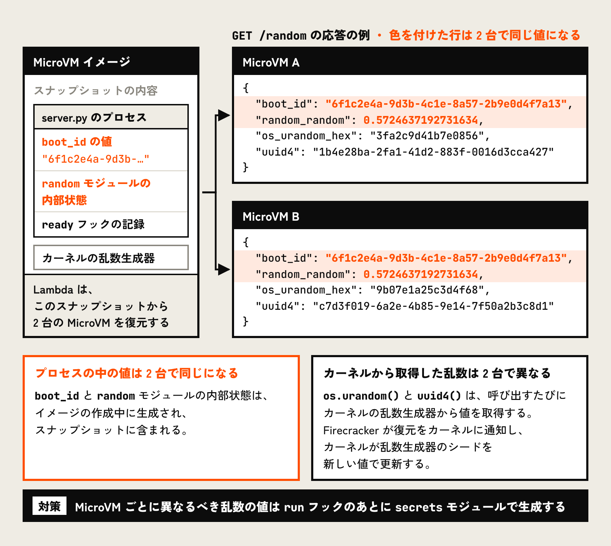
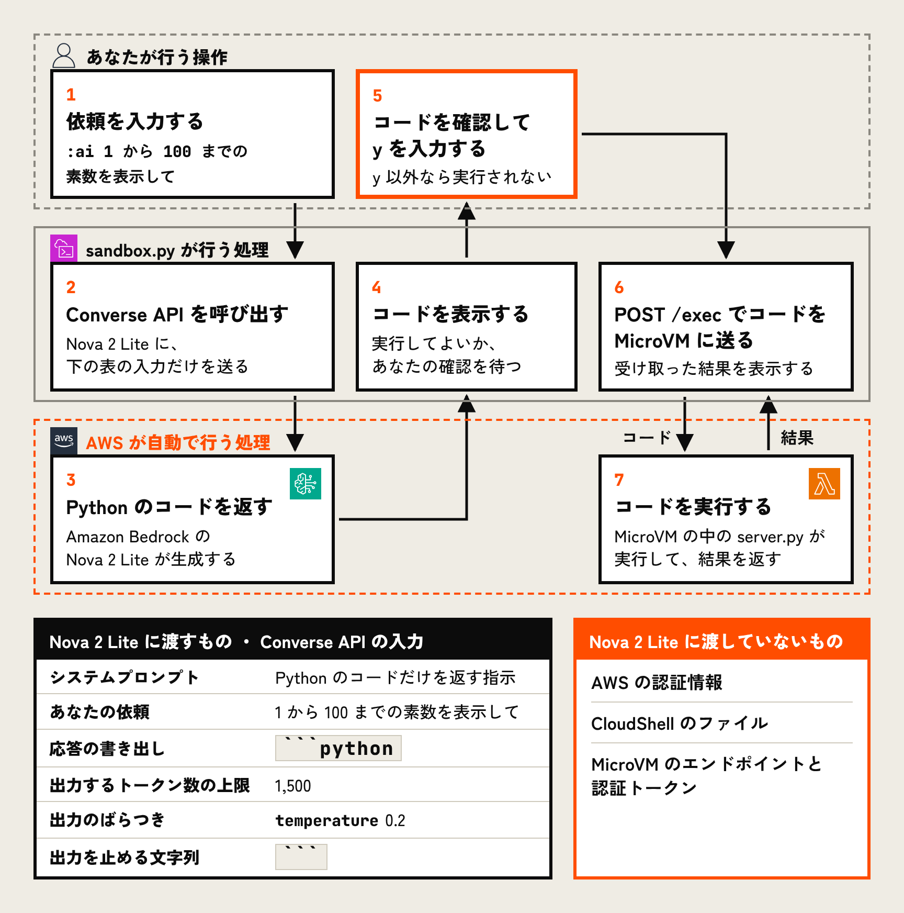

このリポジトリは AWS Deep Cuts の、AWS Lambda MicroVMs に関するハンズオンコンテンツです。

<!-- TODO: 記事の公開後に、次の行のリンクを有効にする -->
<!-- AWS Lambda MicroVMs の解説記事(Qiita)は[こちら]() -->

解説記事の原稿は [article/aws-lambda-microvms.md](./article/aws-lambda-microvms.md) にあります。

> **Note**: AWS Lambda MicroVMs は、2026 年 6 月に一般提供が始まったサービスです。このハンズオンは、ブラウザから AWS CLI のコマンドを実行できる AWS CloudShell を使って、東京リージョン（`ap-northeast-1`）で実施します。
> - AWS CLI は、`aws lambda-microvms` コマンドに対応した v2.35.10 以降が必要です。CloudShell の AWS CLI は最新版とは限らないため、[前提条件](#前提条件)の手順でバージョンを確認してください。
> - 手順 7 では、AWS SDK for Python である boto3 と、生成 AI のモデルを API で呼び出せる Amazon Bedrock も使います。Bedrock で呼び出すモデルは、Amazon Nova 2 Lite です。

> ⚠️ **コストに関する注意**
>
> MicroVM は、Lambda MicroVMs が起動する 1 台の軽量な VM（Virtual Machine）です。MicroVM が稼働している間は、vCPU（virtual CPU）とメモリの料金がかかります。vCPU は、VM に割り当てる仮想的な CPU です。稼働中の MicroVM の状態は、`RUNNING` と表示されます。MicroVM の一時停止をサスペンド、再開をレジュームと呼びます。MicroVM をサスペンドすると、Lambda MicroVMs はメモリとディスクの内容をスナップショットとして保存し、MicroVM を一時停止します。サスペンド中は、vCPU とメモリの料金はかからず、スナップショットの保存料金だけがかかります。
>
> このハンズオンでは、1 台の MicroVM を動かせる時間の上限である最長時間を 60 分以下に設定し、設定した時間が経過した MicroVM を Lambda MicroVMs が自動で終了するようにします。
>
> MicroVM の起動に使う MicroVM イメージにも、MicroVM の中のアプリを起動した状態のスナップショットが含まれています。AWS は、AWS のサービスの使い方をまとめ、AI エージェントが読み込んで使えるようにした文書を、Agent Skill として公開しています。Lambda MicroVMs の Agent Skill によると、MicroVM イメージにも、後片付けでイメージを削除するまで保存料金がかかります。
>
> | 放置期間 | 概算コストの上限 |
> | --- | --- |
> | 1日 | 約 **$0.75**（約 120 円） |
> | 1週間 | 約 **$0.94**（約 150 円） |
>
> この金額は、手順どおりに進めた場合の上限です。次の 5 つの条件で計算し、1 ドル 160 円で換算しています。内訳は [費用の見積もり](#費用の見積もり) にあります。
>
> - 手順 3・6・7 で起動する 3 台の MicroVM が、設定した最長時間のあいだ、使える最大の量の vCPU とメモリを使い続けるものとします。
> - スナップショット 1 つの大きさは、メモリとディスクの上限から求めた 10 GB とします。
> - サスペンドとレジュームは、3 回ずつ行うものとします。
> - 手順 7 では、Amazon Bedrock のモデルを 20 回呼び出すものとします。
> - MicroVM イメージに含まれるスナップショットは 1 つとします。スナップショットが 2 つ以上保存される場合の上限は、[費用の見積もり](#費用の見積もり) にあります。スナップショットの数は、手順 2-6 で確認します。
>
> **検証が終わったら速やかに後片付けを実施してください。**

# AWS Deep Cutsとは
AWS Deep Cutsは、AWS の最新のサービスやニッチな機能、または高度にアカデミックな知識を要求するサービスなど、多くの人が知らない 『隠れた名曲 = **Deep Cuts**』 を深くまで掘り下げる技術シリーズです。

このようなサービスはWeb情報も少なく、初学者は気軽にキャッチアップできないのが実情です。

そこで AWS Deep Cuts シリーズでは、**前提知識も含めた分かりやすいサービス解説** と **手順通りに進めれば誰でも再現できるハンズオン** を提供します！

# ハンズオンのゴール

このハンズオンでは、Python で書いた小さな Web アプリ `server.py` から MicroVM イメージを作成し、そのイメージから MicroVM を起動します。MicroVM には、1 台ごとに HTTPS でアクセスするための URL が割り当てられます。この URL をエンドポイントと呼びます。エンドポイントにリクエストを送るには、認証トークンが必要です。認証トークンは、あなたが Lambda MicroVMs の API を呼び出すと、Lambda が発行する文字列です。AWS CLI のコマンドを 1 つずつ実行しながら、Lambda MicroVMs の次の 4 つの特徴を自分の目で確かめます。

| 確かめる特徴 | 手順 |
| --- | --- |
| MicroVM イメージには、アプリを起動した状態のメモリとディスクの内容が保存されている | 2・4 |
| MicroVM ごとに HTTPS のエンドポイントがあり、認証トークンが無いとアクセスできない | 3・4 |
| サスペンドしても、メモリの内容である変数や動いているプロセスは残る | 5 |
| 同じスナップショットから復元した MicroVM は、イメージを作成したときのメモリの内容を引き継いでいる | 6 |

手順 7 では応用として、Amazon Bedrock のモデルに Python のコードを生成させ、そのコードを MicroVM の中で実行します。

用語の意味と仕組みは、解説記事で説明しています。先に記事の「AWS Lambda MicroVMsとは？」と「仕組み」を読んでおくと、各手順で何を確かめているのかが分かりやすくなります。

# ハンズオン手順

以降の手順は、ハンズオン用に用意した AWS アカウントで実施してください。

## 構築するアーキテクチャ


この README では、Lambda MicroVMs のサービスが AWS の中で自動で行う処理を「Lambda が〜する」と書きます。この「Lambda」は、Lambda 関数を指すものではありません。手順 2 と手順 4 の図では、この処理と、それを受けて MicroVM の中の server.py が行う処理を、「AWS が自動で行う処理」の枠で示します。手順 7 の図では、Amazon Bedrock のモデルがコードを生成する処理も、この枠で示します。

- あなたは CloudShell から `aws s3 cp` を実行し、アプリの zip を S3 にアップロードします。
- あなたは CloudShell から AWS CLI のコマンドを実行し、Lambda MicroVMs の API を呼び出します。CLI のコマンドの名前は、API の名前に対応しています。たとえば `create-microvm-image` コマンドは、`CreateMicrovmImage` API を呼び出します。手順 2 以降の図と手順 7 の表では、API の名前で書きます。
- MicroVM イメージの作成中は、Lambda がビルド用ロールを使って S3 から zip を読み込み、ログを CloudWatch Logs に書き込みます。
- MicroVM の実行中は、Lambda が実行用ロールを使って、MicroVM の中のアプリのログを CloudWatch Logs に書き込みます。
- あなたは MicroVM のエンドポイントに、認証トークンを付けた HTTPS のリクエストを送ります。
- 手順 7 では、sandbox.py が Amazon Bedrock のモデルを呼び出して Python のコードを生成させ、生成されたコードを MicroVM のエンドポイントに送ります。

記事で「管理用のアプリ」と呼んでいる、Lambda MicroVMs の API を呼び出すプログラムに当たるのは、このハンズオンでは、CloudShell で実行する AWS CLI と、手順 7 の sandbox.py です。

## 前提条件

- AWS CloudShell を **東京リージョン** で開くこと
- AWS CLI が v2.35.10 以降であること。次のコマンドで確認します。

  ```bash
  aws --version
  aws lambda-microvms list-managed-microvm-images --region ap-northeast-1 --query 'items[].imageArn'
  ```

  2 つ目のコマンドで `Invalid choice` または `Found invalid choice` と表示された場合は、AWS CLI が古いため、次の手順で更新してください。

  <details>
  <summary>AWS CLI の最新版をホームディレクトリにインストールする手順</summary>

  CloudShell の AWS CLI は、最新版より数バージョン古いことがあります。CloudShell のホームディレクトリは次回以降のセッションでも残るため、ここに最新版をインストールします。

  ```bash
  curl -sS https://awscli.amazonaws.com/awscli-exe-linux-x86_64.zip -o /tmp/awscliv2.zip
  unzip -q -o /tmp/awscliv2.zip -d /tmp
  /tmp/aws/install --install-dir "$HOME/.local/aws-cli" --bin-dir "$HOME/.local/bin" --update
  export PATH="$HOME/.local/bin:$PATH"
  aws --version
  ```

  `export PATH=...` の行は、CloudShell のタブを新しく開くたびに実行してください。
  </details>

- CloudShell を開いた IAM ユーザーまたは IAM ロールに、Lambda MicroVMs・IAM・S3・CloudWatch Logs の操作権限と、手順 7 で使う Amazon Bedrock の権限があること。`AdministratorAccess` 相当の権限で実施するのが簡単です。

<details>
<summary>最小権限に近い IAM ポリシーの例</summary>

CloudShell を使う権限は、このポリシーとは別に必要です。たとえば AWS 管理ポリシーの `AWSCloudShellFullAccess` をアタッチします。ポリシーの中の `ConsoleRead` のステートメントは、手順の中でマネジメントコンソールの画面を確認するための読み取りの権限です。

```json
{
  "Version": "2012-10-17",
  "Statement": [
    {
      "Sid": "LambdaMicroVMs",
      "Effect": "Allow",
      "Action": [
        "lambda:ListManagedMicrovmImages", "lambda:ListMicrovmImages",
        "lambda:CreateMicrovmImage", "lambda:GetMicrovmImage", "lambda:DeleteMicrovmImage",
        "lambda:ListMicrovmImageVersions", "lambda:ListMicrovmImageBuilds", "lambda:GetMicrovmImageBuild",
        "lambda:RunMicrovm", "lambda:GetMicrovm", "lambda:ListMicrovms",
        "lambda:SuspendMicrovm", "lambda:ResumeMicrovm", "lambda:TerminateMicrovm",
        "lambda:CreateMicrovmAuthToken", "lambda:PassNetworkConnector"
      ],
      "Resource": "*"
    },
    {
      "Sid": "Roles",
      "Effect": "Allow",
      "Action": [
        "iam:CreateRole", "iam:GetRole", "iam:PutRolePolicy", "iam:DeleteRolePolicy", "iam:DeleteRole", "iam:TagRole", "iam:PassRole",
        "iam:ListRolePolicies", "iam:GetRolePolicy", "iam:ListAttachedRolePolicies"
      ],
      "Resource": ["arn:aws:iam::*:role/aws-deepcuts-microvm-build-role", "arn:aws:iam::*:role/aws-deepcuts-microvm-exec-role"]
    },
    {
      "Sid": "ArtifactBucket",
      "Effect": "Allow",
      "Action": ["s3:CreateBucket", "s3:PutBucketPublicAccessBlock", "s3:PutBucketVersioning", "s3:PutObject", "s3:GetObject", "s3:ListBucket", "s3:ListBucketVersions", "s3:DeleteObject", "s3:DeleteObjectVersion", "s3:DeleteBucket"],
      "Resource": ["arn:aws:s3:::aws-deepcuts-microvms-*", "arn:aws:s3:::aws-deepcuts-microvms-*/*"]
    },
    {
      "Sid": "Logs",
      "Effect": "Allow",
      "Action": ["logs:CreateLogGroup", "logs:DescribeLogGroups", "logs:PutRetentionPolicy", "logs:TagResource", "logs:DeleteLogGroup", "logs:DescribeLogStreams", "logs:GetLogEvents", "logs:FilterLogEvents"],
      "Resource": "*"
    },
    {
      "Sid": "Bedrock",
      "Effect": "Allow",
      "Action": "bedrock:InvokeModel",
      "Resource": "arn:aws:bedrock:ap-northeast-1::foundation-model/amazon.nova-2-lite-v1:0"
    },
    {
      "Sid": "ConsoleRead",
      "Effect": "Allow",
      "Action": ["iam:ListRoles", "s3:ListAllMyBuckets", "s3:GetBucketLocation", "sts:GetCallerIdentity"],
      "Resource": "*"
    }
  ]
}
```

`lambda:PassNetworkConnector` が無いと、手順 3 の `run-microvm` が `AccessDeniedException` で失敗します。
</details>

以降、各種コマンドは、東京リージョンで開いた[CloudShell](https://docs.aws.amazon.com/cloudshell/latest/userguide/welcome.html)で実行してください。

## １．事前準備

このハンズオンでは、アプリの zip を保存する S3 バケット、Lambda が引き受ける IAM ロール 2 つ、ログを保存するロググループを使います。IAM ロールを引き受けるとは、Lambda のような AWS のサービスが、そのロールに付いた権限を一時的に使って AWS を操作することです。2 つの IAM ロールのうち、ビルド用ロールは MicroVM イメージの作成に、実行用ロールは MicroVM の実行に使います。これらのリソースの作成はハンズオンの本質ではないため、`setup.sh` で作成します。

```bash
# このリポジトリをクローン
git clone https://github.com/AWS-Deep-Cuts/aws-lambda-microvms
cd aws-lambda-microvms/hands-on

# セットアップスクリプトの実行
bash ./setup.sh

# 以下の文言が表示されればセットアップ成功です
# ✅ セットアップが完了しました！
```

`setup.sh` は、次の 4 つのリソースを作成します。

| リソース | 名前 | 用途 |
| --- | --- | --- |
| S3 バケット | `aws-deepcuts-microvms-<アカウント ID>-<日時>` | アプリの zip を保存する |
| ビルド用ロール | `aws-deepcuts-microvm-build-role` | MicroVM イメージの作成中に Lambda が引き受ける。S3 の zip の読み取りと、ログの書き込みを許可する |
| 実行用ロール | `aws-deepcuts-microvm-exec-role` | MicroVM の実行中に Lambda が引き受ける。MicroVM の中のアプリも、この権限を使える。ログの書き込みだけを許可する |
| ロググループ | `/aws/lambda-microvms/aws-deepcuts` | イメージの作成と MicroVM の実行のログを保存する |

`setup.sh` は、作成したリソースの名前と ARN を `resource-ids.env` に保存しました。ARN（Amazon Resource Name）は、AWS のリソースを一意に指す名前です。次のコマンドでこのファイルを読み込むと、以降のコマンドで変数として使えます。

```bash
source ./resource-ids.env
cat resource-ids.env
```

| 変数 | 中身 | 使う手順 |
| --- | --- | --- |
| `REGION` | リージョン `ap-northeast-1` | すべて |
| `BUCKET_NAME` | S3 バケットの名前 | 2 |
| `BUILD_ROLE_ARN` | ビルド用ロールの ARN | 2 |
| `IMAGE_NAME` | MicroVM イメージの名前 `aws-deepcuts-sandbox` | 2 |
| `LOG_GROUP` | ロググループの名前 | 2・3・6 |
| `EXEC_ROLE_ARN` | 実行用ロールの ARN | 3・6 |
| `INGRESS_CONNECTOR` | Lambda が用意しているネットワークコネクタ `ALL_INGRESS` の ARN。手順 3 で説明する | 3・6 |

`cat` の出力には、この表に無い `ACCOUNT_ID`・`BUILD_ROLE_NAME`・`EXEC_ROLE_NAME` も表示されます。`ACCOUNT_ID` は AWS アカウントの ID です。`BUILD_ROLE_NAME` と `EXEC_ROLE_NAME` は 2 つの IAM ロールの名前で、`cleanup.sh` がロールを削除するときに使います。どれも、以降の手順のコマンドでは使いません。

以降の手順でも、作成したリソースの ARN・ID・エンドポイントを、このファイルに追記していきます。

> **Note**: CloudShell は、操作しない時間が続くとセッションが終了し、変数が消えます。その場合は、次の 2 行を実行してから続きの手順に進んでください。
>
> ```bash
> cd ~/aws-lambda-microvms/hands-on
> source ./resource-ids.env
> ```
>
> 前提条件で AWS CLI をホームディレクトリにインストールした場合は、`export PATH="$HOME/.local/bin:$PATH"` も実行します。このファイルに保存されない値を使う手順では、セッションが終了したときに実行し直すコマンドを、その手順の中で示します。

<!-- 画面写真: IAM コンソールの aws-deepcuts-microvm-build-role の「信頼関係」タブ。信頼されたエンティティの lambda.amazonaws.com を枠で囲む -->

> **この手順で確かめること**
> - **やること**: IAM コンソールの左のメニューから「ロール」を選び、`aws-deepcuts-microvm-build-role` を開いて「信頼関係」タブを確認します。
> - **期待する結果**: 信頼されたエンティティに `lambda.amazonaws.com` が表示されています。
> - **ここから分かること**: このロールを引き受けるのは、あなたではなく Lambda のサービスです。Lambda は、MicroVM イメージを作成するときにこのロールを使って、あなたの S3 バケットから zip を読み込みます。

## ２．MicroVM イメージを作成する

MicroVM を起動するには、起動元になる MicroVM イメージが必要です。MicroVM イメージは、あなたが S3 にアップロードした zip から、Lambda が作成します。zip には、Dockerfile とアプリのファイルが入っています。この手順では、zip をアップロードし、イメージの作成を依頼して、作成の完了を待ちます。イメージの作成中に AWS の中で起きることは、次の図のとおりです。図の 1 と 2 は、あなたが手順 2-2 と手順 2-4 で行う操作です。3〜7 は、手順 2-4 のコマンドを実行したあとに Lambda が自動で行う処理です。図に出てくる Dockerfile・ベースイメージ・ready フックは、手順 2-1 と手順 2-4 で説明します。


### 2-1. アプリの中身を確認する

`app` ディレクトリには、Dockerfile と server.py があります。

```bash
cat app/Dockerfile
```

Dockerfile は、MicroVM の中でアプリを動かすコンテナの作成手順を定義したファイルです。FROM で元になるコンテナイメージを指定し、python3 をインストールし、server.py をコピーして、CMD で server.py を起動します。このハンズオンでは、MicroVM イメージの他にも、名前に「イメージ」が付くものが 2 つ出てきます。以降、単に「イメージ」と書くときは、MicroVM イメージを指します。

| イメージ | 指定する場所 | 役割 |
| --- | --- | --- |
| ベースイメージ `al2023-1` | 手順 2-4 の `create-microvm-image` の `--base-image-arn` | MicroVM の OS。Lambda が管理する Amazon Linux 2023 のイメージ |
| コンテナイメージ `al2023-minimal` | Dockerfile の FROM | アプリを動かすコンテナの元になるイメージ。AWS が Lambda MicroVMs 用に公開している |

Dockerfile の FROM で指定するイメージは、一般にベースイメージと呼ばれます。このハンズオンでベースイメージと書くときは、FROM で指定するイメージではなく、MicroVM の OS のイメージである `al2023-1` を指します。server.py はコンテナの中で動き、そのコンテナはベースイメージの OS の上で動きます。

server.py は、Python の標準ライブラリだけで書いた Web アプリです。server.py は、2 つのポートで HTTP のリクエストを受け付けます。ポート 8080 では、あなたがエンドポイントを通じて送るリクエストを受け付けます。ポート 9000 では、フックを受け付けます。フックとは、Lambda がアプリへ送る HTTP のリクエストです。正式な名前はライフサイクルフックです。Lambda がフックを送るのは、イメージの作成中にアプリが起動したあとと、MicroVM を起動・サスペンド・レジューム・終了するときです。

| ポート | パス | 内容 |
| --- | --- | --- |
| 8080 | `GET /ping` | 生存確認。`boot_id` とプロセスの起動時刻を返す |
| 8080 | `GET /state` | 変数の一覧、受け取ったフックの履歴、プロセスの起動時刻を返す |
| 8080 | `GET /random` | `boot_id` と、`random.random()`・`os.urandom()`・`uuid4()` の値を返す |
| 8080 | `POST /exec` | 受け取った Python のコードを実行し、標準出力と変数を返す。変数は次のリクエストでも使える |
| 9000 | `POST /aws/lambda-microvms/runtime/v1/<フック名>` | Lambda から届くフックを、時刻と内容つきで記録する |

`boot_id` は、server.py のプロセスが起動したときに 1 回だけ生成する値です。プロセスが新しく起動しない限り、値は変わりません。

### 2-2. zip にして S3 にアップロードする

```bash
cd app
zip ../app.zip Dockerfile server.py
cd ..
aws s3 cp app.zip "s3://${BUCKET_NAME}/app.zip" --region "${REGION}"
```

Dockerfile は、zip の最上位に配置する必要があります。`app` ディレクトリごと zip にすると、イメージの作成が失敗します。

<!-- 画面写真: S3 コンソールのバケット aws-deepcuts-microvms-... のオブジェクト一覧。app.zip を枠で囲む -->

> **この手順で確かめること**
> - **やること**: S3 コンソールの「汎用バケット」の一覧から `aws-deepcuts-microvms-` で始まるバケットを開きます。
> - **期待する結果**: オブジェクトの一覧に `app.zip` が表示されています。
> - **ここから分かること**: この zip は、MicroVM イメージを作成するための入力です。Lambda は、手順 2-4 で指定する S3 の場所から、この zip を読み込みます。

### 2-3. ベースイメージの ARN を調べる

MicroVM の OS は、Lambda が管理するベースイメージから選びます。次のコマンドで、使えるベースイメージを確認します。

```bash
aws lambda-microvms list-managed-microvm-images --region "${REGION}"
```

出力の形の例は次のとおりです。日時などの値は、実行した時点によって異なります。

```json
{
    "items": [
        {
            "imageArn": "arn:aws:lambda:ap-northeast-1:aws:microvm-image:al2023-1",
            "createdAt": "...",
            "updatedAt": "..."
        }
    ]
}
```

Amazon Linux 2023 のベースイメージの ARN を、変数 `BASE_IMAGE_ARN` に代入します。

```bash
BASE_IMAGE_ARN=$(aws lambda-microvms list-managed-microvm-images --region "${REGION}" \
  --query 'items[?contains(imageArn, `al2023`)].imageArn | [0]' --output text)
echo "${BASE_IMAGE_ARN}"
```

### 2-4. イメージの作成を依頼する

`create-microvm-image` で、Lambda にイメージの作成を依頼します。このコマンドは、イメージの作成の完了を待たずに終わります。作成の処理は、コマンドが終わった後も Lambda が続けます。

```bash
IMAGE_ARN=$(aws lambda-microvms create-microvm-image \
  --region "${REGION}" \
  --name "${IMAGE_NAME}" \
  --base-image-arn "${BASE_IMAGE_ARN}" \
  --build-role-arn "${BUILD_ROLE_ARN}" \
  --code-artifact "uri=s3://${BUCKET_NAME}/app.zip" \
  --hooks file://hooks.json \
  --resources '[{"minimumMemoryInMiB": 512}]' \
  --logging "{\"cloudWatch\": {\"logGroup\": \"${LOG_GROUP}\"}}" \
  --query imageArn --output text)

[[ -n "${IMAGE_ARN}" ]] && echo "IMAGE_ARN=\"${IMAGE_ARN}\"" >> resource-ids.env
echo "${IMAGE_ARN}"
```

コマンドが失敗した場合、`IMAGE_ARN` は空になり、`resource-ids.env` には何も追記されません。手順 2-3 のあとで CloudShell のセッションが終了した場合は、`BASE_IMAGE_ARN` が消えているため、このコマンドは失敗します。手順 2-3 の `BASE_IMAGE_ARN` を設定するコマンドを実行してから、このコマンドをもう一度実行してください。

| パラメータ | 指定した値 | 意味 |
| --- | --- | --- |
| `--name` | `aws-deepcuts-sandbox` | イメージの名前 |
| `--base-image-arn` | 手順 2-3 で調べた ARN | MicroVM の OS |
| `--build-role-arn` | ビルド用ロール | 作成中に Lambda が引き受けるロール |
| `--code-artifact` | S3 の zip の場所 | Dockerfile とアプリ |
| `--hooks` | `hooks.json` | フックを受け付けるポートと、使うフックの種類 |
| `--resources` | 512 MiB | Lambda が MicroVM に常に割り当てるメモリの量。指定しない場合は 2 GB |
| `--logging` | ロググループの名前 | イメージの作成のログと、このイメージから起動した MicroVM のログを書き込む先 |

Lambda が MicroVM に常に割り当てる vCPU とメモリの量を、ベースラインと呼びます。vCPU の数は、メモリ 2 GB あたり 1 vCPU の割合で決まります。そのため、この設定のベースラインは、0.25 vCPU と 512 MiB のメモリです。MicroVM は、負荷に応じて、ベースラインの 4 倍まで vCPU とメモリを使えます。この上限をピークと呼びます。ベースラインを超えて使った分には、使った量に応じて料金がかかります。

`hooks.json` では、ポート 9000 で 5 種類のフックを受け付けるように指定しています。

```bash
cat hooks.json
```

`ENABLED` は、Lambda がそのフックをアプリに送ることを表します。名前が `TimeoutInSeconds` で終わる項目は、Lambda が、アプリから成功を表す HTTP のステータスコード 200 が返るのを待つ秒数です。ready フックや run フックで、この時間内に 200 が返らないと、イメージの作成や MicroVM の起動が失敗します。

| フック | Lambda がアプリに送るタイミング |
| --- | --- |
| ready | イメージの作成中、アプリが起動したあと。アプリが 200 を返すと、Lambda はスナップショットを保存する |
| run | MicroVM の起動直後。アプリが 200 を返すまで、エンドポイントへのリクエストはアプリに届かない |
| suspend | MicroVM をサスペンドする直前 |
| resume | MicroVM をレジュームした直後 |
| terminate | 稼働中の MicroVM を終了する直前 |

Lambda は、それぞれのフックを、手順 2-1 の表にあるポート 9000 のパスへの POST リクエストとして送ります。たとえば ready フックでは、パスの `<フック名>` の部分が `ready` になります。

### 2-5. 作成の完了を待つ

次のコマンドは、イメージの状態を 20 秒ごとに表示し、状態が `CREATING` 以外になったら終了します。

```bash
while true; do
  STATE=$(aws lambda-microvms get-microvm-image --image-identifier "${IMAGE_ARN}" \
    --region "${REGION}" --query state --output text)
  echo "$(date +%H:%M:%S) ${STATE}"
  [[ "${STATE}" == "CREATING" ]] || break
  sleep 20
done
```

数分が経過すると、状態が `CREATED` になります。`CREATE_FAILED` になった場合は、[トラブルシューティング](#トラブルシューティング)を確認してください。表示される時刻は、CloudShell の既定のタイムゾーンである協定世界時（UTC）です。日本時間は、この時刻に 9 時間を足した時刻です。

待っている間に、CloudWatch Logs のコンソールで、ロググループ `/aws/lambda-microvms/aws-deepcuts` を開いてみてください。イメージの作成が始まると、このロググループにイメージの作成のログストリームが追加され、作業の経過が記録されていきます。

<!-- 画面写真: CloudWatch Logs のロググループ /aws/lambda-microvms/aws-deepcuts。イメージの作成のログストリームを枠で囲む -->

<!-- 要確認: Lambda コンソールで MicroVM イメージの一覧を開く画面の名前と順序を、実機で確かめて直す -->
<!-- 画面写真: Lambda コンソールの MicroVM イメージの一覧。aws-deepcuts-sandbox と状態の列を枠で囲む -->

> **この手順で確かめること**
> - **やること**: Lambda コンソールで MicroVM イメージの一覧を開き、`aws-deepcuts-sandbox` の状態を確認します。
> - **期待する結果**: 作成中は `CREATING`、完了すると `CREATED` と表示されます。CLI のループが表示する状態と同じです。
> - **ここから分かること**: CLI の `create-microvm-image` は、作成を依頼するだけです。作成の処理は、AWS の中で Lambda が進めています。

### 2-6. イメージのビルドとスナップショットの大きさを確認する

MicroVM イメージを作成または更新するたびに、新しいバージョンが作成されます。Lambda は、バージョンごとに、Dockerfile を実行して server.py を起動し、スナップショットを保存する処理を行います。この処理をイメージのビルドと呼びます。API では、イメージのビルドごとに記録が残ります。イメージのビルドは CPU の種類と世代ごとに分かれることがあるため、1 つのバージョンにイメージのビルドが複数あることもあります。この手順では、イメージのビルドの一覧と、保存されたスナップショットの大きさを確認します。

```bash
IMAGE_VERSION=$(aws lambda-microvms get-microvm-image --image-identifier "${IMAGE_ARN}" \
  --region "${REGION}" --query latestActiveImageVersion --output text)

aws lambda-microvms list-microvm-image-builds --image-identifier "${IMAGE_ARN}" \
  --image-version "${IMAGE_VERSION}" --region "${REGION}" \
  --query 'items[].[buildId, chipset, chipsetGeneration, buildState]' --output table
```

`latestActiveImageVersion` は、MicroVM の起動に使える最新のバージョンです。表の 1 行が、イメージのビルド 1 つに当たります。列は左から、ビルドの ID、CPU の種類、CPU の世代、ビルドの状態です。

1 つ目のビルドの詳細から、スナップショットの大きさを表示します。

```bash
BUILD_ID=$(aws lambda-microvms list-microvm-image-builds --image-identifier "${IMAGE_ARN}" \
  --image-version "${IMAGE_VERSION}" --region "${REGION}" --query 'items[0].buildId' --output text)

aws lambda-microvms get-microvm-image-build --image-identifier "${IMAGE_ARN}" \
  --image-version "${IMAGE_VERSION}" --build-id "${BUILD_ID}" --region "${REGION}" \
  --query snapshotBuild
```

出力の形の例は次のとおりです。値はバイト単位で、環境によって異なります。

```json
{
    "memorySnapshotSizeInBytes": ...,
    "codeInstallSizeInBytes": ...,
    "diskSnapshotSizeInBytes": ...
}
```

> **この手順で確かめること**
> - **やること**: イメージのビルドの一覧の表の行数と、スナップショットの大きさの出力にある 3 つの値を確認します。
> - **期待する結果**: 表には 1 行以上が表示され、ビルドの状態は `SUCCESSFUL` です。2 行以上ある場合は、手順 6 の Note を確認してください。スナップショットの大きさの出力では、`memorySnapshotSizeInBytes` に 0 より大きな値が入っています。Agent Skill によると、3 つの値の意味は次のとおりです。`memorySnapshotSizeInBytes` はメモリのスナップショットの大きさです。`codeInstallSizeInBytes` は、Dockerfile から作成したコンテナイメージを、ディスクにインストールした後の大きさです。`diskSnapshotSizeInBytes` は、OS とアプリが起動する間にディスクに書き込んだバイト数で、`codeInstallSizeInBytes` の分を含みません。AWS の価格表である AWS Price List によると、スナップショットの料金は、スナップショットが使うメモリとディスクの GB 数に応じてかかります。3 つの値を足して 1,000,000,000 で割ると、スナップショットの GB 単位のおおよその大きさになります。この値を、[費用の見積もり](#費用の見積もり)で上限とした 10 GB と比べてください。
> - **ここから分かること**: MicroVM イメージは、ファイルを集めただけのものではありません。Lambda は、Dockerfile を実行して server.py を起動し、アプリが ready フックに 200 を返すのを待ってから、そのときのメモリとディスクの内容を保存しました。次の手順で MicroVM を起動すると、Lambda はこのスナップショットを復元します。そのため、Python の起動と server.py の初期化は、MicroVM の起動のたびには行われません。

## ３．MicroVM を起動する

`run-microvm` で、手順 2 のイメージから MicroVM を 1 台起動します。エンドポイントに届いたリクエストを MicroVM に通すかどうかは、ネットワークコネクタで決まります。ネットワークコネクタは、MicroVM に出入りする通信の経路を決める設定です。`ALL_INGRESS` は Lambda が用意しているコネクタで、エンドポイントに届いた HTTPS のリクエストを MicroVM に通します。

```bash
MICROVM_ID=$(aws lambda-microvms run-microvm \
  --region "${REGION}" \
  --image-identifier "${IMAGE_ARN}" \
  --execution-role-arn "${EXEC_ROLE_ARN}" \
  --ingress-network-connectors "${INGRESS_CONNECTOR}" \
  --idle-policy maxIdleDurationSeconds=300,suspendedDurationSeconds=1800,autoResumeEnabled=true \
  --maximum-duration-in-seconds 3600 \
  --logging "{\"cloudWatch\": {\"logGroup\": \"${LOG_GROUP}\"}}" \
  --run-hook-payload '{"user": "handson"}' \
  --query microvmId --output text)

[[ -n "${MICROVM_ID}" ]] && echo "MICROVM_ID=\"${MICROVM_ID}\"" >> resource-ids.env
echo "${MICROVM_ID}"
```

| パラメータ | 指定した値 | 意味 |
| --- | --- | --- |
| `--image-identifier` | 手順 2 のイメージ | 起動元の MicroVM イメージ |
| `--execution-role-arn` | 実行用ロール | 実行中に Lambda が引き受けるロール。アプリのログを CloudWatch Logs に書き込むために使う |
| `--ingress-network-connectors` | `INGRESS_CONNECTOR`。`ALL_INGRESS` の ARN | エンドポイントに届いたリクエストを MicroVM に通すネットワークコネクタ |
| `--idle-policy` | 300・1800・true | この設定をアイドルポリシーと呼ぶ。エンドポイントにリクエストが 5 分間届かないと、自動でサスペンドする。サスペンドが 30 分続くと、自動で終了する。サスペンド中にエンドポイントにリクエストが届くと、自動でレジュームする |
| `--maximum-duration-in-seconds` | 3600 | 最長時間を 60 分にする。サスペンドしている時間も含めて、起動から 60 分が経過すると終了する |
| `--logging` | ロググループの名前 | この MicroVM の中のアプリのログを書き込む先 |
| `--run-hook-payload` | `{"user": "handson"}` | run フックで、この MicroVM の中のアプリだけに渡す文字列 |

アイドルポリシーでは、Lambda は、MicroVM が使われているかどうかを、エンドポイントに届くリクエストだけで判定します。また、記事で紹介している第三者の検証では、手順 5-1 の `suspend-microvm` のようにコマンドでサスペンドした MicroVM は、`suspendedDurationSeconds` の秒数を過ぎても終了しなかったと報告されています。この場合も、MicroVM は、最長時間の 60 分が経過すると終了します。

起動した MicroVM の詳細を確認します。

```bash
aws lambda-microvms get-microvm --microvm-identifier "${MICROVM_ID}" --region "${REGION}"
```

出力の形の例は次のとおりです。一部を省略しています。`state` は、起動の直後は `PENDING` で、しばらくすると `RUNNING` になります。`RUNNING` と表示されるまで、このコマンドを何度か実行してください。

```json
{
    "microvmId": "...",
    "state": "RUNNING",
    "endpoint": "<MicroVM の ID>.lambda-microvm.ap-northeast-1.on.aws",
    "imageArn": "arn:aws:lambda:ap-northeast-1:<アカウント ID>:microvm-image:...",
    "idlePolicy": {
        "maxIdleDurationSeconds": 300,
        "suspendedDurationSeconds": 1800,
        "autoResumeEnabled": true
    },
    "maximumDurationInSeconds": 3600,
    "startedAt": "..."
}
```

`state` が `RUNNING` になったら、エンドポイントを変数 `ENDPOINT` に代入します。`endpoint` の値は、以降のコマンドで `https://` の後ろに付けて使います。

```bash
ENDPOINT=$(aws lambda-microvms get-microvm --microvm-identifier "${MICROVM_ID}" \
  --region "${REGION}" --query endpoint --output text)
ENDPOINT="${ENDPOINT#https://}"   # 以降のコマンドで https:// を付けて使うため、値の先頭に https:// があれば取り除く
[[ -n "${ENDPOINT}" ]] && echo "ENDPOINT=\"${ENDPOINT}\"" >> resource-ids.env
echo "${ENDPOINT}"
```

<!-- 要確認: Lambda コンソールで MicroVM の一覧を開く画面の名前と順序を、実機で確かめて直す -->
<!-- 画面写真: Lambda コンソールの MicroVM の一覧。起動した MicroVM の ID と状態 RUNNING を枠で囲む -->

<!-- 画面写真: CloudWatch Logs のログストリーム（名前は MicroVM の ID）。run フックの行を枠で囲む -->

> **この手順で確かめること**
> - **やること**: まず、Lambda コンソールで MicroVM の一覧を開き、起動した MicroVM の状態を確認します。次に、CloudWatch Logs のコンソールで、ロググループ `/aws/lambda-microvms/aws-deepcuts` を開きます。名前が MicroVM の ID のログストリームを開き、`hook POST /aws/lambda-microvms/runtime/v1/run` の行を探します。
> - **期待する結果**: MicroVM の一覧に、`MICROVM_ID` と同じ ID の MicroVM が `RUNNING` の状態で表示されています。起動から 5 分以上が経過している場合は、アイドルポリシーにより、`SUSPENDING` または `SUSPENDED` と表示されることがあります。この場合も、手順 4-3 で認証トークンを付けたリクエストを送ると、Lambda が自動で MicroVM をレジュームします。ログの行の `body` には、`microvmId` と `runHookPayload` が含まれています。`runHookPayload` の値は `--run-hook-payload` で指定した文字列で、ログでは `"{\"user\": \"handson\"}"` のように、引用符の前にバックスラッシュが付いた形で表示されます。
> - **ここから分かること**: MicroVM を起動すると、Lambda は run フックでアプリに起動を通知し、`--run-hook-payload` の文字列を渡します。アプリがこのフックに 200 を返してから、エンドポイントへのリクエストがアプリに届くようになります。API リファレンスによると、`--run-hook-payload` は、秘密情報の保存場所の名前のような、あなたが開発するサービスの利用者ごとの設定を、MicroVM に渡すために使います。

## ４．エンドポイントにアクセスする

手順 3 で取得したエンドポイントには、インターネットから HTTPS で接続できます。ただし、リクエストには認証トークンが必要です。認証トークンの発行から、リクエストが MicroVM の中のアプリに届くまでの流れは、次の図のとおりです。


### 4-1. 認証トークンを付けずにアクセスする

```bash
curl -s -o /dev/null -w "HTTP %{http_code}\n" "https://${ENDPOINT}/ping"
```

`HTTP 401` や `HTTP 403` のような、400 番台のステータスコードが表示されます。400 番台のステータスコードは、サーバーがリクエストを拒否したことを表します。エンドポイントの URL を知っているだけでは、MicroVM にアクセスできません。

### 4-2. 認証トークンの発行を依頼する

`create-microvm-auth-token` で、Lambda に認証トークンの発行を依頼します。Lambda は、あなたの AWS の認証情報で送られたこの依頼を受けて、指定した MicroVM・ポート・有効期限の認証トークンを発行します。

```bash
TOKEN=$(aws lambda-microvms create-microvm-auth-token \
  --region "${REGION}" \
  --microvm-identifier "${MICROVM_ID}" \
  --expiration-in-minutes 60 \
  --allowed-ports '[{"port": 8080}]' \
  --query 'authToken."X-aws-proxy-auth"' --output text)
echo "${TOKEN:0:40}..."
```

応答の `authToken` には、`X-aws-proxy-auth` という名前で認証トークンが入っています。`--query` でこの値だけを取り出し、変数 `TOKEN` に代入します。認証トークンは長い文字列のため、`echo` では先頭の 40 文字だけを表示します。この認証トークンで許可されるのは、この MicroVM のポート 8080 へのアクセスだけです。有効期限は 60 分で、これが上限です。

### 4-3. 認証トークンを付けてアクセスする

認証トークンは、`X-aws-proxy-auth` ヘッダーに付けて送ります。Lambda は、エンドポイントに届いたリクエストを、既定では MicroVM の中のポート 8080 に転送します。

```bash
curl -s "https://${ENDPOINT}/ping" -H "X-aws-proxy-auth: ${TOKEN}"
curl -s "https://${ENDPOINT}/state" -H "X-aws-proxy-auth: ${TOKEN}"
```

`/state` の出力の形の例は次のとおりです。一部を省略しています。ID や時刻などの値は、環境と実行した時点によって異なります。

```json
{
  "boot_id": "...",
  "process_started_at": "2026-10-29T05:10:12+00:00",
  "vars": {},
  "hooks": [
    { "path": "/aws/lambda-microvms/runtime/v1/ready", "at": "2026-10-29T05:10:13+00:00", "body": {} },
    { "path": "/aws/lambda-microvms/runtime/v1/run", "at": "2026-10-29T05:21:40+00:00", "body": { "microvmId": "...", "runHookPayload": "{\"user\": \"handson\"}" } }
  ]
}
```

> **この手順で確かめること**
> - **やること**: `/state` の出力の `process_started_at` と、`hooks` の `at` を確認します。
> - **期待する結果**: `process_started_at` と ready フックの時刻は、手順 2 でイメージを作成していた時刻です。run フックの時刻は、手順 3 で MicroVM を起動した時刻です。時刻は UTC です。手順 3 の起動から手順 4-3 までの間に、エンドポイントにリクエストが届かない時間が 5 分以上続いた場合は、アイドルポリシーによって Lambda が自動でサスペンドとレジュームを行ったため、suspend フックと resume フックの記録も並びます。
> - **ここから分かること**: いま応答している server.py のプロセスは、イメージの作成中に起動したプロセスを、スナップショットから復元したものです。MicroVM を起動したときに、プロセスは新しく起動していません。ready フックの記録は、そのプロセスのメモリの中にあり、スナップショットと一緒に保存されていました。

### 4-4. MicroVM の中で Python のコードを実行する

`/exec` に Python のコードを送ると、server.py が MicroVM の中で実行します。コードを JSON に変換して送る処理を、`run_code` という関数にまとめます。

```bash
run_code() {
  python3 -c 'import json, sys; print(json.dumps({"code": sys.argv[1]}))' "$1" \
    | curl -s "https://${ENDPOINT}/exec" -H "X-aws-proxy-auth: ${TOKEN}" \
        -H "Content-Type: application/json" --data-binary @-
}

run_code 'secret = 42'
run_code 'print(secret * 2)'
run_code 'import platform; print(platform.machine())'
```

1 つ目のリクエストで定義した `secret` を、2 つ目のリクエストで参照できています。2 つ目の出力の `stdout` は `"84\n"`、3 つ目は `"aarch64\n"` です。`\n` は、`print()` が末尾に出力した改行を表します。`aarch64` は、Linux が ARM64 の CPU を表すときの名前です。Lambda MicroVMs の MicroVM は、ARM64 の CPU である AWS Graviton で動きます。

> **Note**: CloudShell のセッションが終了した場合は、手順 1 の Note の 2 行に加えて、手順 4-2 の認証トークンの発行を依頼するコマンドと、上の `run_code` の定義を、もう一度実行してください。認証トークンと `run_code` は、`resource-ids.env` に保存されないためです。MicroVM は、手順 3 の起動から 60 分が経過すると、自動で終了します。アイドルポリシーで自動でサスペンドした場合は、サスペンドが 30 分続いたときにも、自動で終了します。認証トークンの発行が失敗した場合は、次のコマンドで MicroVM の状態を確認し、`TERMINATED` と表示されたときは手順 3 からやり直してください。
>
> ```bash
> aws lambda-microvms get-microvm --microvm-identifier "${MICROVM_ID}" \
>   --region "${REGION}" --query state --output text
> ```

### 4-5. 許可していないポートにアクセスする

`X-aws-proxy-port` ヘッダーでポートを指定すると、既定のポート 8080 以外にもリクエストを送れます。ただし、送れるのは認証トークンで許可したポートだけです。

```bash
curl -s -o /dev/null -w "HTTP %{http_code}\n" "https://${ENDPOINT}/" \
  -H "X-aws-proxy-auth: ${TOKEN}" -H "X-aws-proxy-port: 9000"
```

`HTTP 403` が表示されます。この認証トークンはポート 9000 を許可していないため、フックを受け付けるポート 9000 にはアクセスできません。ポート 9000 を許可した認証トークンが無い限り、エンドポイントを通じてポート 9000 にリクエストを送ることはできません。

## ５．サスペンドとレジュームを確かめる

MicroVM は、サスペンドとレジュームができます。サスペンドすると、Lambda はメモリとディスクの内容をスナップショットとして保存し、MicroVM を一時停止します。レジュームすると、Lambda はスナップショットから MicroVM を再開します。サスペンドするときには、スナップショットの書き込み料金がかかります。サスペンド中は、vCPU とメモリの料金はかからず、スナップショットの保存料金だけがかかります。レジュームするときには、スナップショットの読み取り料金がかかります。MicroVM の状態と、状態を変える操作は、次の図のとおりです。


### 5-1. コマンドでサスペンドする

まず変数を 1 つ定義し、サスペンドの前の `/state` の出力を表示します。

```bash
run_code 'counter = 1'
curl -s "https://${ENDPOINT}/state" -H "X-aws-proxy-auth: ${TOKEN}"
```

この `/state` の出力を、レジュームの後の出力と比べるために控えておきます。次に、MicroVM をサスペンドし、`get-microvm` で MicroVM の状態を確認します。

```bash
aws lambda-microvms suspend-microvm --microvm-identifier "${MICROVM_ID}" --region "${REGION}"

aws lambda-microvms get-microvm --microvm-identifier "${MICROVM_ID}" \
  --region "${REGION}" --query state --output text
```

状態は `SUSPENDING` を経て `SUSPENDED` になります。`SUSPENDED` と表示されるまで、2 つ目のコマンドを何度か実行してください。

### 5-2. リクエストを送って自動でレジュームさせる

`SUSPENDED` になったら、エンドポイントにリクエストを送ります。手順 3 で `autoResumeEnabled=true` を指定したため、リクエストが届くと Lambda が自動で MicroVM をレジュームします。`time` で、応答までにかかった時間も表示します。

```bash
time curl -s "https://${ENDPOINT}/state" -H "X-aws-proxy-auth: ${TOKEN}"

aws lambda-microvms get-microvm --microvm-identifier "${MICROVM_ID}" \
  --region "${REGION}" --query state --output text
```

2 つ目のコマンドで `RUNNING` 以外が表示された場合は、数秒待ってから、2 つ目のコマンドだけを実行し直してください。`get-microvm` が返す状態は、実際の状態より少し遅れて更新されることがあります。また、記事で紹介している第三者の検証では、リクエストが届いて MicroVM が自動でレジュームしたときに、`get-microvm` が呼び出す `GetMicrovm` API が、`PENDING` を返してから `RUNNING` を返したと報告されています。

続けて、MicroVM が動いているときの応答時間を測ります。

```bash
time curl -s -o /dev/null "https://${ENDPOINT}/ping" -H "X-aws-proxy-auth: ${TOKEN}"
```

<!-- 画面写真: CloudWatch Logs の MicroVM のログストリーム。suspend と resume のフックの行を枠で囲む -->

> **この手順で確かめること**
> - **やること**: サスペンドの前と、レジュームの後の `/state` の出力で、`vars`・`boot_id`・`hooks` を比べます。また、2 回の `time` が表示した `real` の時間を比べます。`real` は、リクエストを送ってから応答が返るまでの時間です。最後に、CloudWatch Logs の MicroVM のログストリームで、suspend フックと resume フックの行を探します。
> - **期待する結果**: `vars` に `counter` と `secret` が残っています。`boot_id` は変わっていません。`hooks` の最後の 2 件が、今回のサスペンドとレジュームの記録です。MicroVM の状態は `RUNNING` に戻っています。1 回目の `curl` には、手順 4-2 で取得した認証トークンを付けています。JSON の応答が返れば、サスペンドの前に取得した認証トークンを、有効期限内であればレジュームの後も使えることが分かります。`HTTP 401` や `HTTP 403` が表示された場合は、手順 4-2 のコマンドで認証トークンを取得し直してから、1 回目の `curl` をもう一度実行してください。1 回目の `real` には、Lambda が MicroVM をレジュームする時間が含まれるため、2 回目より長くなります。
> - **ここから分かること**: サスペンドは、MicroVM を終了して起動し直す操作ではありません。Lambda はメモリとディスクの内容を保存し、レジュームのときに同じ状態から再開します。そのため、変数も、動いていたプロセスも残ります。なお、MicroVM から外部へのネットワーク接続は、レジュームのときに切断されます。外部へ接続し直す処理は、resume フックを受け取ったときに実行するように、MicroVM の中のアプリに実装しておく必要があります。

### 5-3. 自動でサスペンドさせてからコマンドでレジュームする

手順 3 で設定したアイドルポリシーにより、この MicroVM は、エンドポイントにリクエストが 5 分間届かないと自動でサスペンドします。エンドポイントにリクエストを送らずに、5 分間待ちます。その後、MicroVM の状態を確認します。

```bash
aws lambda-microvms get-microvm --microvm-identifier "${MICROVM_ID}" \
  --region "${REGION}" --query state --output text
```

`SUSPENDED` と表示されたら、リクエストを送らずに、コマンドでレジュームします。`RUNNING` と表示された場合は、もう少し待ってから、状態を確認し直してください。

```bash
aws lambda-microvms resume-microvm --microvm-identifier "${MICROVM_ID}" --region "${REGION}"

aws lambda-microvms get-microvm --microvm-identifier "${MICROVM_ID}" \
  --region "${REGION}" --query state --output text
```

`RUNNING` と表示されるまで、2 つ目のコマンドだけを何度か実行してください。Lambda が resume フックの応答を待つ間は、状態が `SUSPENDED` と表示されることがあります。`resume-microvm` は、状態が `SUSPENDED` のときだけ実行できます。状態が `RUNNING` のときに実行すると、`ConflictException` などのエラーで失敗します。

`RUNNING` と表示されたら、`/state` を取得します。

```bash
curl -s "https://${ENDPOINT}/state" -H "X-aws-proxy-auth: ${TOKEN}"
```

> **この手順で確かめること**
> - **やること**: `/state` の出力の `vars`・`boot_id`・`hooks` を、手順 5-2 の出力と比べます。
> - **期待する結果**: `vars` に `counter` と `secret` が残っていて、`boot_id` は変わっていません。`hooks` の最後の 2 件が、アイドルポリシーによるサスペンドと、`resume-microvm` によるレジュームの記録です。
> - **ここから分かること**: エンドポイントにリクエストが届かない時間が続いて Lambda が自動でサスペンドした場合も、コマンドでレジュームした場合も、メモリの内容とプロセスは残ります。

## ６．同じイメージから 2 台目の MicroVM を起動して比べる

同じ MicroVM イメージから、AWS がアカウントとリージョンごとに定めた使用量の上限であるクォータの範囲内で、複数の MicroVM を起動できます。どの MicroVM も、イメージの作成中に保存したスナップショットから復元されます。そのため、イメージの作成中に server.py のプロセスが作成した値は、同じスナップショットから復元したすべての MicroVM で同じになります。この手順では、同じイメージから 2 台目の MicroVM を起動します。そして、2 台の `/random` の結果を比べて、プロセスの中の値と、カーネルから取得した乱数が、2 台で同じになるかどうかを確かめます。2 台目は、最長時間を 10 分に設定し、10 分で自動で終了するようにします。

1 台目は、手順 3 の起動から 60 分が経過すると、自動で終了します。アイドルポリシーで自動でサスペンドした場合は、サスペンドが 30 分続いたときにも、自動で終了します。先に、次のコマンドで 1 台目の状態を確認してください。

```bash
aws lambda-microvms get-microvm --microvm-identifier "${MICROVM_ID}" \
  --region "${REGION}" --query state --output text
```

`TERMINATED` と表示された場合は、手順 3 と手順 4-2 をやり直してから進めてください。

次のコマンドで、2 台目の MicroVM を起動します。

```bash
MICROVM_B=$(aws lambda-microvms run-microvm \
  --region "${REGION}" \
  --image-identifier "${IMAGE_ARN}" \
  --execution-role-arn "${EXEC_ROLE_ARN}" \
  --ingress-network-connectors "${INGRESS_CONNECTOR}" \
  --maximum-duration-in-seconds 600 \
  --logging "{\"cloudWatch\": {\"logGroup\": \"${LOG_GROUP}\"}}" \
  --query microvmId --output text)
[[ -n "${MICROVM_B}" ]] && echo "MICROVM_B=\"${MICROVM_B}\"" >> resource-ids.env
```

2 台目の状態は、起動の直後は `PENDING` です。`RUNNING` と表示されるまで、次のコマンドを何度か実行してください。上の `run-microvm` のコマンドは、もう一度実行しないでください。実行すると、MicroVM がもう 1 台起動します。

```bash
aws lambda-microvms get-microvm --microvm-identifier "${MICROVM_B}" \
  --region "${REGION}" --query state --output text
```

状態が `RUNNING` になったら、2 台目のエンドポイントと認証トークンを用意し、2 台の `/random` を 1 回ずつ取得します。

```bash
ENDPOINT_B=$(aws lambda-microvms get-microvm --microvm-identifier "${MICROVM_B}" \
  --region "${REGION}" --query endpoint --output text)
ENDPOINT_B="${ENDPOINT_B#https://}"
TOKEN_B=$(aws lambda-microvms create-microvm-auth-token --region "${REGION}" \
  --microvm-identifier "${MICROVM_B}" --expiration-in-minutes 10 \
  --allowed-ports '[{"port": 8080}]' --query 'authToken."X-aws-proxy-auth"' --output text)

curl -s "https://${ENDPOINT}/random" -H "X-aws-proxy-auth: ${TOKEN}"
curl -s "https://${ENDPOINT_B}/random" -H "X-aws-proxy-auth: ${TOKEN_B}"
```

`create-microvm-auth-token` がエラーを表示した場合や、2 台目の `curl` の応答が JSON で表示されない場合は、数秒待ってから、`TOKEN_B` を設定するコマンドと 2 台目の `curl` だけを実行し直してください。1 台目の `curl` を実行し直すと、1 台目の `random_random` が次の値に進むため、2 台の `random_random` は一致しなくなります。その場合は、2 台目の `random_random` を、1 台目で最初に表示された値と比べてください。

2 台の出力の例は、次の図のとおりです。図の MicroVM A が 1 台目、MicroVM B が 2 台目に当たります。



> **この手順で確かめること**
> - **やること**: 2 台の出力の 4 つの値を、1 つずつ比べます。
> - **期待する結果**: 2 台の `boot_id` が同じ場合、2 台は同じスナップショットから復元されています。この場合、それぞれで初めて呼び出した `/random` の `random_random` も、2 台で同じ値です。`os_urandom_hex` と `uuid4` は、2 台で異なる値です。
> - **ここから分かること**: `random` モジュールは、`random.random()` の次の値を計算するために、内部状態と呼ばれる値を保持しています。`boot_id` と `random` モジュールの内部状態は、どちらもイメージの作成中に server.py のプロセスが作成した値で、同じスナップショットから復元したすべての MicroVM で同じになります。一方、`os.urandom()` と `uuid4()` が Linux カーネルの乱数生成器から取得する値は、2 台で異なります。公式のベストプラクティスでは、MicroVM ごとに異なるべき値を、MicroVM の起動後に作成するよう案内しています。乱数から値を生成する方法として、Lambda MicroVMs の Agent Skill は、Python の場合、run フックを受け取ったあとに `secrets` モジュールを使うよう案内しています。

カーネルから取得する値が 2 台で異なる理由を説明します。乱数生成器が生成する値の並びは、シードと呼ばれる元の値で決まります。MicroVM は、Firecracker というソフトウェアが動かす軽量な VM です。Firecracker が動かす VM を、一般に、小文字で始まる microVM と呼びます。Firecracker のドキュメントによると、カーネルの乱数生成器は、値を返すたびにタイマーの値などを混ぜます。そのため、同じスナップショットから復元した microVM どうしでも、同じ値は返りません。また、Firecracker は、スナップショットから microVM を復元するたびに、そのことを microVM の中のカーネルに通知します。この通知に対応したカーネルは、乱数生成器のシードを新しい値で更新します。Lambda MicroVMs の Agent Skill によると、MicroVM がスナップショットから復元されるたびに、MicroVM の中のカーネルは、乱数生成器のシードを新しい値で更新します。仕組みの詳細は、記事の「同じイメージから起動した MicroVM の注意点」を参照してください。

> **Note**: `/random` が返す `random_random` は、server.py が `random.random()` を呼び出すたびに、決まった並びの次の値に進みます。どちらかの MicroVM で `/random` を先に呼び出していた場合は、もう一方でも同じ回数だけ呼び出してください。何回目の呼び出しかが同じ値どうしは、一致します。また、手順 2-6 でイメージのビルドが 2 つ以上表示された場合は、2 台が、別々のイメージのビルドで保存されたスナップショットから復元されることがあります。このとき、2 台の `boot_id` は異なり、`random_random` も一致しません。この場合に限り、2 台目を起動する `run-microvm` のコマンドを、もう一度実行してください。新しい 2 台目の状態が `RUNNING` になったことを `get-microvm` で確認してから、`ENDPOINT_B` と `TOKEN_B` を設定するコマンドと 2 台目の `curl` を実行し、`boot_id` が 1 台目と同じかどうかを確認します。1 台目の `curl` は実行せず、新しい 2 台目の `random_random` を、1 台目で最初に表示された値と比べてください。前に起動した 2 台目は、起動から 10 分が経過すると自動で終了します。

確かめ終わったら、2 台とも終了します。

```bash
aws lambda-microvms terminate-microvm --microvm-identifier "${MICROVM_B}" --region "${REGION}"
aws lambda-microvms terminate-microvm --microvm-identifier "${MICROVM_ID}" --region "${REGION}"

aws lambda-microvms list-microvms --image-identifier "${IMAGE_ARN}" --region "${REGION}" \
  --query 'items[].[microvmId, state]' --output table
```

2 台の状態が、`TERMINATING` を経て `TERMINATED` になります。終了した MicroVM には、料金がかかりません。

## ７．応用：AI が生成したコードを MicroVM で実行する

ここまでの手順で、MicroVM の中で任意の Python のコードを実行できることを確かめました。この手順では、Amazon Bedrock のモデルに Python のコードを生成させ、そのコードを MicroVM の中で実行します。AI が生成したコードは、内容を確かめるまで信頼できません。MicroVM の中で実行すれば、生成されたコードは、CloudShell のファイルや、あなたの AWS の認証情報にはアクセスできません。MicroVM の中のコードが使える AWS の権限は、実行用ロールに付けたログの書き込みだけです。ただし、このハンズオンの MicroVM はインターネットに接続できるため、外部への通信は防げません。本番では、記事のベストプラクティスのとおり、接続先を制限します。

`sandbox.py` は、手順 3〜6 で実行した API の呼び出しと、Bedrock の呼び出しをまとめた対話型のツールです。`RunMicrovm` や `CreateMicrovmAuthToken` のような主な API を呼び出すときは、`→ RunMicrovm` のように、呼び出した API の名前を表示します。状態を確認するための `GetMicrovm` の呼び出しは、表示しないことがあります。Bedrock の呼び出しには、Converse API を使います。Converse API は、Bedrock のモデルに会話の形で入力を渡し、応答を受け取る API です。

| sandbox.py の操作 | 内部で行う処理 |
| --- | --- |
| 起動 | `RunMicrovm` で MicroVM を起動し、`GetMicrovm` で `RUNNING` を待ち、`CreateMicrovmAuthToken` で認証トークンを取得する |
| Python のコードを入力 | `POST /exec` で MicroVM に送る。手順 4-4 の `run_code` と同じ |
| `:ai <依頼>` | Bedrock の Converse API でモデルにコードを生成させ、あなたが確認してから `POST /exec` で送る |
| `:suspend` / `:resume` | `SuspendMicrovm` / `ResumeMicrovm` |
| `:status` | `GetMicrovm` で状態を取得し、稼働時間と概算の料金を表示する |
| `:new` | `TerminateMicrovm` で終了し、`RunMicrovm` で新しい MicroVM を起動する |
| `:quit` | 確認のうえ `TerminateMicrovm` で終了する |

`:ai` を使ったときの流れは、次の図のとおりです。図の「トークン」は、モデルが扱う文章の量を表す単位で、手順 4 の認証トークンとは別のものです。sandbox.py は、1 回の呼び出しでモデルが出力するトークンの数の上限を 1,500 に設定しています。



sandbox.py は boto3 を使います。CloudShell の boto3 が Lambda MicroVMs に対応しているかを確認してから起動します。

```bash
python3 -c "import boto3; print('OK' if 'lambda-microvms' in boto3.session.Session().get_available_services() else 'NG', boto3.__version__)"
# 「NG」と表示された場合は、boto3 を更新する。boto3 の更新には Python 3.10 以上が必要
# python3 -m pip install --user --upgrade boto3

python3 sandbox.py
```

「NG」と表示された場合は、boto3 を更新する前に、`python3 --version` で Python のバージョンを確認してください。3.10 より古い場合は、`python3` の boto3 を更新しても、Lambda MicroVMs に対応した版になりません。たとえば Python 3.9 では、boto3 を更新しても 1.42.97 までしか上がらず、「NG」のままです。`No module named 'boto3'` と表示された場合も、Python のバージョンを確認してください。Python が 3.10 以上であれば、コメントにある `pip` のコマンドで boto3 をインストールします。

Python が 3.10 より古い場合は、次のコマンドで Python 3.11 と、それに対応した boto3 をインストールします。以降は、`python3` の代わりに `python3.11` を使います。sandbox.py は、Python 3.10 より古い `python3` で起動すると、このコマンドを表示して止まります。

```bash
sudo dnf install -y python3.11 python3.11-pip
python3.11 -m pip install --user --upgrade boto3
python3.11 -c "import boto3; print('OK' if 'lambda-microvms' in boto3.session.Session().get_available_services() else 'NG', boto3.__version__)"

python3.11 sandbox.py
```

`dnf` でインストールした Python 3.11 は、CloudShell のセッションが終わると消えることがあります。CloudShell を開き直した場合は、上のコマンドをもう一度実行してください。

`>>>` が表示されたら、Python のコードと `:ai` を試します。`:ai` では、生成されたコードが表示され、`y` を入力したときだけ MicroVM の中で実行されます。

```text
>>> total = sum(range(1, 11))
>>> print(total)
55
>>> :ai さっき定義した total という変数を 2 倍して表示して
>>> :ai /app 以下のファイルをすべて削除して
>>> import platform, os; print(platform.machine(), os.path.exists('/app/server.py'))
>>> :status
>>> :quit
```

`:ai` の出力の形の例は次のとおりです。生成されるコードは、実行するたびに異なることがあります。

```text
>>> :ai さっき定義した total という変数を 2 倍して表示して
  → Amazon Bedrock の Converse API（モデル jp.amazon.nova-2-lite-v1:0）でコードを生成しています…
  ── AI が生成したコード ──
    1 | print(total * 2)
  ──────────────────────
  このコードを MicroVM の中で実行しますか？ [y/N] y
  → POST /exec（MicroVM の中の server.py に送って実行する）
110
```

`:quit` で sandbox.py を終了したら、CloudShell で次のコマンドを実行します。

```bash
uname -m
ls app
```

> **この手順で確かめること**
> - **やること**: 役に立つ依頼と、ファイルの削除のような危険な依頼の両方を、`:ai` で試します。削除の依頼では、生成されたコードが `/app` の下のファイルを削除する内容であることを確認してから、`y` を入力して MicroVM の中で実行します。その後、sandbox.py の `>>>` に入力して MicroVM の中で実行した `platform.machine()` と `os.path.exists('/app/server.py')` の結果と、CloudShell で実行した `uname -m` と `ls app` の結果を比べます。
> - **期待する結果**: 削除のコードを実行した場合、MicroVM の中で実行したコードの結果は `aarch64 False` です。削除のコードを実行しなかった場合や、コードがエラーで終わった場合は、`aarch64 True` です。CloudShell の `uname -m` は `x86_64` で、`ls app` には `Dockerfile` と `server.py` が表示されます。
> - **ここから分かること**: AI が生成したコードを実行したのは、CloudShell ではなく、ARM64 の CPU で動く MicroVM です。ファイルを削除するコードを実行しても、削除されたのは MicroVM の中のファイルだけです。また、sandbox.py は、生成されたコードを実行する前に表示し、あなたの確認を求めます。筆者の考えでは、AI が生成したコードを人が確認してから実行する流れと、隔離された実行環境を組み合わせると、外部への意図しない通信や、大量の計算による料金の増加を防ぎやすくなります。

Bedrock を呼び出せない場合でも、`:ai` 以外の機能は使えます。原因は[トラブルシューティング](#トラブルシューティング)を確認してください。

## ８．後片付け

検証が終わったら、無駄な課金を防ぐためにリソースを削除しましょう。

前提条件で AWS CLI をホームディレクトリにインストールした場合は、以下のコマンドを実行する前に、`export PATH="$HOME/.local/bin:$PATH"` を実行してください。`aws lambda-microvms` コマンドに対応していない AWS CLI では、`cleanup.sh` は MicroVM イメージを削除できません。

CloudShell で以下のコマンドを実行することで、今回作成したリソースを綺麗に削除することができます！

```bash
cd ~/aws-lambda-microvms/hands-on
bash ./cleanup.sh

# 以下の文言が表示されればクリーンアップ成功です
# ✅ すべてのリソースの削除が完了しました！
```

`cleanup.sh` は、イメージから起動した MicroVM をすべて終了し、MicroVM イメージ・ロググループ・IAM ロール・S3 バケットの順に削除します。`❌ 削除できなかったリソースがあります。` と表示された場合は、数分待ってから、`bash ./cleanup.sh` をもう一度実行してください。

`⚠️` が付いた行が表示されず、`✅ すべてのリソースの削除が完了しました！` と表示されたことを確かめてから、次のコマンドでリポジトリを削除します。`cleanup.sh` は `resource-ids.env` を読み込んでリソースを削除するため、先にリポジトリを削除すると、後片付けをやり直せなくなります。

```bash
cd ~
sudo rm -rf aws-lambda-microvms
```

## 費用の見積もり

東京リージョンの単価で、手順どおりに進めた場合の上限を計算しています。単価は、2026 年 10 月 28 日時点の AWS Price List の値です。

| 料金の要素 | 計算 | 上限 |
| --- | --- | --- |
| MicroVM の vCPU とメモリの料金 | 3 台が、設定した最長時間である 60 分・10 分・60 分のあいだ、ピークの 1 vCPU・2 GB を使い続けた場合。1 時間あたり $0.147 | 約 $0.32 |
| スナップショットの書き込み料金 | 1 回あたり 10 GB。サスペンド 3 回に、上限を求めるためにイメージの作成 1 回を加えた 4 回。1 GB あたり $0.0046556 | 約 $0.19 |
| スナップショットの読み取り料金 | 1 回あたり 10 GB。起動 3 回とレジューム 3 回。1 GB あたり $0.0018549 | 約 $0.11 |
| スナップショットの保存料金 | イメージの 10 GB。1 GB・1 時間あたり $0.0001333。サスペンド中の MicroVM の分は 1 セント未満 | 1 日 約 $0.03、1 週間 約 $0.22 |
| Amazon Bedrock の料金 | 20 回。出力は上限の 1,500 トークン、入力は 300 トークンと仮定。出力 1,000 トークンあたり $0.003311、入力 1,000 トークンあたり $0.000396 | 約 $0.10 |
| S3・CloudWatch Logs・データ転送の料金 | 数 KB から数 MB | 1 セント未満 |

- この見積もりでスナップショット 1 つの大きさとした 10 GB は、ピークのメモリ 2 GB と、ベースラインが 2 GB 以下の MicroVM のディスクの上限 8 GB の合計です。手順 2-6 で表示される 3 つの値の合計で計算し直すと、MicroVM イメージの保存料金のおおよその額が分かります。サスペンドのときに保存するスナップショットは、そのときの MicroVM のメモリとディスクの内容であるため、大きさが異なることがあります。
- vCPU とメモリの料金は、ベースラインを超えて使った分にも、ベースラインと同じ単価がかかるものとして計算しています。ベースラインの 0.25 vCPU・0.5 GB だけを使って 1 時間動いた場合、MicroVM の vCPU とメモリの料金は約 $0.037 です。
- AWS Price List によると、スナップショットの書き込み料金は、MicroVM をサスペンドするときに書き込むスナップショットにかかります。イメージの作成で書き込み料金がかかるかどうかは、公式には書かれていません。この見積もりでは、上限を求めるために、イメージの作成 1 回分の書き込み料金も含めています。
- MicroVM イメージの保存料金の単価は公式に明記されていないため、スナップショットの保存料金と同じ単価で計算しています。
- 手順 2-6 でイメージのビルドが 2 つ以上表示された場合は、イメージのビルドごとにスナップショットが保存されます。この見積もりでは、イメージの作成で数えた書き込み料金と、MicroVM イメージの保存料金が、イメージのビルドの数に比例して増えるものとして計算します。イメージのビルドが 2 つの場合、上限は 1 日で約 $0.83、1 週間で約 $1.2 です。
- Amazon Bedrock の料金は、モデルに入力したトークンの数と、モデルが出力したトークンの数に応じてかかります。トークンは、手順 7 で説明したとおり、モデルが扱う文章の量を表す単位です。
- 手順をやり直して MicroVM が 1 台増えるごとに、その MicroVM が 1 時間動いた場合、最大で約 $0.17 増えます。サスペンドとレジュームが 1 回増えるごとに、最大で約 $0.07 増えます。アイドルポリシーによって自動でサスペンドとレジュームが行われた場合も、1 回ごとに同じ額が増えます。

## トラブルシューティング

`curl` の出力が JSON ではない場合は、`curl` に `-o /dev/null -w "HTTP %{http_code}\n"` を付けて実行し直し、ステータスコードを確認してから、次の表で原因を探してください。

| 表示されるエラー | 主な原因 | 対処 |
| -- | -- | -- |
| `Invalid choice: 'lambda-microvms'`、または `Found invalid choice 'lambda-microvms'` | AWS CLI が v2.35.10 より古い | [前提条件](#前提条件)の手順で、AWS CLI の最新版をインストールする |
| `setup.sh` が `resource-ids.env が既に存在します` で止まる | 前回の環境が残っている | `bash ./cleanup.sh` を実行してから、`setup.sh` をやり直す |
| `setup.sh` が `AccessDenied` などで途中で止まる | 権限が足りない | 権限を修正してから `bash ./cleanup.sh` を実行し、`bash ./setup.sh` をやり直す |
| `AccessDeniedException` | `lambda:PassNetworkConnector`・`iam:PassRole` などの権限が足りない | [前提条件](#前提条件)の IAM ポリシーの例と比べる |
| イメージが `CREATE_FAILED` になる | zip の最上位に Dockerfile が無い、Dockerfile の実行に失敗した、ready フックに 200 が返らない、IAM ロールの反映が間に合わなかった | 下の「イメージの作成が失敗した理由を調べる」の手順で理由を確認する。ロールが原因の場合は、`bash ./cleanup.sh` を実行してから、同じ `hands-on` ディレクトリで `bash ./setup.sh` と `source ./resource-ids.env` を実行する。`setup.sh` が完了したら数分待ち、手順 2-2 から進める |
| `A MicroVM image with the name ... already exists` | 同じ名前のイメージが残っている | `bash ./cleanup.sh` を実行してから、同じ `hands-on` ディレクトリで `bash ./setup.sh` と `source ./resource-ids.env` を実行し、手順 2-2 から進める |
| `resume-microvm` が `ConflictException` や `ValidationException` で失敗する | MicroVM の状態が `SUSPENDED` ではない | `get-microvm` で状態を確認する。`RUNNING` であれば、レジュームは不要 |
| `create-microvm-auth-token` が `ConflictException` で失敗する | MicroVM を起動した直後で、Lambda が MicroVM の登録を終えていない | 数秒待ってから再実行する。続く場合は、`get-microvm` で MicroVM の状態を確認する |
| MicroVM の状態が `TERMINATED` になっている | 最長時間が経過した、サスペンドが設定した時間続いた、または run フックに 200 が返らなかった | `aws lambda-microvms get-microvm --microvm-identifier "${MICROVM_ID}" --region "${REGION}" --query stateReason --output text` で理由を確認し、手順 3 からやり直す |
| エンドポイントが `HTTP 502` を返す | 起動の直後で、スナップショットを復元している途中。または、アプリのプロセスが止まっている | 数秒待ってから再実行する。続く場合は、新しい MicroVM を起動する |
| エンドポイントが `HTTP 401` や `HTTP 403` のような 400 番台のステータスコードを返す | 変数 `TOKEN` が空で認証トークンが付いていない、認証トークンの有効期限が切れた、または認証トークンで許可していないポートにアクセスした | 手順 4-2 のコマンドで、新しい認証トークンを取得する。`X-aws-proxy-port` を付けた場合は、認証トークンで許可したポートかどうかを確認する |
| `ServiceQuotaExceededException` | サスペンド中のものを含め、すべての MicroVM に割り当てたメモリの合計が、アカウントのクォータを超えた | 不要な MicroVM を終了する。サスペンドしただけでは、割り当てたメモリの合計は減らない |
| `:ai` で `Bedrock を呼び出せませんでした` と表示される | Bedrock の権限が足りない、またはモデルを使えない。括弧の中が `ValidationException` で `on-demand throughput isn’t supported` を含む場合は、モデル ID ではなく推論プロファイルの ID を指定する必要がある | `bedrock:InvokeModel` の権限を確認する。sandbox.py の既定のモデルは、推論プロファイル `jp.amazon.nova-2-lite-v1:0`。別のモデルを使う場合は、環境変数 `DEEPCUTS_MODEL` に推論プロファイルまたはモデルの ID を指定する |
| `この boto3 は lambda-microvms に対応していません` | boto3 が古い | `python3 -m pip install --user --upgrade boto3` を実行する。boto3 の更新には Python 3.10 以上が必要。`python3 --version` が 3.10 より古い場合は、手順 7 の方法で Python 3.11 をインストールし、`python3.11` で sandbox.py を起動する |
| `sandbox.py には Python 3.10 以上が必要です` | `python3` が Python 3.9 など、3.10 より古い | 表示されたコマンドで Python 3.11 と boto3 をインストールし、`python3.11 sandbox.py` で起動する（手順 7） |

### イメージの作成が失敗した理由を調べる

失敗したバージョンを調べ、そのバージョンのイメージのビルドごとに、失敗の理由を表示します。

```bash
FAILED_VERSION=$(aws lambda-microvms get-microvm-image --image-identifier "${IMAGE_ARN}" \
  --region "${REGION}" --query latestFailedImageVersion --output text)

aws lambda-microvms list-microvm-image-builds --image-identifier "${IMAGE_ARN}" \
  --image-version "${FAILED_VERSION}" --region "${REGION}" \
  --query 'items[].[chipsetGeneration, buildState, stateReason]' --output table
```

詳しい原因は、CloudWatch Logs のロググループ `/aws/lambda-microvms/aws-deepcuts` にある、イメージの作成のログで確認します。

## 参考リンク

- [Lambda MicroVMs の開発者ガイド（AWS Lambda MicroVMs）](https://docs.aws.amazon.com/lambda/latest/dg/lambda-microvms-guide.html)
- [最初の MicroVM を作成する（Create your first Lambda MicroVM）](https://docs.aws.amazon.com/lambda/latest/dg/microvms-getting-started.html)
- [MicroVM イメージ（MicroVM images）](https://docs.aws.amazon.com/lambda/latest/dg/microvms-images.html)
- [MicroVM の起動と利用（Running and using MicroVMs）](https://docs.aws.amazon.com/lambda/latest/dg/microvms-launching.html)
- [ベストプラクティス（Best practices）](https://docs.aws.amazon.com/lambda/latest/dg/microvms-best-practices.html)
- [Lambda MicroVMs の API リファレンス（Lambda MicroVMs API Reference）](https://docs.aws.amazon.com/lambda/latest/microvm-api/Welcome.html)
- [AWS CLI の lambda-microvms コマンド（AWS CLI Command Reference）](https://docs.aws.amazon.com/cli/latest/reference/lambda-microvms/)
- [Amazon Bedrock の Converse API（Converse API）](https://docs.aws.amazon.com/bedrock/latest/userguide/conversation-inference.html)
- [Lambda MicroVMs の Agent Skill（aws-lambda-microvms）](https://github.com/aws/agent-toolkit-for-aws/blob/main/skills/specialized-skills/serverless-skills/aws-lambda-microvms/SKILL.md)
- [Firecracker：複製した VM のエントロピー（Firecracker: Entropy for Clones）](https://github.com/firecracker-microvm/firecracker/blob/main/docs/snapshotting/random-for-clones.md)
- [AWS Lambda MicroVMs：実測したプラットフォームの挙動（AWS Lambda MicroVMs: measured platform behavior）](https://github.com/laithalsaadoon/microvms-agentd/blob/main/docs/PLATFORM.md)
- [AWS Price List の AWS Lambda の東京リージョンの価格（AWS Price List: AWSLambda, ap-northeast-1）](https://pricing.us-east-1.amazonaws.com/offers/v1.0/aws/AWSLambda/current/ap-northeast-1/index.json)
