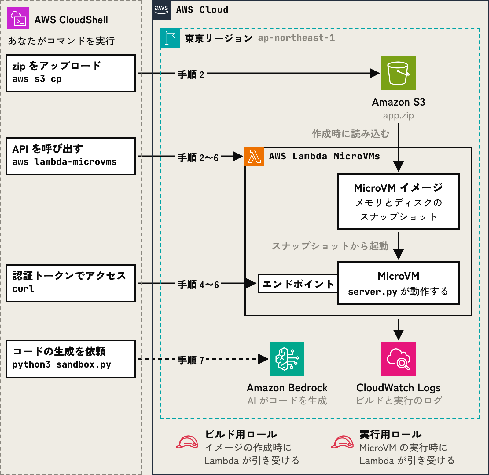
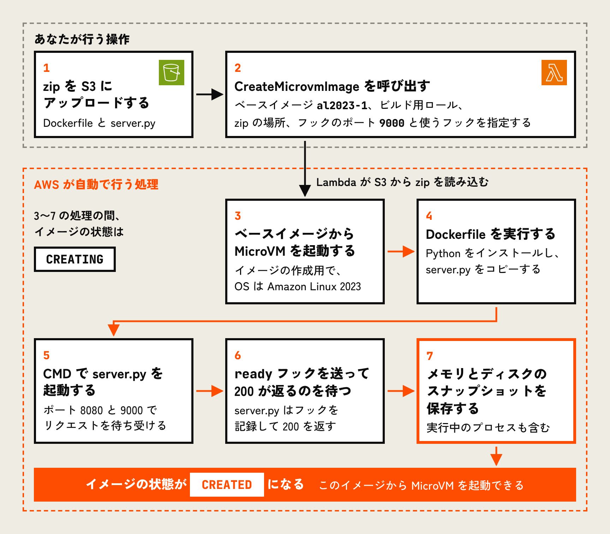
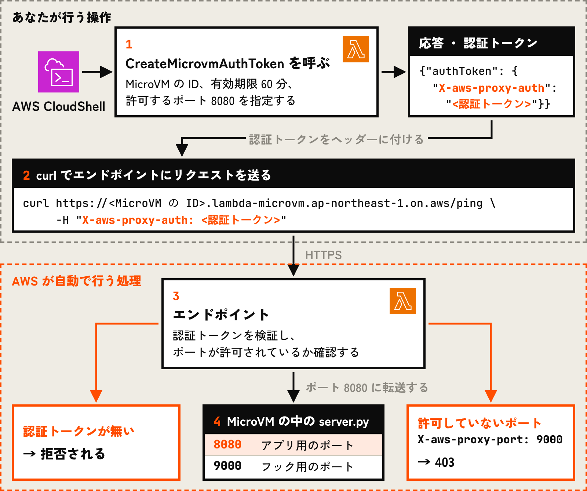
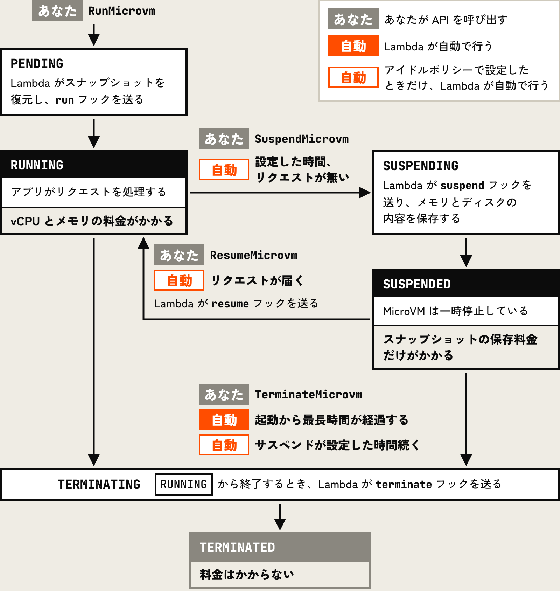

このリポジトリは AWS Deep Cuts の、AWS Lambda MicroVMs に関するハンズオンコンテンツです。

<!-- TODO: 記事の公開後に、次の行のリンクを有効にする -->
<!-- AWS Lambda MicroVMs の解説記事(Qiita)は[こちら]() -->

解説記事の原稿は [article/aws-lambda-microvms.md](./article/aws-lambda-microvms.md) にあります。

> **Note**: AWS Lambda MicroVMs は、2026 年 6 月に一般提供が始まったサービスです。このハンズオンは東京リージョン（`ap-northeast-1`）で実施します。
> - AWS CLI は、`aws lambda-microvms` コマンドに対応した v2.35.10 以降が必要です。CloudShell の AWS CLI は最新版とは限らないため、[前提条件](#前提条件)の手順でバージョンを確認してください。
> - 手順 7 だけ、AWS SDK for Python（boto3）と Amazon Bedrock を使います。モデルは Amazon Nova 2 Lite です。

> ⚠️ **コストに関する注意**
>
> MicroVM は、Lambda MicroVMs が起動する 1 台の軽量な仮想マシンです。MicroVM には、状態が `RUNNING` の間だけ、vCPU（仮想 CPU）とメモリの料金がかかります。MicroVM を一時停止するサスペンドの間は、vCPU とメモリの料金はかからず、メモリとディスクの内容を保存したデータであるスナップショットの保存料金だけがかかります。このハンズオンでは、1 台の MicroVM を動かせる時間の上限である最長時間を 60 分に設定し、起動から 60 分たった MicroVM を Lambda が自動で終了するようにします。MicroVM の起動に使う MicroVM イメージにも、MicroVM の中のアプリを起動した状態のスナップショットが含まれており、後片付けで MicroVM イメージを削除するまで保存料金がかかります。
>
> | 放置期間 | 概算コストの上限 |
> | --- | --- |
> | 1日 | 約 **$0.75**（約 120 円） |
> | 1週間 | 約 **$0.94**（約 150 円） |
>
> この金額は、手順どおりに進めた場合の上限です。MicroVM 3 台が設定した最長時間まで最大の量の vCPU とメモリで動き、スナップショット 1 つの大きさが上限の 10 GB、サスペンドとレジュームが 3 回ずつ、手順 7 で AI を 20 回呼び出したものとして計算しています。1 ドル 160 円で換算しています。内訳は [費用の見積もり](#費用の見積もり) にあります。
>
> **検証が終わったら速やかに後片付けを実施してください。**

# AWS Deep Cutsとは
AWS Deep Cutsは、AWS の最新のサービスやニッチな機能、または高度にアカデミックな知識を要求するサービスなど、多くの人が知らない 『隠れた名曲 = **Deep Cuts**』 を深くまで掘り下げる技術シリーズです。

このようなサービスはWeb情報も少なく、初学者は気軽にキャッチアップできないのが実情です。

そこで AWS Deep Cuts シリーズでは、**前提知識も含めた分かりやすいサービス解説** と **手順通りに進めれば誰でも再現できるハンズオン** を提供します！

# ハンズオンのゴール

このハンズオンでは、Python で書いた小さな Web アプリ `server.py` から MicroVM イメージを作成し、そのイメージから MicroVM を起動します。AWS CLI のコマンドを 1 つずつ実行しながら、Lambda MicroVMs の次の 4 つの特徴を自分の目で確かめます。

| 確かめる特徴 | 手順 |
| --- | --- |
| MicroVM イメージには、アプリを起動した状態のメモリとディスクが保存されている | 2・4 |
| MicroVM ごとに HTTPS のエンドポイントがあり、認証トークンが無いとアクセスできない | 3・4 |
| サスペンドしても、メモリの内容である変数や動いているプロセスは残る | 5 |
| 同じスナップショットから復元した MicroVM は、イメージを作成したときのメモリの内容を引き継いでいる | 6 |

手順 7 では応用として、生成 AI のモデルを API で呼び出せる Amazon Bedrock を使って Python のコードを生成し、そのコードを MicroVM の中で実行します。

用語の意味と仕組みは、解説記事で説明しています。先に記事の「AWS Lambda MicroVMsとは？」と「仕組み」を読んでおくと、各手順で何を確かめているのかが分かりやすくなります。

# ハンズオン手順

以降の手順は、ハンズオン用に用意した AWS アカウントで実施してください。

## 構築するアーキテクチャ



- あなたは CloudShell から AWS CLI のコマンドを実行し、Lambda MicroVMs の API を呼び出します。
- MicroVM イメージの作成中は、Lambda がビルド用ロールを使って S3 から zip を読み込み、ログを CloudWatch Logs に書き込みます。
- MicroVM の実行中は、Lambda が実行用ロールを使って、MicroVM の中のアプリのログを CloudWatch Logs に書き込みます。
- あなたは MicroVM のエンドポイントに、認証トークンを付けた HTTPS のリクエストを送ります。

## 前提条件

- AWS CloudShell を **東京リージョン** で開くこと
- AWS CLI が v2.35.10 以降であること。次のコマンドで確認します。

  ```bash
  aws --version
  aws lambda-microvms list-managed-microvm-images --region ap-northeast-1 --query 'items[].imageArn'
  ```

  2 つ目のコマンドで `Invalid choice` または `Found invalid choice` と表示された場合は、AWS CLI が古いため、次の手順で更新してください。

  <details>
  <summary>AWS CLI をホームディレクトリに最新版でインストールする手順</summary>

  CloudShell の AWS CLI は、最新版より数バージョン古いことがあります。CloudShell のホームディレクトリは次回以降のセッションでも残るため、ここに最新版をインストールします。

  ```bash
  curl -sS https://awscli.amazonaws.com/awscli-exe-linux-x86_64.zip -o /tmp/awscliv2.zip
  unzip -q -o /tmp/awscliv2.zip -d /tmp
  /tmp/aws/install --install-dir "$HOME/.local/aws-cli" --bin-dir "$HOME/.local/bin" --update
  export PATH="$HOME/.local/bin:$PATH"
  aws --version
  ```

  `export PATH=...` の行は、CloudShell のタブを新しく開くたびに実行してください。
  </details>

- CloudShell を開いた IAM ユーザーまたは IAM ロールに、Lambda MicroVMs・IAM・S3・CloudWatch Logs の操作権限と、手順 7 で使う Amazon Bedrock の権限があること。`AdministratorAccess` 相当の権限で実施するのが簡単です。

<details>
<summary>最小権限に近い IAM ポリシーの例</summary>

CloudShell を使う権限は、このポリシーとは別に必要です。たとえば AWS 管理ポリシーの `AWSCloudShellFullAccess` を付けます。`ConsoleRead` の文は、手順の中でマネジメントコンソールの画面を確認するための読み取りの権限です。

```json
{
  "Version": "2012-10-17",
  "Statement": [
    {
      "Sid": "LambdaMicroVMs",
      "Effect": "Allow",
      "Action": [
        "lambda:ListManagedMicrovmImages", "lambda:ListMicrovmImages",
        "lambda:CreateMicrovmImage", "lambda:GetMicrovmImage", "lambda:DeleteMicrovmImage",
        "lambda:ListMicrovmImageVersions", "lambda:ListMicrovmImageBuilds", "lambda:GetMicrovmImageBuild",
        "lambda:RunMicrovm", "lambda:GetMicrovm", "lambda:ListMicrovms",
        "lambda:SuspendMicrovm", "lambda:ResumeMicrovm", "lambda:TerminateMicrovm",
        "lambda:CreateMicrovmAuthToken", "lambda:PassNetworkConnector"
      ],
      "Resource": "*"
    },
    {
      "Sid": "Roles",
      "Effect": "Allow",
      "Action": [
        "iam:CreateRole", "iam:GetRole", "iam:PutRolePolicy", "iam:DeleteRolePolicy", "iam:DeleteRole", "iam:TagRole", "iam:PassRole",
        "iam:ListRolePolicies", "iam:GetRolePolicy", "iam:ListAttachedRolePolicies"
      ],
      "Resource": ["arn:aws:iam::*:role/aws-deepcuts-microvm-build-role", "arn:aws:iam::*:role/aws-deepcuts-microvm-exec-role"]
    },
    {
      "Sid": "ArtifactBucket",
      "Effect": "Allow",
      "Action": ["s3:CreateBucket", "s3:PutBucketPublicAccessBlock", "s3:PutBucketVersioning", "s3:PutObject", "s3:GetObject", "s3:ListBucket", "s3:ListBucketVersions", "s3:DeleteObject", "s3:DeleteObjectVersion", "s3:DeleteBucket"],
      "Resource": ["arn:aws:s3:::aws-deepcuts-microvms-*", "arn:aws:s3:::aws-deepcuts-microvms-*/*"]
    },
    {
      "Sid": "Logs",
      "Effect": "Allow",
      "Action": ["logs:CreateLogGroup", "logs:DescribeLogGroups", "logs:PutRetentionPolicy", "logs:TagResource", "logs:DeleteLogGroup", "logs:DescribeLogStreams", "logs:GetLogEvents", "logs:FilterLogEvents"],
      "Resource": "*"
    },
    {
      "Sid": "Bedrock",
      "Effect": "Allow",
      "Action": "bedrock:InvokeModel",
      "Resource": "arn:aws:bedrock:ap-northeast-1::foundation-model/amazon.nova-2-lite-v1:0"
    },
    {
      "Sid": "ConsoleRead",
      "Effect": "Allow",
      "Action": ["iam:ListRoles", "s3:ListAllMyBuckets", "s3:GetBucketLocation", "sts:GetCallerIdentity"],
      "Resource": "*"
    }
  ]
}
```

`lambda:PassNetworkConnector` が無いと、手順 3 の `run-microvm` が `AccessDeniedException` で失敗します。
</details>

以降、各種コマンドは[CloudShell](https://docs.aws.amazon.com/cloudshell/latest/userguide/welcome.html)（東京リージョン）で実行してください。

## １．事前準備

MicroVM イメージを作成するには、アプリの zip を保存する S3 バケット、Lambda が引き受ける IAM ロール 2 つ、ログを保存するロググループが必要です。IAM ロールを引き受けるとは、Lambda のような AWS のサービスが、そのロールに付いた権限を一時的に使って AWS を操作することです。これらのリソースの作成はハンズオンの本質ではないため、`setup.sh` で作成します。

```bash
# このリポジトリをクローン
git clone https://github.com/AWS-Deep-Cuts/aws-lambda-microvms
cd aws-lambda-microvms/hands-on

# セットアップスクリプトの実行
bash ./setup.sh

# 以下の文言が表示されればセットアップ成功です
# ✅ セットアップが完了しました！
```

`setup.sh` は、次の 4 つのリソースを作成します。

| リソース | 名前 | 用途 |
| --- | --- | --- |
| S3 バケット | `aws-deepcuts-microvms-<アカウント ID>-<日時>` | アプリの zip を保存する |
| ビルド用ロール | `aws-deepcuts-microvm-build-role` | MicroVM イメージの作成中に Lambda が引き受ける。S3 の zip の読み取りと、ログの書き込みを許可する |
| 実行用ロール | `aws-deepcuts-microvm-exec-role` | MicroVM の実行中に Lambda が引き受ける。MicroVM の中のアプリも、この権限を使える。ログの書き込みだけを許可する |
| ロググループ | `/aws/lambda-microvms/aws-deepcuts` | イメージの作成と MicroVM の実行のログを保存する |

`setup.sh` は、作成したリソースの名前と ARN を `resource-ids.env` に保存しました。ARN（Amazon Resource Name）は、AWS のリソースを一意に指す名前です。次のコマンドでこのファイルを読み込むと、以降のコマンドで変数として使えます。

```bash
source ./resource-ids.env
cat resource-ids.env
```

| 変数 | 中身 | 使う手順 |
| --- | --- | --- |
| `REGION` | リージョン `ap-northeast-1` | すべて |
| `BUCKET_NAME` | S3 バケットの名前 | 2 |
| `BUILD_ROLE_ARN` | ビルド用ロールの ARN | 2 |
| `IMAGE_NAME` | MicroVM イメージの名前 `aws-deepcuts-sandbox` | 2 |
| `LOG_GROUP` | ロググループの名前 | 2・3・6 |
| `EXEC_ROLE_ARN` | 実行用ロールの ARN | 3・6 |
| `INGRESS_CONNECTOR` | Lambda が用意しているネットワークコネクタ `ALL_INGRESS` の ARN。手順 3 で説明する | 3・6 |

以降の手順で作成するリソースの ID も、このファイルに追記していきます。

> **Note**: CloudShell は、操作しない時間が続くとセッションが終了し、変数が消えます。その場合は、次の 2 行を実行してから続きの手順に進んでください。
>
> ```bash
> cd ~/aws-lambda-microvms/hands-on
> source ./resource-ids.env
> ```
>
> 前提条件で AWS CLI をホームディレクトリにインストールした場合は、`export PATH="$HOME/.local/bin:$PATH"` も実行します。手順 4 以降で中断した場合は、手順 4-2 の認証トークンの発行と、手順 4-4 の `run_code` の定義も、もう一度実行してください。認証トークンと `run_code` は、このファイルに保存されないためです。

<!-- 画面写真: IAM コンソールの aws-deepcuts-microvm-build-role の「信頼関係」タブ。信頼されたエンティティの lambda.amazonaws.com を枠で囲む -->

> **この手順で確かめること**
> - **やること**: IAM コンソールの左のメニューから「ロール」を選び、`aws-deepcuts-microvm-build-role` を開いて「信頼関係」タブを確認します。
> - **期待する結果**: 信頼されたエンティティに `lambda.amazonaws.com` が表示されています。
> - **ここから分かること**: このロールを引き受けるのは、あなたではなく Lambda のサービスです。Lambda は、MicroVM イメージを作成するときにこのロールを使って、あなたの S3 バケットから zip を読み込みます。

## ２．MicroVM イメージを作成する

MicroVM を起動するには、起動元になる MicroVM イメージが必要です。MicroVM イメージは、あなたが S3 にアップロードした zip から、Lambda が作成します。zip には、Dockerfile とアプリのファイルが入っています。この手順では、zip をアップロードし、イメージの作成を依頼して、作成の完了を待ちます。イメージの作成中に AWS の中で起きることは、次の図のとおりです。図の「AWS が自動で行う処理」は、Lambda が行う処理です。



### 2-1. アプリの中身を確認する

`app` ディレクトリには、Dockerfile と server.py があります。

```bash
cat app/Dockerfile
```

Dockerfile は、MicroVM の中でアプリを動かすコンテナの作り方を書いたファイルです。FROM で元になるコンテナイメージを指定し、python3 をインストールし、server.py をコピーして、CMD で server.py を起動します。このハンズオンでは、名前に「イメージ」が付くものが 2 つ出てきます。

| イメージ | 指定する場所 | 役割 |
| --- | --- | --- |
| ベースイメージ `al2023-1` | 手順 2-4 の `create-microvm-image` の `--base-image-arn` | MicroVM の OS。Lambda が管理する Amazon Linux 2023 のイメージ |
| コンテナイメージ `al2023-minimal` | Dockerfile の FROM | アプリを動かすコンテナの元になるイメージ。AWS が Lambda MicroVMs 用に公開している。スナップショットからの復元に対応した OpenSSL が入っている |

Dockerfile の FROM で指定するイメージは、一般にベースイメージと呼ばれます。このハンズオンでベースイメージと書くときは、FROM で指定するイメージではなく、表のベースイメージ `al2023-1` を指します。server.py を動かすコンテナは、このベースイメージの OS の上で動きます。

server.py は、Python の標準ライブラリだけで書いた Web アプリです。2 つのポートで HTTP のリクエストを受け付けます。ポート 9000 では、フックを受け付けます。フックとは、MicroVM の状態が変わるときに、Lambda がアプリへ送る HTTP のリクエストです。正式な名前はライフサイクルフックで、イメージの作成の完了の直前、起動、サスペンド、レジューム、終了のときに送られます。

| ポート | パス | 内容 |
| --- | --- | --- |
| 8080 | `GET /ping` | 生存確認。`boot_id` とプロセスの起動時刻を返す |
| 8080 | `GET /state` | 変数の一覧、受け取ったフックの履歴、プロセスの起動時刻を返す |
| 8080 | `GET /random` | `boot_id` と、`random.random()`・`os.urandom()`・`uuid4()` の値を返す |
| 8080 | `POST /exec` | 受け取った Python のコードを実行し、標準出力と変数を返す。変数は次のリクエストでも使える |
| 9000 | `POST /aws/lambda-microvms/runtime/v1/<フック名>` | Lambda から届くフックを、時刻と内容つきで記録する |

`boot_id` は、server.py のプロセスが起動したときに 1 回だけ生成する値です。プロセスが新しく起動しない限り、値は変わりません。

### 2-2. zip にして S3 にアップロードする

```bash
cd app
zip ../app.zip Dockerfile server.py
cd ..
aws s3 cp app.zip "s3://${BUCKET_NAME}/app.zip" --region "${REGION}"
```

Dockerfile は、zip の最上位に配置する必要があります。`app` ディレクトリごと zip にすると、イメージの作成が失敗します。

<!-- 画面写真: S3 コンソールのバケット aws-deepcuts-microvms-... のオブジェクト一覧。app.zip を枠で囲む -->

> **この手順で確かめること**
> - **やること**: S3 コンソールの「汎用バケット」の一覧から `aws-deepcuts-microvms-` で始まるバケットを開きます。
> - **期待する結果**: オブジェクトの一覧に `app.zip` が表示されています。
> - **ここから分かること**: この zip は、MicroVM イメージを作成するための入力です。Lambda は、手順 2-4 で指定する S3 の場所から、この zip を読み込みます。

### 2-3. ベースイメージの ARN を調べる

MicroVM の OS は、Lambda が管理するベースイメージから選びます。次のコマンドで、使えるベースイメージを確認します。

```bash
aws lambda-microvms list-managed-microvm-images --region "${REGION}"
```

出力の形の例は次のとおりです。日時などの値は、実行した時点によって異なります。

```json
{
    "items": [
        {
            "imageArn": "arn:aws:lambda:ap-northeast-1:aws:microvm-image:al2023-1",
            "createdAt": "...",
            "updatedAt": "..."
        }
    ]
}
```

Amazon Linux 2023 のベースイメージの ARN を、変数に入れます。

```bash
BASE_IMAGE_ARN=$(aws lambda-microvms list-managed-microvm-images --region "${REGION}" \
  --query 'items[?contains(imageArn, `al2023`)].imageArn | [0]' --output text)
echo "${BASE_IMAGE_ARN}"
```

### 2-4. イメージの作成を依頼する

`create-microvm-image` で、Lambda にイメージの作成を依頼します。このコマンドは、イメージの作成の完了を待たずに終わります。作成の処理は、コマンドが終わった後も Lambda が続けます。

```bash
IMAGE_ARN=$(aws lambda-microvms create-microvm-image \
  --region "${REGION}" \
  --name "${IMAGE_NAME}" \
  --base-image-arn "${BASE_IMAGE_ARN}" \
  --build-role-arn "${BUILD_ROLE_ARN}" \
  --code-artifact "uri=s3://${BUCKET_NAME}/app.zip" \
  --hooks file://hooks.json \
  --resources '[{"minimumMemoryInMiB": 512}]' \
  --logging "{\"cloudWatch\": {\"logGroup\": \"${LOG_GROUP}\"}}" \
  --query imageArn --output text)

[[ -n "${IMAGE_ARN}" ]] && echo "IMAGE_ARN=\"${IMAGE_ARN}\"" >> resource-ids.env
echo "${IMAGE_ARN}"
```

コマンドが失敗した場合、`IMAGE_ARN` は空になり、`resource-ids.env` には何も追記されません。

| パラメータ | 指定した値 | 意味 |
| --- | --- | --- |
| `--name` | `aws-deepcuts-sandbox` | イメージの名前 |
| `--base-image-arn` | 手順 2-3 で調べた ARN | MicroVM の OS |
| `--build-role-arn` | ビルド用ロール | 作成中に Lambda が引き受けるロール |
| `--code-artifact` | S3 の zip の場所 | Dockerfile とアプリ |
| `--hooks` | `hooks.json` | フックを受け付けるポートと、使うフックの種類 |
| `--resources` | 512 MiB | MicroVM のメモリのベースライン。ベースラインは、Lambda が MicroVM に常に割り当てる vCPU とメモリの量。vCPU はメモリ 2 GB あたり 1 個の割合で決まり、この設定では 0.25 個。既定は 2 GB と 1 vCPU |
| `--logging` | ロググループの名前 | イメージの作成のログを書き込む先 |

`hooks.json` では、ポート 9000 で 5 種類のフックを受け付けるように指定しています。

```bash
cat hooks.json
```

`ENABLED` は、Lambda がそのフックをアプリに送ることを表します。名前が `TimeoutInSeconds` で終わる項目は、Lambda が、アプリから成功を表す HTTP のステータスコード 200 が返るのを待つ秒数です。ready フックや run フックで、この時間内に 200 が返らないと、イメージの作成や MicroVM の起動が失敗します。

| フック | Lambda がアプリに送るタイミング |
| --- | --- |
| ready | イメージの作成中、アプリが起動したあと。アプリが 200 を返すと、Lambda はスナップショットを保存する |
| run | MicroVM の起動直後。アプリが 200 を返すまで、エンドポイントへのリクエストはアプリに届かない |
| suspend | MicroVM をサスペンドする直前 |
| resume | MicroVM をレジュームした直後 |
| terminate | MicroVM を終了する直前 |

Lambda は、それぞれのフックを、手順 2-1 の表にあるポート 9000 のパスに、POST リクエストとして送ります。たとえば ready フックでは、パスの `<フック名>` の部分が `ready` になります。

### 2-5. 作成の完了を待つ

次のコマンドは、イメージの状態を 20 秒ごとに表示し、状態が `CREATING` 以外になったら終了します。

```bash
while true; do
  STATE=$(aws lambda-microvms get-microvm-image --image-identifier "${IMAGE_ARN}" \
    --region "${REGION}" --query state --output text)
  echo "$(date +%H:%M:%S) ${STATE}"
  [[ "${STATE}" == "CREATING" ]] || break
  sleep 20
done
```

数分たつと、状態が `CREATED` になります。`CREATE_FAILED` になった場合は、[トラブルシューティング](#トラブルシューティング)を確認してください。表示される時刻は、CloudShell の既定の時間帯である協定世界時（UTC）です。日本時間は、9 時間を足した時刻です。

待っている間に、CloudWatch Logs のコンソールで、ロググループ `/aws/lambda-microvms/aws-deepcuts` を開いてみてください。イメージの作成が始まると、このロググループにログストリームが 1 つ追加され、作業の経過が記録されていきます。

<!-- 画面写真: CloudWatch Logs のロググループ /aws/lambda-microvms/aws-deepcuts。イメージの作成のログストリームを枠で囲む -->

<!-- 要確認: Lambda コンソールで MicroVM イメージの一覧を開く画面の名前と順序を、実機で確かめて直す -->
<!-- 画面写真: Lambda コンソールの MicroVM イメージの一覧。aws-deepcuts-sandbox と状態の列を枠で囲む -->

> **この手順で確かめること**
> - **やること**: Lambda コンソールで MicroVM イメージの一覧を開き、`aws-deepcuts-sandbox` の状態を確認します。
> - **期待する結果**: 作成中は `CREATING`、完了すると `CREATED` と表示されます。CLI のループが表示する状態と同じです。
> - **ここから分かること**: CLI の `create-microvm-image` は、作成を依頼するだけです。作成の処理は、AWS の中で Lambda が進めています。

### 2-6. イメージのビルドとスナップショットの大きさを確認する

MicroVM イメージを作成または更新するたびに、新しいバージョンが作成されます。Lambda は、バージョンごとに、Dockerfile を実行して server.py を起動し、スナップショットを保存する処理を行います。この処理をイメージのビルドと呼びます。API では、イメージのビルドごとに記録が残ります。イメージのビルドは CPU の種類と世代ごとに分かれることがあるため、1 つのバージョンにイメージのビルドが複数あることもあります。この手順では、イメージのビルドの一覧と、保存されたスナップショットの大きさを確認します。

```bash
IMAGE_VERSION=$(aws lambda-microvms get-microvm-image --image-identifier "${IMAGE_ARN}" \
  --region "${REGION}" --query latestActiveImageVersion --output text)

aws lambda-microvms list-microvm-image-builds --image-identifier "${IMAGE_ARN}" \
  --image-version "${IMAGE_VERSION}" --region "${REGION}" \
  --query 'items[].[buildId, chipset, chipsetGeneration, buildState]' --output table
```

`latestActiveImageVersion` は、MicroVM の起動に使える最新のバージョンです。表の 1 行が、イメージのビルド 1 つに当たります。列は左から、ビルドの ID、CPU の種類、CPU の世代、ビルドの状態です。

1 つ目のビルドの詳細から、スナップショットの大きさを表示します。

```bash
BUILD_ID=$(aws lambda-microvms list-microvm-image-builds --image-identifier "${IMAGE_ARN}" \
  --image-version "${IMAGE_VERSION}" --region "${REGION}" --query 'items[0].buildId' --output text)

aws lambda-microvms get-microvm-image-build --image-identifier "${IMAGE_ARN}" \
  --image-version "${IMAGE_VERSION}" --build-id "${BUILD_ID}" --region "${REGION}" \
  --query snapshotBuild
```

出力の形の例は次のとおりです。値はバイト単位で、環境によって異なります。

```json
{
    "memorySnapshotSizeInBytes": ...,
    "codeInstallSizeInBytes": ...,
    "diskSnapshotSizeInBytes": ...
}
```

> **この手順で確かめること**
> - **やること**: ビルドの一覧の行数と、出力の `memorySnapshotSizeInBytes` と `diskSnapshotSizeInBytes` を確認します。
> - **期待する結果**: ビルドの状態は `SUCCESSFUL` です。`memorySnapshotSizeInBytes` はメモリのスナップショットの大きさ、`diskSnapshotSizeInBytes` はディスクのスナップショットの大きさで、どちらにも 0 より大きな値が入っています。3 つの値を足して 1,000,000,000 で割ると、おおよその GB になります。[費用の見積もり](#費用の見積もり)で上限とした 10 GB と比べてください。
> - **ここから分かること**: MicroVM イメージは、ファイルを集めただけのものではありません。Lambda は、Dockerfile を実行して server.py を起動し、アプリが ready フックに 200 を返すのを待ってから、そのときのメモリとディスクの内容を保存しました。次の手順で MicroVM を起動すると、Lambda はこのスナップショットを復元します。そのため、Python の起動と server.py の初期化は、MicroVM の起動のたびには行われません。

## ３．MicroVM を起動する

`run-microvm` で、手順 2 のイメージから MicroVM を 1 台起動します。エンドポイントに届いたリクエストを MicroVM に通すかどうかは、ネットワークコネクタで決まります。ネットワークコネクタは、MicroVM に出入りする通信の経路を決める設定です。`ALL_INGRESS` は Lambda が用意しているコネクタで、エンドポイントに届いた HTTPS のリクエストを MicroVM に通します。

```bash
MICROVM_ID=$(aws lambda-microvms run-microvm \
  --region "${REGION}" \
  --image-identifier "${IMAGE_ARN}" \
  --execution-role-arn "${EXEC_ROLE_ARN}" \
  --ingress-network-connectors "${INGRESS_CONNECTOR}" \
  --idle-policy maxIdleDurationSeconds=300,suspendedDurationSeconds=1800,autoResumeEnabled=true \
  --maximum-duration-in-seconds 3600 \
  --logging "{\"cloudWatch\": {\"logGroup\": \"${LOG_GROUP}\"}}" \
  --run-hook-payload '{"user": "handson"}' \
  --query microvmId --output text)

[[ -n "${MICROVM_ID}" ]] && echo "MICROVM_ID=\"${MICROVM_ID}\"" >> resource-ids.env
echo "${MICROVM_ID}"
```

| パラメータ | 指定した値 | 意味 |
| --- | --- | --- |
| `--image-identifier` | 手順 2 のイメージ | 起動元の MicroVM イメージ |
| `--execution-role-arn` | 実行用ロール | 実行中に Lambda が引き受けるロール。アプリのログを CloudWatch Logs に書き込むために使う |
| `--ingress-network-connectors` | `INGRESS_CONNECTOR`。`ALL_INGRESS` の ARN | エンドポイントに届いたリクエストを MicroVM に通すネットワークコネクタ |
| `--idle-policy` | 300・1800・true | 5 分間リクエストが無いと自動でサスペンドする。サスペンドが 30 分続くと終了する。サスペンド中にリクエストが届くと自動でレジュームする |
| `--maximum-duration-in-seconds` | 3600 | 最長時間を 60 分にする。サスペンドしている時間も含めて、起動から 60 分たつと終了する |
| `--logging` | ロググループの名前 | アプリのログを書き込む先 |
| `--run-hook-payload` | `{"user": "handson"}` | run フックで、この MicroVM のアプリだけに渡す文字列 |

起動した MicroVM の詳細を確認します。

```bash
aws lambda-microvms get-microvm --microvm-identifier "${MICROVM_ID}" --region "${REGION}"
```

出力の形の例は次のとおりです。一部を省略しています。`state` は、起動の直後は `PENDING` で、しばらくすると `RUNNING` になります。`RUNNING` になるまで、このコマンドを何度か実行し、かかった時間を確かめてください。

```json
{
    "microvmId": "...",
    "state": "RUNNING",
    "endpoint": "<MicroVM の ID>.lambda-microvm.ap-northeast-1.on.aws",
    "imageArn": "arn:aws:lambda:ap-northeast-1:<アカウント ID>:microvm-image:...",
    "idlePolicy": {
        "maxIdleDurationSeconds": 300,
        "suspendedDurationSeconds": 1800,
        "autoResumeEnabled": true
    },
    "maximumDurationInSeconds": 3600,
    "startedAt": "..."
}
```

`state` が `RUNNING` になったら、エンドポイントを変数に入れます。`endpoint` の値は、以降のコマンドで `https://` の後ろに付けて使います。

```bash
ENDPOINT=$(aws lambda-microvms get-microvm --microvm-identifier "${MICROVM_ID}" \
  --region "${REGION}" --query endpoint --output text)
ENDPOINT="${ENDPOINT#https://}"   # 以降のコマンドで https:// を付けて使うため、値の先頭に https:// があれば取り除く
[[ -n "${ENDPOINT}" ]] && echo "ENDPOINT=\"${ENDPOINT}\"" >> resource-ids.env
echo "${ENDPOINT}"
```

<!-- 要確認: Lambda コンソールで MicroVM の一覧を開く画面の名前と順序を、実機で確かめて直す -->
<!-- 画面写真: Lambda コンソールの MicroVM の一覧。起動した MicroVM の ID と状態 RUNNING を枠で囲む -->

<!-- 画面写真: CloudWatch Logs のログストリーム（名前は MicroVM の ID）。run フックの行を枠で囲む -->

> **この手順で確かめること**
> - **やること**: まず、Lambda コンソールで MicroVM の一覧を開き、起動した MicroVM の状態を確認します。次に、CloudWatch Logs のコンソールで、ロググループ `/aws/lambda-microvms/aws-deepcuts` を開きます。名前が MicroVM の ID のログストリームを開き、`hook POST /aws/lambda-microvms/runtime/v1/run` の行を探します。
> - **期待する結果**: MicroVM の一覧に、`MICROVM_ID` と同じ ID の MicroVM が `RUNNING` の状態で表示されています。ログの行の `body` には、`microvmId` と `runHookPayload` が含まれています。`runHookPayload` の値は `--run-hook-payload` で指定した文字列で、ログでは `"{\"user\": \"handson\"}"` のように、引用符の前にバックスラッシュが付いた形で表示されます。
> - **ここから分かること**: MicroVM を起動すると、Lambda は run フックでアプリに起動を通知し、`--run-hook-payload` の文字列を渡します。アプリがこのフックに 200 を返してから、エンドポイントへのリクエストが届くようになります。あなたが開発するサービスの利用者の ID や、秘密情報の保存場所の名前のように、MicroVM ごとに異なる値は、このフックで渡します。秘密情報そのものは渡しません。

## ４．エンドポイントにアクセスする

MicroVM のエンドポイントは、インターネットから HTTPS で接続できる URL です。ただし、リクエストには認証トークンが必要です。認証トークンの発行から、リクエストがアプリに届くまでの流れは、次の図のとおりです。



### 4-1. 認証トークンを付けずにアクセスする

```bash
curl -s -o /dev/null -w "HTTP %{http_code}\n" "https://${ENDPOINT}/ping"
```

`HTTP 401` や `HTTP 403` のような、400 番台のステータスコードが表示されます。400 番台のステータスコードは、サーバーがリクエストを拒否したことを表します。エンドポイントの URL を知っているだけでは、MicroVM にアクセスできません。

### 4-2. 認証トークンを発行する

```bash
TOKEN=$(aws lambda-microvms create-microvm-auth-token \
  --region "${REGION}" \
  --microvm-identifier "${MICROVM_ID}" \
  --expiration-in-minutes 60 \
  --allowed-ports '[{"port": 8080}]' \
  --query 'authToken."X-aws-proxy-auth"' --output text)
echo "${TOKEN:0:40}..."
```

このトークンで許可されるのは、この MicroVM のポート 8080 へのアクセスだけです。有効期限は 60 分で、これが上限です。

### 4-3. 認証トークンを付けてアクセスする

認証トークンは、`X-aws-proxy-auth` ヘッダーに付けて送ります。

```bash
curl -s "https://${ENDPOINT}/ping" -H "X-aws-proxy-auth: ${TOKEN}"
curl -s "https://${ENDPOINT}/state" -H "X-aws-proxy-auth: ${TOKEN}"
```

`/state` の出力の形の例は次のとおりです。一部を省略しています。

```json
{
  "boot_id": "...",
  "process_started_at": "2026-10-29T05:10:12+00:00",
  "vars": {},
  "hooks": [
    { "path": "/aws/lambda-microvms/runtime/v1/ready", "at": "2026-10-29T05:10:13+00:00", "body": {} },
    { "path": "/aws/lambda-microvms/runtime/v1/run", "at": "2026-10-29T05:21:40+00:00", "body": { "microvmId": "...", "runHookPayload": "{\"user\": \"handson\"}" } }
  ]
}
```

> **この手順で確かめること**
> - **やること**: `/state` の出力の `process_started_at` と、`hooks` の `at` を確認します。
> - **期待する結果**: `process_started_at` と ready フックの時刻は、手順 2 でイメージを作成していた時刻です。run フックの時刻は、手順 3 で MicroVM を起動した時刻です。時刻は UTC です。手順 3 の起動から 5 分以上たっている場合は、アイドルポリシーで自動的にサスペンドとレジュームが行われたため、suspend と resume の記録も並びます。
> - **ここから分かること**: いま応答している server.py のプロセスは、イメージの作成中に起動したプロセスを、スナップショットから復元したものです。MicroVM を起動したときに、プロセスは新しく起動していません。ready フックの記録は、そのプロセスのメモリの中にあり、スナップショットと一緒に保存されていました。

### 4-4. MicroVM の中で Python のコードを実行する

`/exec` に Python のコードを送ると、server.py が MicroVM の中で実行します。コードを JSON に変換して送る処理を、`run_code` という関数にまとめます。

```bash
run_code() {
  python3 -c 'import json, sys; print(json.dumps({"code": sys.argv[1]}))' "$1" \
    | curl -s "https://${ENDPOINT}/exec" -H "X-aws-proxy-auth: ${TOKEN}" \
        -H "Content-Type: application/json" --data-binary @-
}

run_code 'secret = 42'
run_code 'print(secret * 2)'
run_code 'import platform; print(platform.machine())'
```

1 つ目のリクエストで定義した `secret` を、2 つ目のリクエストで参照できています。2 つ目の出力の `stdout` は `84`、3 つ目は `aarch64` です。`aarch64` は、Linux が ARM64 の CPU を表すときの名前です。Lambda MicroVMs の MicroVM は、ARM64 の CPU である AWS Graviton で動きます。

### 4-5. 許可していないポートにアクセスする

`X-aws-proxy-port` ヘッダーを付けると、ポート 8080 以外にもリクエストを送れます。ただし、送れるのは認証トークンで許可したポートだけです。

```bash
curl -s -o /dev/null -w "HTTP %{http_code}\n" "https://${ENDPOINT}/" \
  -H "X-aws-proxy-auth: ${TOKEN}" -H "X-aws-proxy-port: 9000"
```

`HTTP 403` が表示されます。この認証トークンはポート 9000 を許可していないため、フックを受け付けるポート 9000 にはアクセスできません。ポート 9000 を許可した認証トークンを発行しない限り、エンドポイントを通じてポート 9000 にリクエストを送ることはできません。

## ５．サスペンドとレジュームを確かめる

MicroVM は、サスペンドとレジュームができます。サスペンドすると、Lambda はメモリとディスクの内容を保存して、MicroVM を一時停止します。サスペンド中は vCPU とメモリの料金がかからず、スナップショットの保存料金だけがかかります。MicroVM の状態と、状態を変える操作は、次の図のとおりです。



### 5-1. コマンドでサスペンドする

まず変数を 1 つ定義し、サスペンドの前の状態を表示します。

```bash
run_code 'counter = 1'
curl -s "https://${ENDPOINT}/state" -H "X-aws-proxy-auth: ${TOKEN}"
```

この `/state` の出力を、サスペンドの前の状態として残しておきます。次に、MicroVM をサスペンドし、状態を確認します。

```bash
aws lambda-microvms suspend-microvm --microvm-identifier "${MICROVM_ID}" --region "${REGION}"

aws lambda-microvms get-microvm --microvm-identifier "${MICROVM_ID}" \
  --region "${REGION}" --query state --output text
```

状態は `SUSPENDING` を経て `SUSPENDED` になります。`SUSPENDED` と表示されるまで、2 つ目のコマンドを何度か実行してください。

### 5-2. リクエストを送って自動でレジュームさせる

`SUSPENDED` になったら、エンドポイントにリクエストを送ります。手順 3 で `autoResumeEnabled=true` を指定したため、リクエストが届くと Lambda が自動で MicroVM をレジュームします。`time` で、応答までにかかった時間も表示します。

```bash
time curl -s "https://${ENDPOINT}/state" -H "X-aws-proxy-auth: ${TOKEN}"

aws lambda-microvms get-microvm --microvm-identifier "${MICROVM_ID}" \
  --region "${REGION}" --query state --output text
```

続けて、MicroVM が動いているときの応答時間を測ります。

```bash
time curl -s -o /dev/null "https://${ENDPOINT}/ping" -H "X-aws-proxy-auth: ${TOKEN}"
```

<!-- 画面写真: CloudWatch Logs の MicroVM のログストリーム。suspend と resume のフックの行を枠で囲む -->

> **この手順で確かめること**
> - **やること**: サスペンドの前と、レジュームの後の `/state` の出力で、`vars`・`boot_id`・`hooks` を比べます。また、2 回の `time` が表示した `real` の時間を比べます。`real` は、リクエストを送ってから応答が返るまでの時間です。最後に、CloudWatch Logs の MicroVM のログストリームで、suspend と resume のフックの行を探します。
> - **期待する結果**: `vars` に `counter` と `secret` が残っています。`boot_id` は変わっていません。`hooks` の最後の 2 件が、今回のサスペンドとレジュームの記録です。MicroVM の状態は `RUNNING` に戻っています。サスペンドの前に発行した認証トークンも、そのまま使えます。1 回目の `real` には、Lambda が MicroVM をレジュームする時間が含まれるため、2 回目より長くなります。
> - **ここから分かること**: サスペンドは、MicroVM を終了して作り直す操作ではありません。Lambda はメモリとディスクの内容を保存し、レジュームのときに同じ状態から再開します。そのため、変数も、動いていたプロセスも残ります。なお、MicroVM から外部へのネットワーク接続は、レジュームのときに切断されます。接続を張り直す処理は、アプリが resume フックを受け取ったときに行います。

### 5-3. 自動でサスペンドさせてからコマンドでレジュームする

`--idle-policy` の設定により、この MicroVM は 5 分間リクエストが無いと自動でサスペンドします。エンドポイントにリクエストを送らずに、5 分間待ちます。その後、状態を確認します。

```bash
aws lambda-microvms get-microvm --microvm-identifier "${MICROVM_ID}" \
  --region "${REGION}" --query state --output text
```

`SUSPENDED` と表示されたら、リクエストを送らずに、コマンドでレジュームします。`RUNNING` と表示された場合は、もう少し待ってから、状態を確認し直してください。

```bash
aws lambda-microvms resume-microvm --microvm-identifier "${MICROVM_ID}" --region "${REGION}"

aws lambda-microvms get-microvm --microvm-identifier "${MICROVM_ID}" \
  --region "${REGION}" --query state --output text
```

状態が `RUNNING` に戻ったことを確かめます。`resume-microvm` は、状態が `SUSPENDED` のときだけ実行できます。状態が `RUNNING` のときに実行すると、`ConflictException` で失敗します。

## ６．同じイメージから 2 台目の MicroVM を起動して比べる

同じ MicroVM イメージから、クォータの範囲内で複数の MicroVM を起動できます。この手順では 2 台目を起動し、同じイメージから復元した 2 台で、プロセスの中で作成した値と、カーネルから取得する乱数がどうなるかを、`/random` の結果で比べます。2 台目は、10 分で自動的に終了するように設定します。

1 台目は、手順 3 の起動から 60 分たつと自動的に終了します。1 台目がすでに終了している場合は、手順 3 と手順 4-2 をやり直してから進めてください。認証トークンの期限だけが切れている場合は、手順 4-2 だけをやり直します。

```bash
MICROVM_B=$(aws lambda-microvms run-microvm \
  --region "${REGION}" \
  --image-identifier "${IMAGE_ARN}" \
  --execution-role-arn "${EXEC_ROLE_ARN}" \
  --ingress-network-connectors "${INGRESS_CONNECTOR}" \
  --maximum-duration-in-seconds 600 \
  --logging "{\"cloudWatch\": {\"logGroup\": \"${LOG_GROUP}\"}}" \
  --query microvmId --output text)
[[ -n "${MICROVM_B}" ]] && echo "MICROVM_B=\"${MICROVM_B}\"" >> resource-ids.env

aws lambda-microvms get-microvm --microvm-identifier "${MICROVM_B}" \
  --region "${REGION}" --query state --output text
```

状態が `RUNNING` になったら、2 台目のエンドポイントと認証トークンを用意し、2 台の `/random` を 1 回ずつ取得します。

```bash
ENDPOINT_B=$(aws lambda-microvms get-microvm --microvm-identifier "${MICROVM_B}" \
  --region "${REGION}" --query endpoint --output text)
ENDPOINT_B="${ENDPOINT_B#https://}"
TOKEN_B=$(aws lambda-microvms create-microvm-auth-token --region "${REGION}" \
  --microvm-identifier "${MICROVM_B}" --expiration-in-minutes 10 \
  --allowed-ports '[{"port": 8080}]' --query 'authToken."X-aws-proxy-auth"' --output text)

curl -s "https://${ENDPOINT}/random" -H "X-aws-proxy-auth: ${TOKEN}"
curl -s "https://${ENDPOINT_B}/random" -H "X-aws-proxy-auth: ${TOKEN_B}"
```


> **この手順で確かめること**
> - **やること**: 2 台の出力の 4 つの値を、1 つずつ比べます。
> - **期待する結果**: 2 台の `boot_id` が同じ場合、2 台は同じスナップショットから復元されています。この場合、それぞれで初めて呼び出した `/random` の `random_random` も、2 台で同じ値です。`os_urandom_hex` と `uuid4` は、2 台で異なる値です。
> - **ここから分かること**: イメージの作成中にプロセスの中で作成した値である `boot_id` と、`random` モジュールの内部状態は、同じスナップショットから復元したすべての MicroVM で同じになります。一方、`os.urandom()` と `uuid4()` は、Linux カーネルの乱数生成器から値を取得します。カーネルは、スナップショットからの復元の通知を受けて乱数生成器に新しい種を混ぜ直すため、これらの値は 2 台で異なります。MicroVM ごとに異なるべき値は、run フックのあとに `secrets` モジュールで生成します。仕組みの詳細は、記事の「同じイメージから起動した MicroVM の注意点」を参照してください。

> **Note**: `random_random` は、呼び出すたびに次の値に進みます。どちらかの MicroVM で `/random` を先に呼び出していた場合は、もう一方でも同じ回数だけ呼び出すと、同じ回数目の値どうしが一致します。また、手順 2-6 でビルドが 2 つ以上表示された場合は、2 台が別のビルドから復元されることがあります。このとき、2 台の `boot_id` は異なり、`random_random` も一致しません。もう 1 台起動し、`boot_id` が同じ 2 台で比べてください。

確かめ終わったら、2 台とも終了します。

```bash
aws lambda-microvms terminate-microvm --microvm-identifier "${MICROVM_B}" --region "${REGION}"
aws lambda-microvms terminate-microvm --microvm-identifier "${MICROVM_ID}" --region "${REGION}"

aws lambda-microvms list-microvms --image-identifier "${IMAGE_ARN}" --region "${REGION}" \
  --query 'items[].[microvmId, state]' --output table
```

2 台の状態が、`TERMINATING` を経て `TERMINATED` になります。終了した MicroVM には、料金がかかりません。

## ７．応用：AI が生成したコードを MicroVM で実行する

ここまでの手順で、MicroVM の中で任意の Python のコードを実行できることを確かめました。この手順では、Amazon Bedrock のモデルに Python のコードを生成させ、そのコードを MicroVM の中で実行します。AI が生成したコードは、内容を確かめるまで信頼できません。MicroVM の中で実行すれば、生成されたコードは、CloudShell のファイルや、あなたの AWS の認証情報にはアクセスできません。MicroVM の中のコードが使える AWS の権限は、実行用ロールに付けたログの書き込みだけです。ただし、このハンズオンの MicroVM はインターネットに接続できるため、外部への通信は防げません。本番では、記事のベストプラクティスのとおり、接続先を制限します。

`sandbox.py` は、手順 3〜6 で実行した API の呼び出しと、Bedrock の呼び出しをまとめた対話型のツールです。API を呼び出すたびに、`→ RunMicrovm` のように、呼び出した API の名前を表示します。Bedrock の呼び出しには、Converse API を使います。Converse API は、Bedrock のモデルに会話の形で入力を渡し、応答を受け取る API です。

| sandbox.py の操作 | 内部で行う処理 |
| --- | --- |
| 起動 | `RunMicrovm` で MicroVM を起動し、`GetMicrovm` で `RUNNING` を待ち、`CreateMicrovmAuthToken` で認証トークンを発行する |
| Python のコードを入力 | `POST /exec` で MicroVM に送る。手順 4-4 の `run_code` と同じ |
| `:ai <依頼>` | Bedrock の Converse API でコードを生成し、あなたが確認してから `POST /exec` で送る |
| `:suspend` / `:resume` | `SuspendMicrovm` / `ResumeMicrovm` |
| `:status` | `GetMicrovm` で状態を取得し、稼働時間と概算の料金を表示する |
| `:new` | `TerminateMicrovm` で終了し、`RunMicrovm` で新しい MicroVM を起動する |
| `:quit` | 確認のうえ `TerminateMicrovm` で終了する |

`:ai` を使ったときの流れは、次の図のとおりです。


sandbox.py は boto3 を使います。CloudShell の boto3 が Lambda MicroVMs に対応しているかを確認してから起動します。

```bash
python3 -c "import boto3; print('OK' if 'lambda-microvms' in boto3.session.Session().get_available_services() else 'NG', boto3.__version__)"
# 「NG」と表示された場合は、boto3 を更新する。boto3 の更新には Python 3.10 以上が必要
# python3 -m pip install --user --upgrade boto3

python3 sandbox.py
```

`>>>` が表示されたら、Python のコードと `:ai` を試します。`:ai` では、生成されたコードが表示され、`y` を入力したときだけ MicroVM の中で実行されます。

```text
>>> total = sum(range(1, 11))
>>> print(total)
55
>>> :ai さっき定義した total という変数を 2 倍して表示して
>>> :ai /app 以下のファイルをすべて削除して
>>> import platform, os; print(platform.machine(), os.path.exists('/app/server.py'))
>>> :status
>>> :quit
```

`:ai` の出力の形の例は次のとおりです。生成されるコードは、実行するたびに異なることがあります。

```text
>>> :ai さっき定義した total という変数を 2 倍して表示して
  → Amazon Bedrock の Converse API（モデル amazon.nova-2-lite-v1:0）でコードを生成しています…
  ── AI が生成したコード ──
    1 | print(total * 2)
  ──────────────────────
  このコードを MicroVM の中で実行しますか？ [y/N] y
  → POST /exec（MicroVM の中の server.py に送って実行する）
110
```

`:quit` で sandbox.py を終了したら、CloudShell で次のコマンドを実行します。

```bash
uname -m
ls app
```

> **この手順で確かめること**
> - **やること**: 役に立つ依頼と、ファイルの削除のような危険な依頼の両方を、`:ai` で試します。その後、sandbox.py の中の `platform.machine()` と `os.path.exists('/app/server.py')` の結果と、CloudShell の `uname -m` と `ls app` の結果を比べます。
> - **期待する結果**: sandbox.py の中では `aarch64 False` と表示されます。CloudShell の `uname -m` は `x86_64` で、`ls app` には `Dockerfile` と `server.py` が表示されます。
> - **ここから分かること**: AI が生成したコードを実行したのは、CloudShell ではなく、ARM64 の CPU で動く MicroVM です。ファイルを削除するコードを実行しても、削除されたのは MicroVM の中のファイルだけです。また、sandbox.py は、生成されたコードを実行する前に表示し、あなたの確認を求めます。AI が生成したものを人が確認してから実行する流れと、隔離された実行環境を組み合わせると、事故を防ぎやすくなります。

Bedrock を呼び出せない場合でも、`:ai` 以外の機能は使えます。原因は[トラブルシューティング](#トラブルシューティング)を確認してください。

## ８．後片付け

検証が終わったら、無駄な課金を防ぐためにリソースを削除しましょう。

CloudShell で以下のコマンドを実行することで、今回作成したリソースを綺麗に削除することができます！

```bash
cd ~/aws-lambda-microvms/hands-on
bash ./cleanup.sh

# 以下の文言が表示されればクリーンアップ成功です
# ✅ すべてのリソースの削除が完了しました！

cd ~
sudo rm -rf aws-lambda-microvms
```

`cleanup.sh` は、イメージから起動した MicroVM をすべて終了し、MicroVM イメージ・ロググループ・IAM ロール・S3 バケットの順に削除します。

## 費用の見積もり

東京リージョンの単価で、手順どおりに進めた場合の上限を計算しています。単価は、2026 年 10 月 28 日時点の AWS Price List の値です。

| 料金の要素 | 計算 | 上限 |
| --- | --- | --- |
| MicroVM の vCPU とメモリ | 3 台が設定の最長時間である 60 分・10 分・60 分まで、ベースラインの 4 倍の 1 vCPU・2 GB で動いた場合。1 時間あたり $0.147 | 約 $0.32 |
| スナップショットの書き込み | 1 回あたり 10 GB。イメージの作成 1 回とサスペンド 3 回。1 GB あたり $0.0046556 | 約 $0.19 |
| スナップショットの読み取り | 1 回あたり 10 GB。起動 3 回とレジューム 3 回。1 GB あたり $0.0018549 | 約 $0.11 |
| スナップショットの保存 | イメージの 10 GB。1 GB・1 時間あたり $0.0001333。サスペンド中の MicroVM の分は 1 セント未満 | 1 日 約 $0.03、1 週間 約 $0.22 |
| Amazon Bedrock | 20 回。出力は上限の 1,500 トークン、入力は 300 トークンと仮定。出力 1,000 トークンあたり $0.003311、入力 1,000 トークンあたり $0.000396 | 約 $0.10 |
| S3・CloudWatch Logs・データ転送 | 数 KB から数 MB | 1 セント未満 |

- スナップショット 1 つの大きさの上限である 10 GB は、ベースライン 0.5 GB の 4 倍のメモリ 2 GB と、ベースラインが 2 GB 以下の MicroVM のディスクの上限 8 GB の合計です。手順 2-6 で表示される 3 つの値の合計で計算し直すと、実際に近い額が分かります。
- 手順 2-6 でビルドが 2 つ以上表示された場合は、イメージの作成の書き込みと、イメージの保存の金額が、ビルドの数の倍になります。ビルドが 2 つの場合、上限は 1 日で約 $0.83、1 週間で約 $1.2 です。
- 手順をやり直すと、MicroVM が 1 台・1 時間増えるごとに最大で約 $0.15、サスペンドとレジュームが 1 回増えるごとに最大で約 $0.07 増えます。
- ベースラインの 0.25 vCPU・0.5 GB だけで動いた場合、MicroVM の 1 時間あたりの料金は約 $0.037 です。

## トラブルシューティング

| 表示されるエラー | 主な原因 | 対処 |
| -- | -- | -- |
| `Invalid choice: 'lambda-microvms'`、または `Found invalid choice 'lambda-microvms'` | AWS CLI が v2.35.10 より古い | [前提条件](#前提条件)の手順で、AWS CLI の最新版をインストールする |
| `setup.sh` が `resource-ids.env が既に存在します` で止まる | 前回の環境が残っている | `bash ./cleanup.sh` を実行してから、`setup.sh` をやり直す |
| `setup.sh` が `AccessDenied` などで途中で止まる | 権限が足りない | 権限を直してから `bash ./cleanup.sh` を実行し、`bash ./setup.sh` をやり直す |
| `AccessDeniedException` | `lambda:PassNetworkConnector`・`iam:PassRole` などの権限が足りない | [前提条件](#前提条件)の IAM ポリシーの例と比べる |
| イメージが `CREATE_FAILED` になる | zip の最上位に Dockerfile が無い、Dockerfile の実行に失敗した、ready フックに 200 が返らない、IAM ロールの反映が間に合わなかった | 下の「イメージの作成が失敗した理由を調べる」の手順で理由を確認する。ロールが原因の場合は、`cleanup.sh` を実行してから、手順 1 からやり直す |
| `A MicroVM image with the name ... already exists` | 同じ名前のイメージが残っている | `bash ./cleanup.sh` を実行してから、手順 1 からやり直す |
| `resume-microvm` が `ConflictException` で失敗する | MicroVM の状態が `SUSPENDED` ではない | `get-microvm` で状態を確認する。`RUNNING` であれば、レジュームは不要 |
| エンドポイントが `HTTP 502` を返す | 起動の直後で、スナップショットを復元している途中。または、アプリのプロセスが止まっている | 数秒待ってから再実行する。続く場合は、新しい MicroVM を起動する |
| エンドポイントが `HTTP 403` を返す | 認証トークンの期限切れ、または許可していないポートへのアクセス | 手順 4-2 で認証トークンを発行し直す |
| `ServiceQuotaExceededException` | 同時に動かせる MicroVM のメモリの合計が、クォータを超えた | 不要な MicroVM を終了する |
| `:ai` で `Bedrock を呼び出せませんでした` と表示される | Bedrock の権限が足りない、またはモデルを使えない | `bedrock:InvokeModel` の権限を確認する。別のモデルを使う場合は、環境変数 `DEEPCUTS_MODEL` にモデル ID を指定する |
| `この boto3 は lambda-microvms に対応していません` | boto3 が古い | `python3 -m pip install --user --upgrade boto3` を実行する。boto3 の更新には Python 3.10 以上が必要 |

### イメージの作成が失敗した理由を調べる

失敗したバージョンを調べ、そのバージョンのビルドごとに、失敗の理由を表示します。

```bash
FAILED_VERSION=$(aws lambda-microvms get-microvm-image --image-identifier "${IMAGE_ARN}" \
  --region "${REGION}" --query latestFailedImageVersion --output text)

aws lambda-microvms list-microvm-image-builds --image-identifier "${IMAGE_ARN}" \
  --image-version "${FAILED_VERSION}" --region "${REGION}" \
  --query 'items[].[chipsetGeneration, buildState, stateReason]' --output table
```

詳しい原因は、CloudWatch Logs のロググループ `/aws/lambda-microvms/aws-deepcuts` にある、イメージの作成のログで確認します。

## 参考リンク

- [Lambda MicroVMs の開発者ガイド（AWS Lambda MicroVMs）](https://docs.aws.amazon.com/lambda/latest/dg/lambda-microvms-guide.html)
- [最初の MicroVM を作成する（Create your first Lambda MicroVM）](https://docs.aws.amazon.com/lambda/latest/dg/microvms-getting-started.html)
- [MicroVM イメージ（MicroVM images）](https://docs.aws.amazon.com/lambda/latest/dg/microvms-images.html)
- [MicroVM の起動と利用（Running and using MicroVMs）](https://docs.aws.amazon.com/lambda/latest/dg/microvms-launching.html)
- [ベストプラクティス（Best practices）](https://docs.aws.amazon.com/lambda/latest/dg/microvms-best-practices.html)
- [Lambda MicroVMs の API リファレンス（Lambda MicroVMs API Reference）](https://docs.aws.amazon.com/lambda/latest/microvm-api/Welcome.html)
- [AWS CLI の lambda-microvms コマンド（AWS CLI Command Reference）](https://docs.aws.amazon.com/cli/latest/reference/lambda-microvms/)
- [Amazon Bedrock の Converse API（Converse API）](https://docs.aws.amazon.com/bedrock/latest/userguide/conversation-inference.html)
