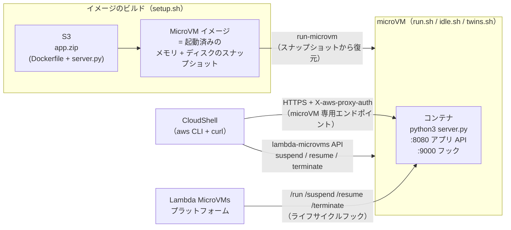

このリポジトリは AWS Deep Cuts の、AWS Lambda MicroVMs に関するハンズオンコンテンツです。

<!-- TODO: 記事公開後にリンクを追加 -->
<!-- AWS Lambda MicroVMs の解説記事(AWS Builder Center)は[こちら]() -->

解説記事の原稿は [article/aws-lambda-microvms.md](./article/aws-lambda-microvms.md) にあります。

> **Note**: このハンズオンは 2026 年 6 月に GA となった **AWS Lambda MicroVMs** を使用します。東京リージョン（`ap-northeast-1`）で実施します（大阪リージョンは 2026 年 10 月時点で未対応です）。microVM は **ARM64（Graviton）のみ** です。
>
> AWS CLI は `aws lambda-microvms` サブコマンドに対応した **v2.35.10 以降** が必要です。CloudShell には最新版が入っています。

> ⚠️ **コストに関する注意**
>
> このハンズオンで作成するリソースの料金は、microVM の稼働（vCPU 秒 + メモリ GiB 秒）、スナップショットの保存（GiB 時間、**最低 1 週間分**）、スナップショットの読み書き（GiB）です。最小クラス（ベースライン 0.25 vCPU / 0.5 GB）の microVM 1 台は、稼働中 **約 $0.04/時間** です（東京の単価 vCPU 秒 $0.0000322421、GB 秒 $0.0000042688 で計算。2026 年 10 月時点）。
>
> スクリプトで起動する microVM はすべて **最長 15〜30 分で自動終了** する設定にしているので、放置しても microVM の課金は止まります。残るのはイメージ（スナップショット）の保存料金だけです。
>
> | 放置期間 | 概算コスト |
> | --- | --- |
> | 1日 | 約 **$0.1**（約 15 円。ハンズオン全体の実行 + スナップショット保存 1 週間分） |
> | 1週間 | 約 **$0.1**（スナップショットの保存は最低 1 週間分が課金されるため、1 日放置と変わりません） |
>
> **検証が終わったら速やかに後片付けを実施してください。**

# AWS Deep Cutsとは
AWS Deep Cutsは、AWS の最新のサービスやニッチな機能、または高度にアカデミックな知識を要求するサービスなど、多くの人が知らない 『隠れた名曲 = **Deep Cuts**』 を深くまで掘り下げる技術シリーズです。

このようなサービスはWeb情報も少なく、初学者は気軽にキャッチアップできないのが実情です。

そこで AWS Deep Cuts シリーズでは、**前提知識も含めた分かりやすいサービス解説** と **手順通りに進めれば誰でも再現できるハンズオン** を提供します！

# ハンズオンのゴール

このハンズオンでは、Python の「状態を持つサンドボックス」を Lambda MicroVMs 上に作り、**microVM を眠らせて起こすと、メモリの中身がそのまま残っている** ことを確かめます。あわせて、以下の観点を確認します。

1. イメージのビルドが「アプリを起動してからメモリとディスクを凍結する」処理であること（スナップショットのサイズが見える）
2. スナップショットからの起動にかかる時間
3. サスペンド → レジュームで、変数・プロセス・フックの履歴が残っていること、およびレジュームにかかる時間
4. 眠っている間、microVM の中の時計がどう進むか
5. アイドルポリシーによる自動サスペンドと、リクエストによる自動レジューム
6. 認証トークンの「ポートのスコープ」と、egress コネクタの有無によるインターネット到達性
7. （発展）同じスナップショットから起動した 2 台の microVM が、同じ乱数を出すかどうか
8. （発展）シェルで中に入り、アプリが「microVM の中のコンテナ」として動いていること

# ハンズオン手順

以降の手順は、ハンズオン用に用意した AWS アカウントで実施してください。

## 前提条件

- AWS CloudShell（東京リージョン）。`aws`、`curl`、`python3`、`zip` を使います
- 実行する IAM プリンシパルに、Lambda MicroVMs・IAM・S3・CloudWatch Logs の操作権限があること（`AdministratorAccess` 相当で実施するのが簡単です）

<details>
<summary>最小権限に近い IAM ポリシー例（実行者用）</summary>

```json
{
  "Version": "2012-10-17",
  "Statement": [
    {
      "Sid": "LambdaMicroVMs",
      "Effect": "Allow",
      "Action": [
        "lambda:ListManagedMicrovmImages",
        "lambda:ListManagedMicrovmImageVersions",
        "lambda:CreateMicrovmImage",
        "lambda:GetMicrovmImage",
        "lambda:GetMicrovmImageVersion",
        "lambda:ListMicrovmImageVersions",
        "lambda:ListMicrovmImageBuilds",
        "lambda:GetMicrovmImageBuild",
        "lambda:DeleteMicrovmImage",
        "lambda:DeleteMicrovmImageVersion",
        "lambda:RunMicrovm",
        "lambda:GetMicrovm",
        "lambda:ListMicrovms",
        "lambda:SuspendMicrovm",
        "lambda:ResumeMicrovm",
        "lambda:TerminateMicrovm",
        "lambda:CreateMicrovmAuthToken",
        "lambda:CreateMicrovmShellAuthToken",
        "lambda:PassNetworkConnector",
        "lambda:TagResource",
        "lambda:ListTags"
      ],
      "Resource": "*"
    },
    {
      "Sid": "BuildRole",
      "Effect": "Allow",
      "Action": ["iam:CreateRole", "iam:GetRole", "iam:PutRolePolicy", "iam:DeleteRolePolicy", "iam:DeleteRole", "iam:TagRole", "iam:PassRole"],
      "Resource": ["arn:aws:iam::*:role/aws-deepcuts-microvm-build-role", "arn:aws:iam::*:role/aws-deepcuts-microvm-exec-role"]
    },
    {
      "Sid": "ArtifactBucket",
      "Effect": "Allow",
      "Action": ["s3:CreateBucket", "s3:PutPublicAccessBlock", "s3:PutObject", "s3:GetObject", "s3:ListBucket", "s3:DeleteObject", "s3:DeleteBucket"],
      "Resource": ["arn:aws:s3:::aws-deepcuts-microvms-*", "arn:aws:s3:::aws-deepcuts-microvms-*/*"]
    },
    {
      "Sid": "Logs",
      "Effect": "Allow",
      "Action": ["logs:CreateLogGroup", "logs:DescribeLogGroups", "logs:PutRetentionPolicy", "logs:TagResource", "logs:DeleteLogGroup", "logs:FilterLogEvents", "logs:GetLogEvents", "logs:DescribeLogStreams"],
      "Resource": "*"
    },
    {
      "Sid": "Identity",
      "Effect": "Allow",
      "Action": "sts:GetCallerIdentity",
      "Resource": "*"
    }
  ]
}
```

`lambda:TagResource` を忘れると `create-microvm-image --tags` が、`lambda:PassNetworkConnector` を忘れると `run-microvm` が、それぞれメッセージ無しの `AccessDeniedException` になります（原因は CloudTrail に出ます）。
</details>

## 構築するアーキテクチャ



- `hands-on/app/server.py` は、Python 標準ライブラリだけで書いた 2 ポートの HTTP サーバーです。8080 番で「Python コードを実行して変数を保持する」API、9000 番で Lambda MicroVMs からのライフサイクルフックを受けます。
- `hands-on/app/Dockerfile` は `public.ecr.aws/lambda/microvms:al2023-minimal` に `python3` を入れるだけです。
- ライフサイクルフックは、プラットフォームが `http://<microVM 内>:9000/aws/lambda-microvms/runtime/v1/<フック名>` に HTTP で呼びに来ます（`ready` / `validate` はビルド時、`run` / `suspend` / `resume` / `terminate` は実行時）。`server.py` は届いたフックをすべて記録して 200 を返します。

以降、各種コマンドは[CloudShell](https://docs.aws.amazon.com/cloudshell/latest/userguide/welcome.html)（東京リージョン）で実行してください。

## １．事前準備（イメージのビルド）

```bash
# このリポジトリをクローン
git clone https://github.com/AWS-Deep-Cuts/aws-lambda-microvms
cd aws-lambda-microvms/hands-on

# セットアップスクリプトの実行（イメージのビルドに数分かかります）
bash ./setup.sh

# 以下の文言が表示されればセットアップ成功です
# ✅ セットアップが完了しました！
```

setup.sh は以下を行います。

1. AWS CLI が `lambda-microvms` に対応しているか、認証情報が有効かを確認
2. Lambda 管理のベースイメージ（`al2023-1`）を `list-managed-microvm-images` で発見
3. S3 バケットを作り、`Dockerfile` と `server.py` を zip にしてアップロード
4. ビルド用 IAM ロール（Lambda サービスがビルド時に引き受け、S3 の成果物を読み、ビルドログを書く）と、実行用 IAM ロール（microVM が実行時に引き受け、アプリのログを CloudWatch Logs に書く）を作成
5. CloudWatch Logs ロググループ `/aws/lambda-microvms/aws-deepcuts` を作成（保持 7 日）
6. `create-microvm-image` でイメージを作成し、`CREATED` になるまで待機
7. リソース ID を `resource-ids.env` に保存

> **この手順で確かめること**
> - **やること**: ビルド完了後に表示される「このバージョンのビルド（スナップショット）」の表を見ます。
> - **期待する結果**: `memorySnapshotBytes`（メモリスナップショット）、`diskSnapshotBytes`、`codeInstallBytes` に値が入っています。ビルドは対象チップセット世代（Graviton の世代）ごとに作られるため、表が複数出ます。
> - **ここから分かること**: イメージのビルドは「Dockerfile を実行してコンテナを作る」だけではなく、**アプリを起動し、`/ready` フックが 200 を返したところでメモリとディスクを凍結する** 処理です。`run-microvm` は、この凍結した状態を復元します。

ビルドの進み具合やエラーは CloudWatch Logs のロググループ `/aws/lambda-microvms/aws-deepcuts` で確認できます（ロググループを指定しない場合の既定は `/aws/lambda-microvms/<イメージ名>` です）。

## ２．サスペンド／レジューム

```bash
bash ./run.sh

# 以下の文言が表示されれば成功です
# ✅ サスペンド／レジュームの確認が完了しました！
```

run.sh は、microVM を 1 台起動し（最長 15 分で自動終了する設定）、変数を定義してからサスペンド → レジュームし、最後に終了します。計測結果は `output/results.md` に追記されます。

---

#### 観点 1: スナップショットからの起動

> **この観点で確かめること**
> - **やること**: `run-microvm` を呼んでから、エンドポイントの `/ping` が 200 を返すまでの時間を計測します。
> - **期待する結果**: 数秒以内に応答します。`〔実測値: 未測定〕`
> - **ここから分かること**: アプリの初期化（Python の起動やモジュールの読み込み）はビルド時に済んでいて、起動時には繰り返されません。`server.py` の `boot_id` はプロセス起動時に生成される値ですが、これもビルド時の値がそのまま使われます。

---

#### 観点 2: ライフサイクルフックとペイロード

> **この観点で確かめること**
> - **やること**: `/state` に表示される「フック履歴」を見ます。run.sh は `--run-hook-payload` に JSON を渡して起動しています。
> - **期待する結果**: 起動直後に `run` フックが呼ばれていて、その body に渡したペイロードが入っています。
> - **ここから分かること**: フックは、プラットフォームが **microVM の中のアプリに HTTP で通知してくる** 仕組みです。`run` フックが 200 を返すまで外部からのトラフィックは転送されないので、「共有イメージには入れたくない、起動ごとの秘密情報（セッション ID やトークン）」を安全に渡す経路として使えます。

---

#### 観点 3: 認証トークンのポートスコープと、egress

> **この観点で確かめること**
> - **やること**: 8080 番だけを許可した認証トークンで、フック用の 9000 番にアクセスします。続けて、egress コネクタを付けずに起動した microVM の中から `https://checkip.amazonaws.com` に接続します。
> - **期待する結果**: 9000 番へのアクセスは HTTP 403 で止まります。インターネットには **既定で出られます**（公式ドキュメントの記述どおりか、結果を記録してください）。`〔実測値: 未測定〕`
> - **ここから分かること**: エンドポイントへのアクセスは、`X-aws-proxy-auth` ヘッダーのトークン（microVM・ポート・有効期限が埋め込まれた暗号化トークン）でプロキシが認可し、`X-aws-proxy-port` で転送先ポートを選びます（ヘッダーが無ければ既定の 8080 番）。トークンに無いポートはアプリに届く前に止まります。一方、egress は既定でパブリックなインターネットに出られるので、**「信用できないコードを動かす」なら、VPC の egress コネクタで出口を絞る設計が要ります**。

---

#### 観点 4: サスペンドしても状態が残る

> **この観点で確かめること**
> - **やること**: `/exec` で `secret = 42` を定義してから `suspend-microvm` を呼び、`SUSPENDED` を確認して 10 秒待ち、`resume-microvm` で起こします。
> - **期待する結果**: レジューム後の `/state` に `secret = 42` が残っていて、`boot_id` も変わりません。フック履歴に `suspend` と `resume` が追加されています。レジュームにかかる時間 `〔実測値: 未測定〕`
> - **ここから分かること**: サスペンドは「プロセスを止めて後で作り直す」のではなく、**メモリとディスクをそのまま凍結して、後で同じところから続ける** 操作です。サスペンド中はコンピュート料金が止まり、スナップショットの保存料金だけがかかります。

---

#### 観点 5: 眠っている間の時計

> **この観点で確かめること**
> - **やること**: サスペンド前後で、microVM の中の `time.time()`（壁時計）と `time.monotonic()`（単調時計）の差を比べます。
> - **期待する結果**: 結果を記録してください。`〔実測値: 未測定〕`
> - **ここから分かること**: 凍結したメモリを復元すると、ゲスト OS の時計は「眠る前」のままです。それをどう補正するかはプラットフォームの設計で決まります。壁時計だけが進んでいれば「単調時計は眠っていた」、両方進んでいれば「眠っていた時間も含めて進めた」ことになり、タイムアウトやトークンの有効期限を扱うアプリの設計に直接関わります。

---

## ３．アイドルポリシー（自動サスペンド／自動レジューム）

```bash
bash ./idle.sh

# 以下の文言が表示されれば成功です
# ✅ アイドルポリシーの確認が完了しました！
```

> **この観点で確かめること**
> - **やること**: `maxIdleDurationSeconds=60`、`autoResumeEnabled=true` で起動し、何もせずに状態を 10 秒ごとに表示します。`SUSPENDED` になったら、エンドポイントにリクエストを送ります。
> - **期待する結果**: 最後のリクエストから 60 秒ほどで `SUSPENDED` になり、リクエストを送ると自動で起きて変数も残っています。自動レジュームにかかる時間 `〔実測値: 未測定〕`
> - **ここから分かること**: 「アイドル」の判定は **エンドポイントへのトラフィック** で行われます（`get-microvm` での状態確認はエンドポイントを通らないので、アイドルのままです）。`suspendedDurationSeconds` を過ぎると自動終了するので、「使われなくなったサンドボックスが勝手に片付く」設計ができます。

## ４．（発展）双子の microVM と乱数

```bash
bash ./twins.sh
```

> **この観点で確かめること**
> - **やること**: 同じイメージから microVM を 2 台起動し、それぞれの `/random` を 1 回ずつ取得します。`/random` は Python の `random.random()`（プロセス起動時に seed される擬似乱数）、`os.urandom()`（カーネルの乱数）、`uuid4()` を返します。
> - **期待する結果**: 結果を記録してください。`〔実測値: 未測定〕`
> - **ここから分かること**: 2 台は **同じメモリスナップショットから復元** されています。プロセス起動時に seed された擬似乱数の状態も複製されるので、同じ値が出ても不思議ではありません。これは Lambda SnapStart でも知られる「スナップショットの一意性」の問題で、乱数・セッション ID・暗号鍵の生成はスナップショットの後（`run` フック以降）に行う必要があります。

## ５．（発展）シェルで中に入る

```bash
bash ./shell.sh
```

shell.sh は `SHELL_INGRESS` コネクタ付きで microVM を起動し（最長 30 分で自動終了）、接続方法を表示します。マネジメントコンソールの「Connect」から接続するのが簡単です。

> **この観点で確かめること**
> - **やること**: シェルに入って `ps -ef`、`cat /etc/os-release`、`uname -r`、`cat /proc/sys/kernel/random/boot_id` を実行します。
> - **期待する結果**: `python3 /app/server.py` が見え、OS は Amazon Linux 2023 です。
> - **ここから分かること**: シェルは **アプリと同じコンテナの中** に入ります（同じプロセスツリー、同じファイルシステム）。Firecracker の microVM の中で containerd がコンテナを動かし、その中で `server.py` が動く、という 3 層構造です。

## ６．後片付け

検証が終わったら、無駄な課金を防ぐためにリソースを削除しましょう。

CloudShellで以下のコマンドを実行することで、今回作成したリソースを綺麗に削除することができます！

```bash
cd aws-lambda-microvms/hands-on
bash ./cleanup.sh

# 以下の文言が表示されればクリーンアップ成功です
# ✅ すべてのリソースの削除が完了しました！

cd ../..
sudo rm -rf aws-lambda-microvms
```

cleanup.sh は、イメージから起動した microVM をすべて終了 → イメージを削除 → ロググループ → ビルド用ロール → S3 バケットの順に削除します。

## トラブルシューティング

| 表示されるエラー | 主な原因 | 対処 |
| -- | -- | -- |
| `aws: error: argument command: Invalid choice` / `lambda-microvms コマンドに対応していません` | AWS CLI が古い | AWS CLI v2 を最新版に更新する。CloudShell なら新しいセッションを開く |
| `AccessDeniedException`（メッセージ無し） | Lambda MicroVMs 未提供のリージョン、または `lambda:TagResource` などの権限不足 | リージョンを `ap-northeast-1` にする。CloudTrail で拒否されたアクションを確認する |
| イメージが `CREATE_FAILED` | Dockerfile の失敗（`CONTAINER_BUILD_FAILED`。`dnf install` の失敗など）、zip のルートに Dockerfile が無い（`ARCHIVE_DOCKERFILE_NOT_FOUND`）、`/ready` フックが 200 を返さない、`--hooks` の `port` とアプリの待ち受けポートの不一致 | CloudWatch Logs の `/aws/lambda-microvms/aws-deepcuts` と、`list-microvm-image-builds` の `stateReason` を見る |
| `A MicroVM image with the name ... already exists` | 前回のイメージが残っている | `cleanup.sh` を実行してから `setup.sh` をやり直す |
| エンドポイントが `403 Access to port denied` | トークンの `allowedPorts` に無いポートへアクセスした | トークン発行時のポートと `X-aws-proxy-port` を合わせる |
| エンドポイントが `502` | 指定ポートで待ち受けているプロセスが無い | `X-aws-proxy-port` を 8080 にする。シェルで `ps -ef` を確認する |
| `ValidationException` （shell token） | `SHELL_INGRESS` 無しで起動した microVM にシェルトークンを発行した | `shell.sh` で起動した microVM を使う |
| `InsufficientCapacityException` | 一時的な容量不足 | 少し待って再実行する |
| `ServiceQuotaExceededException`（HTTP 402） | 同時 microVM 数などのクォータ超過 | 不要な microVM を終了する。Service Quotas で上限を確認する |

## 参考リンク

- [AWS Lambda MicroVMs（開発者ガイド）](https://docs.aws.amazon.com/lambda/latest/dg/lambda-microvms-guide.html)
- [Create your first Lambda MicroVM](https://docs.aws.amazon.com/lambda/latest/dg/microvms-getting-started.html)
- [MicroVM images](https://docs.aws.amazon.com/lambda/latest/dg/microvms-images.html) / [Running and using MicroVMs](https://docs.aws.amazon.com/lambda/latest/dg/microvms-launching.html) / [Networking](https://docs.aws.amazon.com/lambda/latest/dg/microvms-networking.html) / [Security and permissions](https://docs.aws.amazon.com/lambda/latest/dg/microvms-security.html) / [Troubleshooting](https://docs.aws.amazon.com/lambda/latest/dg/microvms-troubleshooting.html)
- [Lambda MicroVMs API Reference](https://docs.aws.amazon.com/lambda/latest/microvm-api/Welcome.html)
- [AWS CLI `lambda-microvms` リファレンス](https://docs.aws.amazon.com/cli/latest/reference/lambda-microvms/)
- [Run isolated sandboxes with full lifecycle control: AWS Lambda introduces MicroVMs（AWS News Blog）](https://aws.amazon.com/blogs/aws/run-isolated-sandboxes-with-full-lifecycle-control-aws-lambda-introduces-microvms/)
- [awslabs/agent-plugins — aws-lambda-microvms skill](https://github.com/awslabs/agent-plugins/blob/main/plugins/aws-serverless/skills/aws-lambda-microvms/SKILL.md)
