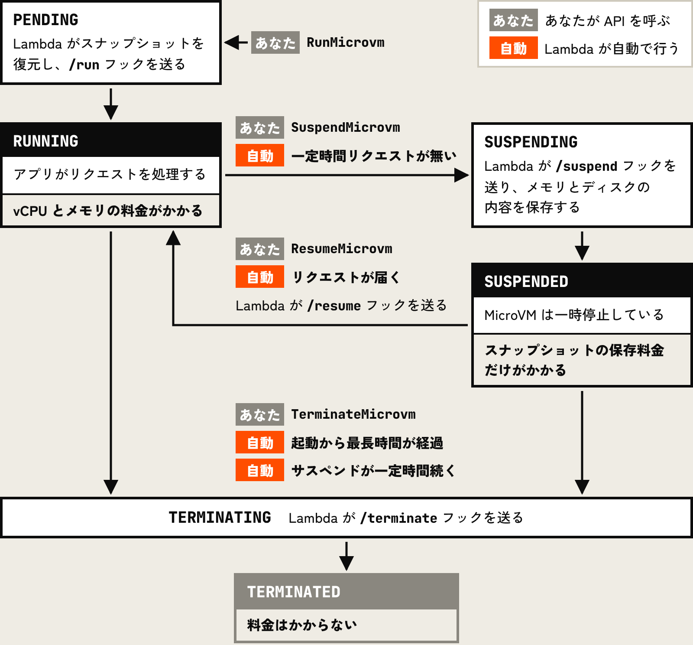
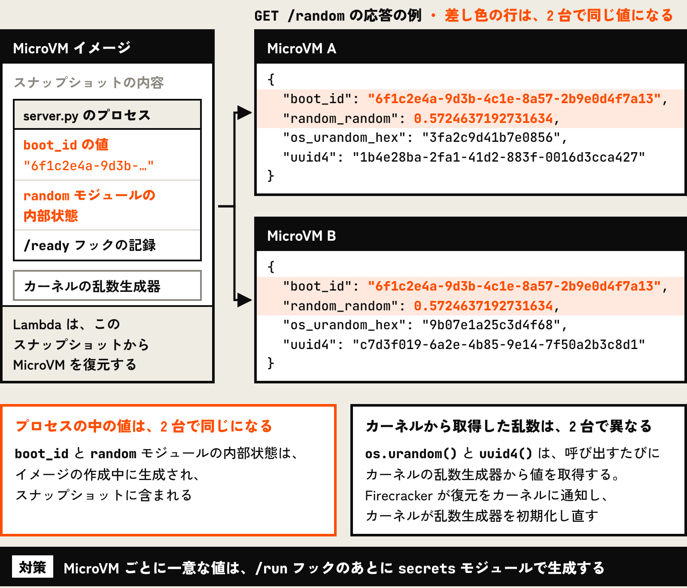
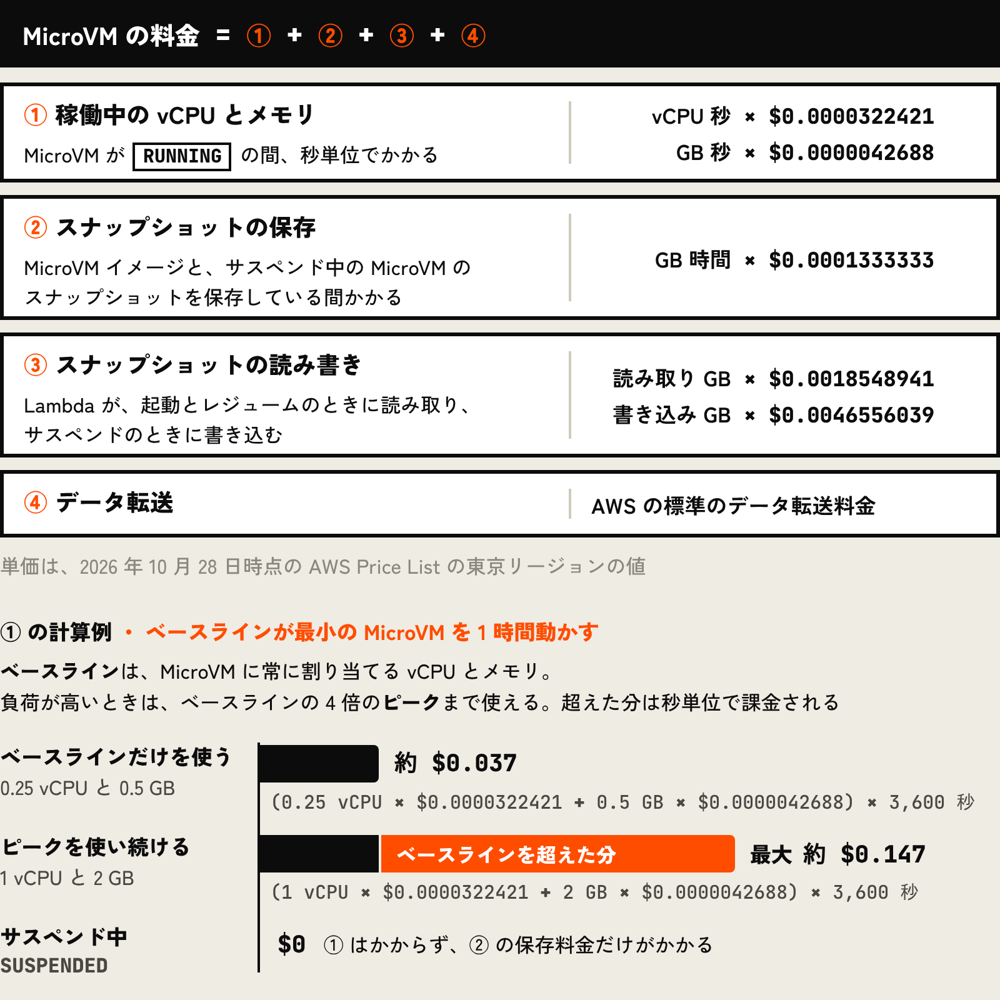
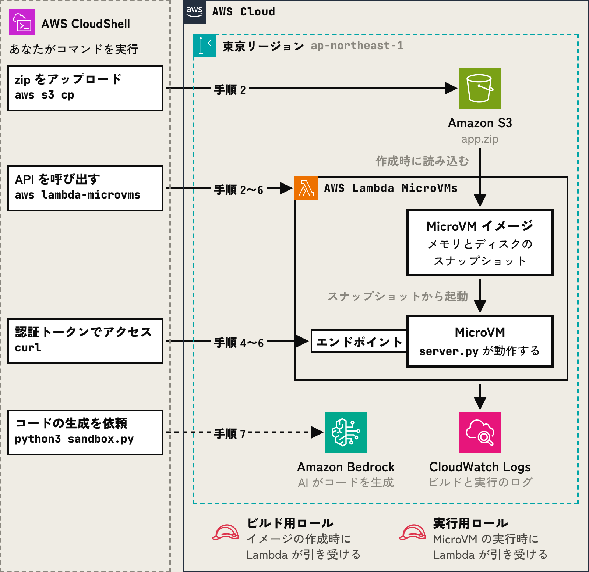

:::note info
AWS Deep Cuts の GitHub はこちらです。
https://github.com/AWS-Deep-Cuts/AWS-Deep-Cuts
:::

# AWS Deep Cutsとは？
AWS Deep Cutsは、AWS の最新のサービスやニッチな機能、または高度にアカデミックな知識を要求するサービスなど、多くの人が知らない 『隠れた名曲 = **Deep Cuts**』 を深くまで掘り下げる技術シリーズです。

このようなサービスはWeb情報も少なく、初学者は気軽にキャッチアップできないのが実情です。

そこで AWS Deep Cuts シリーズでは、**前提知識も含めた分かりやすいサービス解説** と **手順通りに進めれば誰でも再現できるハンズオン** を提供します！

# そもそもAIが生成したコードはどこで実行すればよいのか？
生成 AI は、文章だけでなく、プログラムのコードも生成できます。最近の AI エージェントは、利用者の依頼を受けてコードを生成し、そのコードを実行して結果を返すところまでを自動で行います。たとえば利用者が「この CSV ファイルを集計して、グラフにして」と依頼すると、AI エージェントは集計用の Python のコードを生成して実行し、作成したグラフを返します。

ここで問題になるのが、生成されたコードを実行する場所です。生成されたコードには、誤りや、ファイルの削除や外部へのデータの送信のような意図しない危険な操作が含まれることがあります。そのため、生成されたコードは、利用者の PC や、AI のサービスを動かしているサーバー、他の利用者の環境から切り離して実行する必要があります。このように、信頼できないコードを安全に実行するために隔離した実行環境を、**サンドボックス**と呼びます。

筆者は、AI エージェントのサンドボックスには、次の 4 つの条件が必要だと考えます。

| 条件 | 必要な理由 |
| --- | --- |
| 他から隔離されている | 生成されたコードが、他の利用者や、AI のサービスを動かしているサーバーに影響を与えないようにする |
| 状態を保持できる | 会話の途中で作成した変数やファイルを、次の依頼でも使えるようにする |
| すぐに起動する | 利用者が新しい会話を始めるたびに、利用者を待たせないようにする |
| 待機中の費用が小さい | 利用者が考えている間のように、使われていない時間の費用を抑える |

主な実行環境を、この 4 つの条件で比べると、次のようになります。○ は条件を満たす、△ は工夫すれば満たせる、× は満たさないことを表します。評価は筆者によるものです。

| 実行環境 | 他から隔離されている | 状態を保持できる | すぐに起動する | 待機中の費用が小さい |
| --- | :---: | :---: | :---: | :---: |
| 利用者の PC | × | ○ | ○ | ○ |
| Lambda 関数 | △ | × | ○ | ○ |
| コンテナ | △ | ○ | ○ | × |
| EC2 インスタンス | ○ | ○ | × | △ |
| **Lambda MicroVMs** | ○ | ○ | ○ | ○ |

- **利用者の PC** では、生成されたコードが、利用者のファイルや認証情報に直接アクセスできてしまいます。
- **Lambda 関数** は、1 回の実行が最長 15 分です。また、次の呼び出しで同じ実行環境が使われる保証が無いため、会話をまたいで状態を保持できません。一方で、1 つの実行環境が、同じ関数への別の利用者の呼び出しに再利用されることもあります。そのため、利用者ごとに環境を分けるには、別に作り込みが必要です。
- **コンテナ** は、1 台のサーバーで複数の利用者のコンテナを動かす構成では、コンテナどうしが OS のカーネルを共有します。カーネルの脆弱性を突かれると、他のコンテナにも影響が及ぶおそれがあります。また、コンテナは、起動している限り、利用者が考えている間も料金がかかります。
- **EC2 インスタンス** は VM であるため、隔離は十分です。停止や休止をすれば、待機中の料金も抑えられます。しかし、起動や再開を待つ時間が長く、会話ごとに 1 台を用意する用途には向きません。

2026 年 6 月に一般提供が始まった **AWS Lambda MicroVMs** は、この 4 つの条件を満たす実行環境です。

:::note info
**microVM とは**
画面の表示や USB 機器の接続のように、サーバーとして動かすのに不要な機能を省いて軽くした VM のことです。VM であるため、他の VM と OS のカーネルを共有しません。AWS は、microVM を動かすソフトウェアである Firecracker を、2018 年にオープンソースとして公開しました。Lambda 関数の実行環境も、Firecracker の microVM で動いています。
:::

# AWS Lambda MicroVMsとは？
AWS Lambda MicroVMs は、Firecracker の microVM を、開発者が API で起動・一時停止・再開・終了できるサービスです。Lambda MicroVMs が起動する 1 台の microVM を、**MicroVM** と呼びます。また、MicroVM の一時停止を**サスペンド**、再開を**レジューム**と呼びます。

この記事では、Lambda MicroVMs を使って AI のサービスを開発する人を**開発者**、そのサービスを使う人を**利用者**と呼びます。また、AI との 1 つの会話のような、1 人の利用者との一連のやり取りを**セッション**と呼びます。

全体像は次の図のとおりです。開発者は、アプリを含む **MicroVM イメージ** を 1 つ作成し、そこからセッションごとに MicroVM を起動します。MicroVM には、1 台ごとに HTTPS でアクセスするための URL が割り当てられます。この URL を**エンドポイント**と呼びます。利用者や AI エージェントは、エンドポイントを通じて、MicroVM の中のアプリにアクセスします。図の「あなたのアプリ」は、開発者が作成し、Lambda MicroVMs の API を呼び出すアプリです。


AWS Lambda MicroVMs には、以下のような特徴があります。

- **セッションごとに専用の VM を起動できる**
  開発者が `RunMicrovm` API を呼び出すと、MicroVM が 1 台起動します。Lambda 関数のようにリクエストごとに実行環境が割り当てられるのではなく、1 つのセッションが 1 台の MicroVM を専有します。1 台の MicroVM は、起動してから最長 8 時間で終了します。この 8 時間には、サスペンドしている時間も含まれます。8 時間より短い上限は、`RunMicrovm` の `maximumDurationInSeconds` に秒数で指定できます。この記事では、この上限を**最長時間**と呼びます。
- **起動が速い**
  MicroVM イメージには、アプリを起動した状態のメモリとディスクの内容が保存されています。このように、ある時点のメモリとディスクの内容を保存したデータを、**スナップショット**と呼びます。MicroVM を起動するときは、スナップショットを復元するだけであるため、アプリの初期化を待つ必要がありません。AWS が公開している Lambda MicroVMs の Agent Skill によると、MicroVM は通常 1〜10 秒で接続できる状態になります。Agent Skill は、AI エージェントに AWS のサービスの使い方を教えるための手引きです。
- **状態を保ったままサスペンドできる**
  サスペンドすると、メモリとディスクの内容が保存され、MicroVM は一時停止します。レジュームすると、変数や動いていたプロセスがそのまま残った状態で再開します。一定時間リクエストが無いときに自動でサスペンドし、リクエストが届くと自動でレジュームする設定もあります。この設定を**アイドルポリシー**と呼びます。
- **一般的なサーバーのプログラムを動かせる**
  MicroVM の中では、ポートで HTTP や WebSocket のリクエストを待ち受ける、一般的なサーバーのプログラムが動きます。Lambda 関数のように、処理をハンドラー関数の形に書き換える必要はありません。
- **料金は稼働時間とスナップショットとデータ転送で決まる**
  MicroVM が動いている間の vCPU とメモリの料金と、スナップショットを保存・読み書きする料金、データ転送の料金がかかります。サスペンド中は、vCPU とメモリの料金がかかりません。
- **東京リージョンで使える**
  一般提供が始まった 2026 年 6 月から、東京リージョンで使えます。2026 年 10 月時点で、14 のリージョンで提供されています。大阪リージョンは含まれていません。
- **CPU のアーキテクチャは ARM64**
  MicroVM は、ARM64 の CPU である AWS Graviton で動きます。Python や Node.js のアプリは、そのまま動きます。ただし、x86_64 向けにビルドしたプログラムや、ARM64 版が無いライブラリは動きません。

# 仕組み
この章では、前の章の全体像の図に沿って、MicroVM イメージを作成してから MicroVM を終了するまでの順に、仕組みを説明します。なお、この章では、Lambda MicroVMs のサービスが自動で行う処理を「Lambda が〜する」と書きます。Lambda 関数のことではありません。図では、この処理を「AWS が自動で行う処理」の枠で示しています。

| 節 | 開発者が呼び出す API | 説明すること |
| --- | --- | --- |
| MicroVM イメージの作成 | `CreateMicrovmImage` | スナップショットが保存されるまでの処理 |
| ライフサイクルフック | なし | Lambda がアプリに送る HTTP のリクエスト |
| MicroVM の起動とアクセス | `RunMicrovm`・`CreateMicrovmAuthToken` | エンドポイントと認証トークン |
| サスペンドとレジューム | `SuspendMicrovm`・`ResumeMicrovm` | MicroVM の状態と、アイドルポリシー |
| 同じイメージから起動した MicroVM の注意点 | `RunMicrovm` | スナップショットから復元されたプロセスの値 |
| 料金 | なし | 料金の要素と計算の例 |

## MicroVM イメージの作成
MicroVM イメージを作成するには、Dockerfile とアプリのファイルを 1 つの zip にまとめます。Dockerfile は、インストールするソフトウェア・コピーするファイル・起動するコマンドを順に書いて、アプリの実行環境の作り方を定義するファイルです。ハンズオンで使う Dockerfile は、次のとおりです。

```dockerfile
FROM public.ecr.aws/lambda/microvms:al2023-minimal
RUN dnf install -y python3 && dnf clean all
COPY server.py /app/server.py
EXPOSE 8080 9000
CMD ["python3", "/app/server.py"]
```

FROM の行では、AWS が Lambda MicroVMs 用に公開しているコンテナイメージを指定しています。アプリはこのコンテナの中で動き、コンテナは MicroVM の OS の上で動きます。続く行では、Python をインストールし、アプリの `server.py` をコピーし、CMD で `server.py` を起動します。EXPOSE の 8080 はアプリがリクエストを受け付けるポート、9000 は後の節で説明するライフサイクルフックを受け付けるポートです。

開発者は、この zip を S3 にアップロードし、`CreateMicrovmImage` API を呼び出します。このとき、次の 4 つを指定します。

| 指定するもの | 内容 |
| --- | --- |
| ベースイメージ | MicroVM の OS。Lambda が管理する Amazon Linux 2023 のイメージから選ぶ |
| ビルド用ロール | イメージの作成中に Lambda が引き受ける IAM ロール。Lambda はこのロールの権限で、S3 から zip を読み込み、ログを書き込む |
| zip の場所 | S3 にアップロードした zip |
| フックの設定 | ライフサイクルフックを受け付けるポートと、使うフックの種類 |

IAM ロールを引き受けるとは、Lambda のような AWS のサービスが、そのロールに付いた権限を一時的に使って AWS を操作することです。

`CreateMicrovmImage` を呼び出すと、Lambda は次の順に処理します。番号は、下の図の番号と対応しています。

3. ベースイメージから、イメージの作成用の MicroVM を起動する
4. zip の中の Dockerfile を実行する
5. Dockerfile の CMD に書いたコマンドで、アプリを起動する
6. アプリに ready フックという HTTP のリクエストを送り、アプリが 200 を返すのを待つ
7. そのときのメモリとディスクの内容を、スナップショットとして保存する

3〜7 の処理の間、イメージの状態は `CREATING` です。処理が終わると、状態は `CREATED` になり、このイメージから MicroVM を起動できるようになります。


このうち重要なのは、6 と 7 の処理です。Lambda は、アプリが ready フックに 200 を返したときのメモリとディスクの内容を保存します。つまり、MicroVM イメージには、ファイルだけでなく、起動して初期化が終わったアプリのプロセスも含まれています。

MicroVM イメージは、作成や更新のたびに新しい**バージョン**が作られます。Lambda は、バージョンごとに、スナップショットを作成する処理の記録を残します。この記録を**ビルド**と呼びます。API の仕様では、ビルドは CPU の種類と世代ごとに記録されます。そのため、1 つのバージョンに、複数のビルドとスナップショットがあることもあります。

## ライフサイクルフック
Lambda は、MicroVM の状態が変わるときに、アプリへ HTTP のリクエストを送ります。このリクエストを**ライフサイクルフック**と呼びます。この記事では、ライフサイクルフックを短く「フック」とも書きます。

開発者は、`CreateMicrovmImage` を呼び出すときに、フックを受け付けるポートと、使うフックを指定します。Lambda は、使うと指定したフックだけを送ります。フックは、イメージを作成する前に指定しておく必要があります。Lambda は、たとえば ready フックを、`/aws/lambda-microvms/runtime/v1/ready` というパスへの POST リクエストとして送ります。アプリは、処理をしてから 200 を返します。

| フック | Lambda がリクエストを送るタイミング | アプリで行う処理の例 |
| --- | --- | --- |
| ready | イメージの作成中、アプリの起動後 | 初期化が終わったら 200 を返す。200 を受けて、Lambda がスナップショットを保存する |
| run | MicroVM の起動直後 | 利用者の ID や、秘密情報の保存場所の名前のような、MicroVM ごとの値を受け取る |
| suspend | サスペンドの直前 | 外部との接続を閉じる |
| resume | レジュームの直後 | 外部との接続を張り直す |
| terminate | 終了の直前 | 後始末をする |

run フックのリクエストの本文は JSON で、MicroVM の ID と、`RunMicrovm` の `runHookPayload` パラメータで指定した文字列が入っています。`runHookPayload` は 4,096 バイトまでです。アプリが run フックに 200 を返すまで、エンドポイントへのリクエストはアプリに届きません。

## MicroVM の起動とアクセス
開発者が `RunMicrovm` API を呼び出すと、Lambda はスナップショットを復元して MicroVM を起動します。Python の起動やライブラリの読み込みは、イメージの作成時に終わっています。そのため、MicroVM は、アプリの初期化を待たずに起動します。

`RunMicrovm` では、**実行用ロール**を指定できます。実行用ロールは、MicroVM の実行中に Lambda が引き受ける IAM ロールです。Lambda はこのロールの権限で、アプリのログを CloudWatch Logs に書き込みます。MicroVM の中のアプリも、このロールの権限で AWS のサービスを呼び出せます。

起動した MicroVM には、`https://<MicroVM の ID>.lambda-microvm.<リージョン>.on.aws` という形のエンドポイントが割り当てられます。エンドポイントへのリクエストには、**認証トークン**が必要です。認証トークンは、AWS の認証情報を持つ開発者のアプリが `CreateMicrovmAuthToken` API を呼び出して発行し、MicroVM へのリクエストに付けます。認証トークンには、アクセスを許可する MicroVM とポート、そして有効期限が含まれています。有効期限は最長 60 分です。


エンドポイントに届いたリクエストは、既定では MicroVM の中のポート 8080 に転送されます。他のポートに送るときは、`X-aws-proxy-port` ヘッダーでポートを指定します。認証トークンで許可していないポートへのリクエストは、HTTP 403 で拒否されます。

## サスペンドとレジューム
MicroVM の状態と、状態を変える操作は、次の図のとおりです。



| 状態 | 意味 | かかる料金 |
| --- | --- | --- |
| `PENDING` | 起動の処理中 | |
| `RUNNING` | 動作中で、リクエストを受け付ける | vCPU とメモリ |
| `SUSPENDING`・`SUSPENDED` | サスペンドの処理中・サスペンド中 | スナップショットの保存 |
| `TERMINATING`・`TERMINATED` | 終了の処理中・終了済み | かからない |

サスペンドすると、Lambda はメモリとディスクの内容を保存して、MicroVM を一時停止します。レジュームすると、保存した状態から再開します。変数の値、動いていたプロセス、ファイルはすべて残ります。ただし、MicroVM から外部へのネットワーク接続は、レジュームのときに切断されます。アプリは、resume フックを受け取ったときに、外部に接続し直します。

サスペンドとレジュームは、API で明示的に行うほかに、アイドルポリシーで自動化できます。アイドルポリシーは `RunMicrovm` で指定する設定で、次の 3 つの値を持ちます。アイドルポリシーを指定しない場合、MicroVM は自動でサスペンドしません。

| 設定 | 意味 |
| --- | --- |
| `maxIdleDurationSeconds` | この秒数のあいだエンドポイントにリクエストが届かないと、自動でサスペンドする |
| `autoResumeEnabled` | サスペンド中にリクエストが届いたら、自動でレジュームする |
| `suspendedDurationSeconds` | サスペンドがこの秒数続いたら、自動で終了する |

MicroVM が使われているかどうかは、エンドポイントに届くリクエストだけで判定されます。MicroVM の中のプログラムが CPU を使い続けていても、外からリクエストが届かなければ、MicroVM は自動でサスペンドされます。

MicroVM は、開発者が `TerminateMicrovm` API を呼び出したとき、または起動から最長時間がたったときに終了します。

## 同じイメージから起動した MicroVM の注意点
MicroVM は、イメージの作成時に保存したスナップショットから復元されます。そのため、イメージの作成中にアプリのプロセスの中で作成した値は、同じスナップショットから復元されたすべての MicroVM で同じ値になります。



たとえば、Python の `random` モジュールの内部状態は、プロセスの起動時に決まります。イメージの作成中に起動したプロセスの内部状態がそのまま複製されるため、同じスナップショットから復元された 2 台の MicroVM で `random.random()` を呼ぶと、同じ値が返ります。

一方、`os.urandom()` は、Linux カーネルの乱数生成器から値を取ります。Firecracker のドキュメントによると、Firecracker は、スナップショットから microVM を再開するたびに、VMGenID という識別子を新しい値に書き換えて、microVM の中の Linux カーネルに知らせます。この通知に対応したカーネルは、乱数生成器に新しい種を混ぜ直します。ARM64 の環境でこの通知に対応しているのは、Linux 6.10 以降のカーネルです。第三者の報告によると、MicroVM のカーネルの版は 6.18 です。そのため、`os.urandom()` の値は MicroVM ごとに異なると考えられます。この違いは、ハンズオンの手順 6 で確かめられます。

なお、前の節で説明したとおり、1 つのバージョンに複数のビルドがある場合は、ビルドごとにアプリが別々に起動しています。この場合、別のビルドから復元された MicroVM どうしでは、プロセスの中の値も異なります。

公式のベストプラクティスでは、セッション ID や秘密情報のように MicroVM ごとに異なるべき値を、MicroVM の起動後に作成するよう案内しています。run フックで受け取るか、起動後に暗号論的に安全な乱数生成器で作成します。Python では `secrets` モジュールを使います。

## 料金
MicroVM の料金は、次の 4 つの要素で決まります。単価は、2026 年 10 月 28 日時点の AWS Price List の、東京リージョンの値です。

| 料金の要素 | かかるとき | 東京リージョンの単価 |
| --- | --- | --- |
| ① 稼働中の vCPU とメモリ | 状態が `RUNNING` の間、秒単位でかかる | vCPU 秒あたり $0.0000322421、GB 秒あたり $0.0000042688 |
| ② スナップショットの保存 | イメージを削除するまでと、MicroVM がサスペンドしている間 | GB 時間あたり $0.0001333333 |
| ③ スナップショットの読み書き | 読み取りは MicroVM の起動とレジュームのとき、書き込みはサスペンドのとき | 読み取り GB あたり $0.0018548941、書き込み GB あたり $0.0046556039 |
| ④ データ転送 | MicroVM と外部が通信するとき | AWS の標準のデータ転送料金 |



MicroVM の大きさは、イメージの作成時にメモリの量で指定します。vCPU の数は、メモリ 2 GB あたり 1 vCPU の割合で決まります。この、常に割り当てられる vCPU とメモリの量を、**ベースライン**と呼びます。最も小さいベースラインは、0.25 vCPU と 0.5 GB のメモリです。この MicroVM を 1 時間動かすと、東京リージョンでの vCPU とメモリの料金は約 $0.037 です。

MicroVM は、負荷に応じて、ベースラインの 4 倍まで vCPU とメモリを使えます。ベースラインを超えた分には、実際に使った量に応じて、秒単位で追加の料金がかかります。最も小さいベースラインの MicroVM が、1 時間ずっと 4 倍の量を使い続けた場合が上限で、vCPU とメモリの料金は約 $0.147 です。

サスペンド中は、vCPU とメモリの料金がかかりません。かかるのは、スナップショットの保存料金だけです。また、Agent Skill によると、MicroVM イメージのスナップショットにも、イメージを削除するまで保存料金がかかります。MicroVM を 1 台も起動していない間も同じです。

# AWS Lambda MicroVMsの主な活用事例
- **AI エージェントのコード実行環境**
  AI エージェントのサービスが、会話ごとに MicroVM を 1 台起動し、会話の合間はサスペンドし、会話が終わったら終了します。公式ドキュメントには、主要な AI エージェントのサービスと組み合わせる手順も用意されています。
- **対話型の開発環境と学習環境**
  入力したコードをその場で実行する REPL のような対話型の環境や、ノートブック、研修の受講者ごとの環境として使えます。アイドルポリシーを設定すれば、使われていない環境は自動でサスペンドされるため、費用を抑えられます。
- **CI/CD のビルド環境**
  CI/CD は、コードの変更を自動でビルド・テストし、本番の環境に届ける仕組みです。外部から受け取った信頼できないコードを、顧客の組織ごとに MicroVM で隔離してビルドできます。
- **接続ごとに状態を持つサーバー**
  WebSocket で接続するゲームのサーバーや共同編集のサーバーを、セッションごとに動かせます。
- **セキュリティのための解析**
  疑わしいファイルや解析ツールを、隔離した環境で実行できます。

# AWS Lambda MicroVMsを使う際のベストプラクティス
最初の 4 つは公式のベストプラクティスから、最後の 1 つは筆者の考えです。

- **最長時間とアイドルポリシーを必ず設定する**
  `maximumDurationInSeconds` とアイドルポリシーを設定し、使われなくなった MicroVM が動き続けないようにします。
- **MicroVM ごとに異なる値を起動後に作成する**
  セッション ID、秘密情報、乱数のシードは、run フック以降に作成します。乱数には、暗号論的に安全な乱数生成器を使います。
- **ネットワークの接続先を制限する**
  MicroVM は、既定でインターネットに接続できます。信頼できないコードを実行するときは、`RunMicrovm` の `egressNetworkConnectors` に、VPC に接続するネットワークコネクタを指定します。VPC は、AWS の中に作成する自分専用のネットワークです。すると、MicroVM から外部への通信は VPC を通るようになり、セキュリティグループで接続先を制限できます。
- **実行用ロールの権限と認証トークンを絞る**
  実行用ロールには、アプリに必要な権限だけを付けます。MicroVM の中で実行したコードも、この権限で AWS を操作できるためです。認証トークンで許可するポートと有効期限も、必要な範囲に絞ります。なお、実行用ロールを指定しないと、アプリのログは CloudWatch Logs に転送されません。
- **AI が生成したコードを人が確認してから実行する**
  隔離した環境で実行する場合でも、実行の前にコードを表示して人が確認すると、外部への意図しない通信や、大量の計算による料金の増加を防ぎやすくなります。

# ハンズオンはこちら！
ハンズオンでは、AWS CLI のコマンドを 1 つずつ実行し、MicroVM イメージの作成から、MicroVM の起動、サスペンドとレジューム、同じイメージから起動した 2 台の比較までを確かめます。最後に、生成 AI のモデルを API で呼び出せる Amazon Bedrock を使って Python のコードを生成し、そのコードを MicroVM の中で実行します。



https://github.com/AWS-Deep-Cuts/aws-lambda-microvms

# まとめ
AWS Lambda MicroVMs は、セッションごとに専用の VM を起動し、状態を保ったままサスペンドできるサービスです。MicroVM イメージには、アプリを起動した状態のメモリとディスクが保存されています。この仕組みが、MicroVM の起動が速い理由であり、MicroVM ごとに異なる値を起動後に作成する必要がある理由でもあります。AI が生成したコードを安全に実行する環境を探している方は、ぜひハンズオンで試してみてください！

---

参考文献
1. [Lambda MicroVMs の開発者ガイド（AWS Lambda MicroVMs）](https://docs.aws.amazon.com/lambda/latest/dg/lambda-microvms-guide.html)
1. [AWS Lambda MicroVMs の主要な概念（AWS Lambda MicroVMs core concepts）](https://docs.aws.amazon.com/lambda/latest/dg/microvms-how-it-works.html)
1. [MicroVM イメージ（MicroVM images）](https://docs.aws.amazon.com/lambda/latest/dg/microvms-images.html)
1. [MicroVM の起動と利用（Running and using MicroVMs）](https://docs.aws.amazon.com/lambda/latest/dg/microvms-launching.html)
1. [ベストプラクティス（Best practices）](https://docs.aws.amazon.com/lambda/latest/dg/microvms-best-practices.html)
1. [ライフサイクルを完全に制御できる隔離されたサンドボックスを実行する：AWS Lambda が MicroVMs を発表（Run isolated sandboxes with full lifecycle control: AWS Lambda introduces MicroVMs）](https://aws.amazon.com/blogs/aws/run-isolated-sandboxes-with-full-lifecycle-control-aws-lambda-introduces-microvms/)
1. [AWS Lambda の料金（AWS Lambda Pricing）](https://aws.amazon.com/lambda/pricing/)
1. [Lambda MicroVMs の Agent Skill（aws-lambda-microvms）](https://github.com/aws/agent-toolkit-for-aws/blob/main/skills/specialized-skills/serverless-skills/aws-lambda-microvms/SKILL.md)
1. [Firecracker：サーバーレスアプリケーションのための軽量な仮想化（Firecracker: Lightweight Virtualization for Serverless Applications）](https://www.usenix.org/conference/nsdi20/presentation/agache)
1. [Firecracker：複製した VM の乱数（Firecracker: Random for Clones）](https://github.com/firecracker-microvm/firecracker/blob/main/docs/snapshotting/random-for-clones.md)
