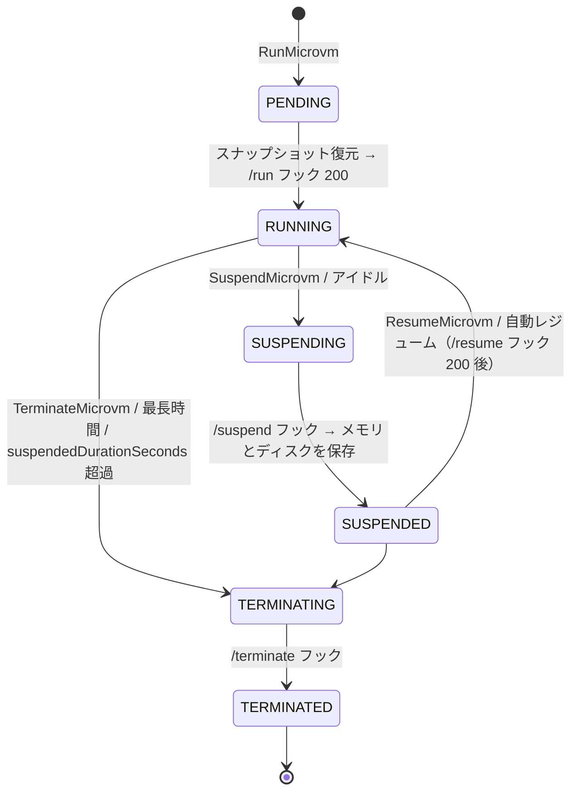

# AWS Lambda MicroVMs を読み解く ― 「関数」ではなく「眠らせられるサンドボックス」、イメージの正体は起動済みメモリのスナップショット【AWS Deep Cuts】

> **レベル**: 200〜300（AWS Lambda とコンテナの基本が分かり、サーバーレスの「次の形」に興味がある方向け）
> **ハンズオン教材**: https://github.com/AWS-Deep-Cuts/aws-lambda-microvms

## TL;DR

- AWS Lambda MicroVMs（2026 年 6 月 22 日 GA。東京は初日からの 5 リージョンの 1 つで、2026 年 10 月時点で 14 リージョン）は、Firecracker の microVM を API で **起動・サスペンド・レジューム・終了** できる「状態を持つサンドボックス」です。1 台ごとに専用の HTTPS エンドポイントが付き、最長 8 時間生きます。イベントで呼ばれる Lambda 関数とは、設計の前提がまるで違います。
- **MicroVM イメージの正体は「起動済みのメモリとディスクのスナップショット」** です。ビルドは「Dockerfile を実行 → アプリを起動 → `/ready` フックが 200 を返す → メモリとディスクを凍結」という処理で、`RunMicrovm` はその復元です。Lambda SnapStart の思想を、汎用のサンドボックスに広げたものだと理解すると全体が見通せます。
- サスペンドはプロセスもメモリも凍結し、レジュームは同じ場所から続きます。サスペンド中はコンピュート料金がかからず、スナップショットの保存料金だけになります。「アイドル」の判定はエンドポイントへのトラフィックで行われます。
- 設計して分かった落とし穴: フックのパスは `/run` ではなく `/aws/lambda-microvms/runtime/v1/run`、実行ロールが無いとランタイムのログが出ない、認証トークンは 60 分でポートに縛られる、egress は **既定でインターネットに出られる**、同じスナップショットから起動した microVM は「同じ乱数」を出しうる。
- Lambda は 2025〜2026 年に 5 つの形態に分化しました。私は、サーバーレスの境界は「実行時間」ではなく **「誰のコードを動かすか」** で引き直されつつあると考えています。

---

## はじめに

AWS Deep Cuts は、AWS の中でも情報が少ない「隠れた名曲 = Deep Cuts」を、前提知識からハンズオンまで掘り下げるシリーズです。今回は AWS Lambda MicroVMs を取り上げます。

この記事は公式ドキュメントの要約ではありません。「Python の REPL を載せた microVM を眠らせて起こすと、変数は生きているのか」というハンズオンを設計し、その過程で API 定義（AWS SDK のサービスモデル、API バージョン `2025-09-09`）と公式ドキュメントを読み込み、「ドキュメントには書いていないが設計上こうなるはずだ」という点を整理したものです。仕様の記述は 2026 年 10 月時点の公式ドキュメントと API 定義で確認できた範囲に限り、コミュニティの計測結果を引くときはそのつど出典を示します。ハンズオンの計測値は、本文中の `〔実測値〕` の欄に記載しています。

---

## 1. Lambda MicroVMs とは何か ― 「関数」と「サンドボックス」の違い

AWS Lambda は 2014 年から「イベントが来たら関数を呼ぶ」モデルを貫いてきました。関数は最長 15 分、実行環境は再利用されることはあっても **状態の保持は保証されず**、呼び出し元から見える「住所」は関数名だけです。

Lambda MicroVMs は、この前提を 3 つとも捨てています。

| | Lambda 関数（Event Functions） | Lambda MicroVMs |
| -- | -- | -- |
| 起動の主体 | イベント（API Gateway、SQS、S3 …） | あなたが `RunMicrovm` を呼ぶ |
| 寿命 | 1 呼び出し最長 15 分 | 1 台最長 8 時間（サスペンド中の時間を含む） |
| 状態 | 保証されない | メモリ・ディスク・プロセスごとサスペンド／レジュームできる |
| 住所 | 関数名（または Function URL） | microVM ごとの専用 HTTPS エンドポイント |
| 中で動くもの | ハンドラー関数 | ポートで待ち受ける任意のサーバー（HTTP/2、gRPC、WebSocket、SSE に対応） |
| 想定用途 | イベント処理、API バックエンド | AI が生成したコードの隔離実行、対話型の開発環境、セッションを持つゲームサーバーなど |

公式ドキュメントの位置づけは明快で、「ユーザーや LLM が生成したコードを、隔離された、応答性の高い環境で実行する」ためのものです。実際、開発者ガイドには Cursor のクラウドエージェント、Claude Managed Agents、OpenAI Agents API のサンドボックスとして使う統合ガイドが並んでいます。AI エージェントが「コードを書いて実行する」時代に、**その実行場所を Lambda が引き受ける** というのが、このサービスの狙いです。

### 1.1 押さえておきたい仕様

| 項目 | 内容 |
| -- | -- |
| API / CLI | `lambda-microvms`（API バージョン `2025-09-09`、24 操作）。AWS CLI v2.35.10 以降 |
| IAM アクション | `lambda:RunMicrovm`、`lambda:CreateMicrovmImage`、`lambda:CreateMicrovmAuthToken` など（名前空間は `lambda`） |
| アーキテクチャ | **ARM64（Graviton）のみ**。イメージのビルドは対象チップセット世代ごとに行われる |
| サイズ | ベースライン 0.5 GB / 0.25 vCPU 〜 8 GB / 4 vCPU（既定 2 GB / 1 vCPU）。ピークはベースラインの 4 倍（最大 32 GB / 16 vCPU）。vCPU はメモリ 2 GB あたり 1 |
| 寿命 | 最長 8 時間（28,800 秒。`maximumDurationInSeconds` で短くできる）。サスペンド中の時間も含む |
| エンドポイント | microVM ごとの HTTPS。1 エンドポイント = 1 microVM（負荷分散はしない） |
| 認証 | `CreateMicrovmAuthToken` で発行する暗号化トークン（JWE）。有効期限は最長 60 分、ポートのスコープ付き |
| ライフサイクルフック | ビルド時 `/ready` `/validate`、実行時 `/run` `/suspend` `/resume` `/terminate`（アプリが HTTP で受ける） |
| アイドルポリシー | `maxIdleDurationSeconds`（最長 28,800）、`suspendedDurationSeconds`、`autoResumeEnabled` |
| ネットワーク | ingress: `ALL_INGRESS` / `NO_INGRESS` / `SHELL_INGRESS`。egress: 既定でインターネット、VPC は Lambda Core の Network Connector |
| 対応リージョン | 発表時はバージニア北部・オハイオ・オレゴン・アイルランド・東京の 5 リージョン。2026 年 8 月に 5 リージョン（ムンバイ・シンガポール・シドニー・フランクフルト・ストックホルム）、10 月に 4 リージョン（香港・マレーシア・タイ・スペイン）が加わり計 14。大阪は未対応（料金表にも SKU が無い） |
| 料金単位 | vCPU 秒 + メモリ GiB 秒（稼働中）、スナップショットの読み書き（GiB）、スナップショット保存（GiB 時間、最低 1 週間） |

### 1.2 "MicroVM" という名前について

Lambda は 2018 年から、すべての関数を Firecracker という軽量 VMM が作る microVM の中で動かしてきました。つまり Lambda 関数も、ずっと microVM の上で動いていたわけです。それなのに新サービスが「MicroVMs」と名乗るのは、**これまで裏方だった microVM そのものを、顧客が操作できるリソースとして表に出した** からです。起動・凍結・復元という VM のライフサイクルを、API として握れるようになったのが本質的な違いです。

---

## 2. 仕組み ― イメージはスナップショット、microVM はその復元

### 2.1 2 つのリソースと 2 つのロール

リソースは 2 種類しかありません。

- **MicroVM イメージ**（`MicrovmImage`）: S3 に置いた zip（ルートに `Dockerfile` を含む）と、Lambda が管理するベースイメージ（`al2023-1`。Amazon Linux 2023 と、microVM を動かすためのサービスコンポーネント）から作る、バージョン付きの成果物。
- **microVM**（`Microvm`）: イメージのあるバージョンから `RunMicrovm` で起動した実体。

ロールも 2 種類です。**ビルドロール** はイメージ作成時に Lambda が引き受け、S3 から成果物を取り、ビルドログを CloudWatch Logs に書きます。**実行ロール** は起動した microVM が引き受け、アプリのログの転送や、中のアプリが AWS サービスを呼ぶときの権限になります。信頼ポリシーは Lambda のサービスプリンシパルに `sts:AssumeRole` と `sts:TagSession` を許可します。

### 2.2 ビルドの流れ ― 「Docker build」ではなく「起動して凍結」

`CreateMicrovmImage` が裏でやっていることを、公式ドキュメントの記述から並べると次のようになります。

```text
1. 管理ベースイメージから、まっさらな microVM を起動する
2. その中で Dockerfile の命令を実行する（依存関係のインストールなど）
3. ENTRYPOINT / CMD でアプリを起動する
4. /ready フックが有効なら、アプリが HTTP 200 を返すまで待つ（503 なら待ち続ける）
5. ディスクとメモリ（動いているプロセスを含む）のスナップショットを取る
6. /validate フックが有効なら、スナップショットから起動して検証し、
   その間にアクセスされたスナップショットの領域を記録する（次回以降の先読みに使う）
```

ここで重要なのは 4 と 5 です。普通のコンテナイメージは「ファイルシステム」の凍結ですが、MicroVM イメージは **「起動して初期化を終えたプロセスが載ったメモリ」ごと凍結** します。`RunMicrovm` はこの凍結状態を復元するので、Python のインタプリタ起動やモジュールの読み込みといった初期化は、起動のたびには繰り返されません。

これは Lambda SnapStart（2022 年に Java で登場し、2024 年に Python と .NET に広がった機能）と同じ考え方です。SnapStart は「関数の初期化後のスナップショットから起動する」機能でしたが、MicroVMs はそれを任意のサーバープロセスに対して行い、しかも **スナップショットのサイズを API で見せてくれます**。`GetMicrovmImageBuild` は `memorySnapshotSizeInBytes`、`diskSnapshotSizeInBytes`、`codeInstallSizeInBytes` を返します。ハンズオンの `setup.sh` では、ビルド完了後にこの値を表示しています。

```text
〔実測値〕 ハンズオンのイメージ（al2023-minimal + python3、ベースライン 512 MiB）の
  memorySnapshotSizeInBytes / diskSnapshotSizeInBytes / codeInstallSizeInBytes: 未測定
```

ビルドは対象チップセットの世代ごとに作られるため、1 つのバージョンに複数のビルドが並びます。「どの世代の Graviton で起動しても同じスナップショットが使えるわけではない」という、物理に根ざした事情が API からも見えます。

### 2.3 microVM の状態遷移とフック



フックは、プラットフォームが **microVM の中のアプリに HTTP で通知してくる** 仕組みです。アプリ側は指定したポート（ハンズオンでは 9000）で待ち受け、各フックに 200 を返します。

| フック | いつ呼ばれるか | 使いどころ |
| -- | -- | -- |
| `/ready` | ビルド時、アプリ起動後 | 初期化が終わるまで 503 を返し、終わったら 200。これが「スナップショットを取ってよい」合図 |
| `/validate` | ビルド時、スナップショットから起動した後 | 疑似的なリクエストを流し、実際に使うメモリ領域をプラットフォームに学習させる（先読みの材料になる） |
| `/run` | 起動後、外部トラフィックが転送される前 | `runHookPayload` で渡された「この 1 台だけの秘密情報」を受け取る |
| `/suspend` | `SUSPENDING` 中、メモリとディスクの保存前 | 書き込み中のバッファを吐く、接続を畳む |
| `/resume` | `SUSPENDED` 中。200 を返して初めて `RUNNING` になる | 時計の補正、接続の張り直し、乱数の再シード |
| `/terminate` | 最終的な終了時のみ（サスペンドでは呼ばれない） | 後始末 |

公式ドキュメントが強調しているのは、**`/run` フックが 200 を返すまで外部からのトラフィックは転送されない** ことと、**自動レジュームのときは `/resume` が終わるまでリクエストが保留される** ことです。前者があるおかげで、共有イメージに焼き込みたくない「起動ごとの秘密（セッション ID、API キーへの参照）」を `runHookPayload` で安全に渡せます。環境変数はイメージ単位でしか設定できず、同じイメージから起動した全 microVM で共有されるので、この違いは設計上とても大きいものです。

### 2.4 エンドポイントとトークン

`RunMicrovm` の応答には、その microVM 専用の HTTPS エンドポイント URL が入っています。ただし、このエンドポイントには **認証なしでアクセスする方法がありません**。`CreateMicrovmAuthToken` で発行した暗号化トークン（JWE）を `X-aws-proxy-auth` ヘッダーに載せる必要があります。

トークンには 3 つのものが埋め込まれています。

1. どの microVM のものか
2. どのポートへのアクセスを許すか（`allowedPorts`: 単一ポート、範囲、または全ポート）
3. いつ失効するか（最長 60 分）

転送先のポートは `X-aws-proxy-port` ヘッダーで選び、指定がなければ 8080 番です。トークンの `allowedPorts` に無いポートを指定すると、アプリに届く前にプロキシが 403 で止めます。許可されたポートで誰も待ち受けていなければ 502 です。起動直後の数秒間（スナップショットの復元中）や、`autoResumeEnabled` を付けずにサスペンドした microVM にリクエストを送ったときも 502 になります。この 403 と 502 の違いは、トラブルシューティングで「トークンの問題か、アプリ（または microVM の状態）の問題か」を切り分ける一番の手がかりになります。

もう 1 つ、地味に重要な仕様があります。Lambda は `X-aws-proxy-*` ヘッダーを **アプリに転送する前に剥がします**。アプリは「自分がプロキシ越しに呼ばれている」ことを意識せずに書けます。WebSocket の場合はヘッダーの代わりにサブプロトコル（`lambda-microvms`、`lambda-microvms.authentication.<トークン>`、`lambda-microvms.port.<ポート>`）で同じ情報を渡します。

### 2.5 ネットワークコネクタ

ingress（外から microVM へ）は Lambda 管理のコネクタを ARN で指定します。`ALL_INGRESS`（全ポートへの HTTPS）、`NO_INGRESS`（外からの接続を無効化）、`SHELL_INGRESS`（シェル接続用）です。ARN の形は `arn:aws:lambda:<リージョン>:aws:network-connector:aws-network-connector:ALL_INGRESS` で、`ALL_INGRESS` という名前だけを渡すと「ARN の形式が不正」と拒否されます。

egress（microVM から外へ）は、**既定でパブリックなインターネットに出られます**。これは公式ドキュメントに明記されており、コミュニティの計測でも、egress コネクタを一切付けずに起動した microVM から `example.com` や `pypi.org` に到達できたと報告されています（laithalsaadoon/microvms-agentd の PLATFORM.md、2026 年 9 月の計測）。既定の出口は Lambda 管理の `INTERNET_EGRESS` コネクタで、出口を絞りたい場合は Lambda Core API（`lambda-core`、API バージョン `2026-04-30`）で VPC の Network Connector を作り、`egressNetworkConnectors` に渡します（egress コネクタは microVM につき 1 つなので、VPC を選ぶと既定のインターネット経路は無くなります）。なお、`RunMicrovm` を呼ぶ側には、既定のコネクタしか使わない場合でも `lambda:PassNetworkConnector` 権限が必要です。Network Connector は VPC のサブネットに ENI を作る仕組みで、作成に最大 10 分ほどかかります。インターネットに出られないサブネット（IGW も NAT も無い）に向ければ、完全に閉じたサンドボックスになります。

### 2.6 アイドルポリシー ― 「使われていない」とは何か

`idlePolicy` は 3 つの値で、サンドボックスの「勝手に眠って、勝手に起きて、勝手に片付く」挙動を決めます。

- `maxIdleDurationSeconds`: この秒数、アイドルが続いたら自動でサスペンドする
- `suspendedDurationSeconds`: サスペンドがこの秒数続いたら自動で終了する
- `autoResumeEnabled`: サスペンド中にリクエストが来たら自動でレジュームする

ここで「アイドル」の定義が重要です。公式ドキュメントによれば、**アイドルは microVM のエンドポイントを通る inbound トラフィックで測ります**。中でプロセスが CPU を使い続けていても、外からリクエストが来なければアイドルです。逆に、監視のつもりで `/health` を叩き続けると、永遠に眠りません。非同期に仕事をするアプリ（キューを処理するワーカーなど）では、自動サスペンドを無効にするか、十分長いアイドル時間を設定する必要があります。

---

## 3. 設計して分かったこと

ここからが本題です。ハンズオンを設計する過程で、ドキュメントの行間や API 定義の細部に引っかかった点をまとめます。

### 3.1 フックのパスは `/run` ではない

API リファレンスの `runHookPayload` の説明には「`/run` ライフサイクルフックのリクエストボディとして届く」と書かれているので、私は最初、アプリは `POST /run` を受ければよいと思っていました。開発者ガイドを読むと、フックのパスは **`/aws/lambda-microvms/runtime/v1/<フック名>`** という固定のプレフィックス付きです。コミュニティの計測でも、6 つのフックすべてがこのプレフィックスで届いたと記録されています。

ハンズオンの `server.py` では、フック用のポートに来た **すべてのパス** を記録して 200 を返す設計にしました。どのパスで来たかを `/state` で見られるので、ドキュメントと実機の差をそのまま観察できます。

```python
class HookHandler(JSONHandler):
    """Lambda MicroVMs から呼ばれるライフサイクルフック。どのパスでも記録して 200 を返す。"""
    def _record(self):
        body = self.read_json()
        HOOK_LOG.append({"path": self.path, "method": self.command, "at": now_iso(), "body": body})
        self.send_json(200, {"ok": True, "hook": self.path})
    do_POST = _record
```

関連して、`--hooks` の `port` とアプリが実際に待ち受けるポートが食い違うと、Dockerfile のビルドもアプリの起動も成功しているのに `CREATE_FAILED` になります。ログがきれいなまま失敗するので、原因に気付きにくい失敗の筆頭です。

### 3.2 `runHookPayload` は「包まれて」届き、上限の記述が 2 つある

`runHookPayload` に渡した文字列は、そのままリクエストボディになるのではなく、`{"runHookPayload": "<渡した文字列>"}` という JSON に包まれて届きます（コミュニティの計測より。ハンズオンの `/state` でフック履歴の body を見ると確認できます）。渡した側が JSON を入れていれば、2 段階のデコードが要ります。

サイズの上限も興味深い点です。API 定義では、`runHookPayload` の説明文に「最大 16,384 バイト」とある一方、同じ定義のデータ型の制約は `max=4096` になっています。開発者ガイドも 16 KB と書いています。コミュニティの計測では 4,097 バイトで `ValidationException` になったと報告されています。**ドキュメントの文章より、API 定義の制約値のほうが実機に近い** という、SDK のモデルを読む人だけが得をする例です。

### 3.3 実行ロールが無いと、ログが出ない

`RunMicrovm` の `executionRoleArn` は任意項目です。省略しても microVM は起動します。ただし公式ドキュメントによれば、実行ロールが無いと **ランタイムの標準出力・標準エラーは CloudWatch Logs に転送されません**。「`--logging` でロググループを指定したのにログが出ない」という状況の原因は、たいていこれです。ハンズオンではビルドロールとは別に実行ロールを作り、ログの書き込みだけを許可しています。

ビルド時のフック（`/ready`、`/validate`）はビルドロール、実行時のフック（`/run` 以降）は実行ロールの権限で動く、という対応関係も押さえておくと、権限エラーの切り分けが速くなります。

### 3.4 トークンは短く、狭く

認証トークンの有効期限は最長 60 分で、公式のベストプラクティスは 15〜30 分です。長時間動くクライアントは、失効前に新しいトークンを取り直す設計が要ります。`allowedPorts` も必要最小限に絞るのが公式の推奨です。ハンズオンでは、アプリ用のポートだけを許可したトークンでフック用のポートにアクセスし、403 で止まることを確かめます。

```text
〔実測値〕 8080 番だけを許可したトークンで 9000 番へ: HTTP 未測定
```

### 3.5 既定で外に出られる、そして中から認証情報が取れる

2.5 で述べたとおり、egress は既定でインターネットに出られます。「信用できないコードを動かす」のが主用途なら、この既定は意識しておくべきです。生成されたコードが外部にデータを送ることを防ぎたいなら、VPC の Network Connector で出口を絞る設計が必須になります。

もう 1 つ、コミュニティの計測で報告されているのが、microVM の中から `169.254.169.254` に IMDSv2 の手順でアクセスすると、**実行ロールの一時認証情報が取れる** ことです（Firecracker の MMDS 経由。前掲 PLATFORM.md、2026 年 9 月の計測）。これは EC2 のインスタンスロールと同じ仕組みで、驚くことではありませんが、「AI が生成したコード」が実行ロールの権限をそのまま使えることを意味します。実行ロールを最小権限にする理由は、ここにあります。

### 3.6 同じスナップショットから起動した microVM は、同じ乱数を出しうる

これは MicroVMs 固有の問題ではなく、**スナップショットから複数のインスタンスを起動する仕組みすべて** に共通する問題です。プロセス起動時に初期化された擬似乱数の状態、生成済みのセッション ID、`/etc/machine-id`、カーネルの `boot_id` は、スナップショットの中に入っています。同じイメージから起動した 2 台は、同じメモリから始まります。

公式のベストプラクティスには「ビルド時に生成した一意な ID、秘密情報、ネットワーク接続は、同じイメージバージョンの全 microVM で共有される。起動後に生成し、CSPRNG を使うこと」と書かれています。OpenSSL を使うアプリには、スナップショットに対応した Lambda 提供のベースコンテナイメージを使うようにも案内されています。

この問題は、AWS 自身が 2021 年に論文として整理しています（M. Brooker ほか, "Restoring Uniqueness in MicroVM Snapshots", arXiv:2102.12892）。Lambda SnapStart の登場時にも「一意性」のガイダンスとして繰り返されました。ハンズオンの `twins.sh` では、同じイメージから 2 台起動し、Python の `random.random()`（プロセス起動時に seed される）と `os.urandom()`（カーネルの乱数）を比べます。

```text
〔実測値〕 random.random() の一致: 未測定 / os.urandom() の一致: 未測定 / boot_id の一致: 未測定
```

コミュニティの計測では、同じイメージから起動した 2 台で `boot_id`、`machine-id`、ホスト名が同じだった一方、カーネルの `/proc/sys/kernel/random/uuid` と、起動後に取った `random.random()` は違っていたと報告されています。何が共有され、何が共有されないかは、**アプリのどの層で、いつ、乱数を取ったか** で決まります。

### 3.7 `state` は結果整合、準備完了はエンドポイントで判断する

`GetMicrovm` の API 定義には、「`state` フィールドは結果整合である。準備完了はエンドポイントに接続して判断せよ」と明記されています。`RUNNING` になったのを見てからリクエストを送る、という素直な実装は、起動直後に 502 を食らう可能性があります。ハンズオンのスクリプトは、`/ping` が 200 を返すまでポーリングし、その時間を起動時間として記録しています。

```text
〔実測値〕 run-microvm → /ping 200: 未測定 / suspend → SUSPENDED: 未測定 / resume → /ping 200: 未測定 / 自動レジューム: 未測定
```

参考までに、コミュニティの計測では、明示的なサスペンドは 1〜2 秒、レジュームは 1.2〜1.5 秒で `RUNNING`、自動レジュームの最初のリクエストは約 1.2 秒で成功したと報告されています（前掲 PLATFORM.md、us-east-1、2026 年 8〜9 月）。東京リージョンでは、イメージのビルドに約 3 分、`PENDING` から `RUNNING` まで約 10 秒、サスペンド後の最初の応答まで約 2.6 秒という報告があります（DevelopersIO、2026 年）。AWS の公式スキルには「レジューム時間は、アクセスされるスナップショットのサイズにほぼ比例し、500 MB あたり約 1 秒」という目安が書かれています。メモリはスナップショットから先に復元され、ディスクは必要になったページから遅延して読まれる、という挙動も AWS のサンプルで説明されています。

### 3.8 眠っている間、時計はどうなるか

凍結したメモリを復元すると、ゲスト OS の時計は「眠る前」のままです。それをどう補正するかはプラットフォームの設計です。壁時計（`time.time()`）だけが進むのか、単調時計（`time.monotonic()`）も進むのかで、タイムアウトやトークンの有効期限を扱うコードの振る舞いが変わります。

```text
〔実測値〕 サスペンド前後の経過: time.time() = 未測定 / time.monotonic() = 未測定
```

コミュニティの計測では、124 秒のサスペンドをまたいで `time.time()`、`CLOCK_MONOTONIC`、`CLOCK_BOOTTIME` のいずれも +124 秒進んでいた、つまり **単調時計も眠っていた時間ぶん進められていた** と報告されています。同時に、サスペンド中に張りっぱなしだった外向きの TLS 接続は、レジューム後にすべて切れていたとも報告されています。`/resume` フックで接続を張り直す設計が要る理由です。

### 3.9 小ネタ: クォータ超過は HTTP 402

API 定義を読んでいて目を引いたのが、`ServiceQuotaExceededException` の HTTP ステータスコードが **402（Payment Required）** になっていることです。402 は 1997 年の HTTP/1.1 仕様以来「将来のために予約」とされてきたコードで、本来の意味での利用はごく最近まで事実上ありませんでした。MicroVMs ではクォータ超過（アカウント・リージョンあたりの合計メモリは既定 400 GB、東京を含む 4 リージョンでは 1,024 GB）の表現に使われています。実害はありませんが、HTTP ステータスコードの歴史が好きな人には見逃せない一行です。

---

## 4. Lambda の分化 ― 5 つの形態の地図

Lambda は 2025 年末から 2026 年にかけて、急速に形態を増やしました。公式ドキュメントでも、従来の関数は「AWS Lambda Event Functions（旧 Lambda functions）」と呼び直されています。

| 形態 | 登場 | 何が違うか | 起動の主体 |
| -- | -- | -- | -- |
| Event Functions（従来の関数） | 2014 | イベント駆動、最長 15 分、ハンドラー関数 | イベント |
| テナント分離モード | 2025 年 11 月 | 関数の実行環境をテナント単位で分離 | イベント |
| Managed Instances | 2025 年 12 月 | EC2 の容量（容量プロバイダ）の上で関数を動かす | イベント |
| Durable Functions | 2025 年 12 月 | 長時間のワークフローをチェックポイント付きで実行 | イベント |
| MicroVMs | 2026 年 6 月 | 状態を持つサンドボックス、最長 8 時間、専用エンドポイント | `RunMicrovm` |
| Web Functions | 2026 年 10 月 | Node.js の Web フレームワークをそのまま HTTPS サーバーとして動かす。アイドル時はゼロにスケール | HTTP リクエスト |

周辺のエコシステムも、GA から 4 か月で一通りそろいました。Step Functions の SDK 統合（`arn:aws:states:::aws-sdk:lambdamicrovms:runMicrovm` のように呼べる）、CloudFormation の `AWS::Lambda::MicrovmImage`、SAM の `AWS::Serverless::MicrovmImage`、Terraform AWS provider の `aws_lambdamicrovms_image` / `aws_lambdamicrovms_microvm`（2026 年 8〜9 月）、Kubernetes 向けの ACK コントローラーまであります。

この分化に対しては、「Lambda は少しずつ EC2 になっていく」という揶揄もあります（Last Week in AWS のポッドキャスト、2026 年 9 月）。たしかに、最長 8 時間・専用エンドポイント・VM のライフサイクル操作という並びは EC2 に近づいて見えます。ただ、この地図で私が注目しているのは、**起動の主体** の列です。Event Functions も Web Functions も「来たものに応じて起動する」のに対し、MicroVMs だけは「あなたが起動する」。言い換えると、MicroVMs は **セッション** という概念を Lambda に持ち込みました。従来のサーバーレスが捨ててきたもの（長寿命、状態、固定の住所）を、Firecracker のスナップショットという技術で「安く、速く、安全に」取り戻した、というのが私の理解です。

使い分けの判断軸は、公式の決定ガイドの言葉を借りれば次の 3 つに整理できます。

1. 15 分で終わるか（終わるなら Event Functions）
2. 呼び出しごとの隔離で足りるか、セッションの状態をメモリに持ちたいか（持ちたいなら MicroVMs）
3. 誰のコードを動かすか（自分のコードなら関数、他人や AI のコードなら MicroVMs）

---

## 5. Firecracker の系譜（Liner Notes）

MicroVMs を理解するには、その土台である Firecracker の歴史を知っておくと見通しがよくなります。

- **2018 年 11 月**: AWS が Firecracker を公開。Rust で書かれた軽量 VMM で、Lambda と Fargate の実行環境として使われていることが明かされました。
- **2020 年**: NSDI '20 で論文 "Firecracker: Lightweight Virtualization for Serverless Applications"（Agache ほか）が発表されました。最小限のデバイスモデル（virtio の net と block、シリアルコンソール程度）、`jailer` による二重の隔離、起動時間 125 ms 程度、microVM あたりのメモリオーバーヘッド 5 MiB 未満、といった設計が述べられています。
- **2021 年**: 論文 "Restoring Uniqueness in MicroVM Snapshots"（Brooker ほか）。著者の Marc Brooker は 2025 年 9 月のブログ "Seven Years of Firecracker" で、AI エージェントのセッションごとに microVM を与えて終わったら捨てる、という使い方を Firecracker の次の主戦場として描いています。スナップショットから多数の microVM を起動すると乱数や ID が重複する問題と、その解決策を整理しました。この論文の中で、Firecracker のスナップショット復元は数ミリ秒で済む一方、通常起動は 200 ms 程度かかることが示されています。
- **2022 年 11 月**: Lambda SnapStart（Java）。初期化後のスナップショットから起動する機能で、2024 年に Python と .NET にも拡大しました。
- **2026 年 2 月**: EC2 の C8i / M8i / R8i でネストされた仮想化が GA になり、ベアメタルでなくても自分で Firecracker を動かせるようになりました。
- **2026 年 6 月**: Lambda MicroVMs。スナップショットの作成と復元、サスペンドとレジュームを、顧客が API で操作できる製品になりました。

つまり MicroVMs は、8 年かけて磨かれた「速く起動して、速く捨てる」技術を、「速く起動して、眠らせて、また起こす」技術として再パッケージしたものです。Firecracker の論文で「将来の課題」とされていたスナップショットの活用が、ちょうど製品になった、と読むこともできます。

---

## 6. 料金と安全な使い方

料金は 4 つの要素から成ります。東京リージョンの単価は次のとおりです（2026 年 10 月 28 日に Price List API で取得。us-east-1 より 15〜20 % 高い）。

| 要素 | 課金対象 | 東京の単価（ARM） | 備考 |
| -- | -- | -- | -- |
| コンピュート | 稼働中のベースライン vCPU 秒 + メモリ GB 秒 | $0.0000322421 / vCPU 秒、$0.0000042688 / GB 秒 | ベースラインを超えた分は、実際に使った分だけ秒単位で追加。サスペンド中・終了後は 0 |
| スナップショット読み取り | 起動・レジューム時に読んだ GB（メモリ + ディスク） | $0.0018548941 / GB | |
| スナップショット書き込み | サスペンド時に書いた GB | $0.0046556039 / GB | |
| スナップショット保存 | イメージと、サスペンド中の microVM の GB 時間 | $0.0001333333 / GB 時間 | **イメージの保存は最低 1 週間分が課金** |

既定サイズ（2 GB / 1 vCPU）を東京で 1 時間動かすと約 $0.15、1 日動かしっぱなしなら約 $3.5 です。InfoQ が引用した「最小構成で 1 日 $3.03（Fargate スポットの約 9 倍）」という Reddit の試算は、us-east-1 の単価で同じ構成を計算した値と一致します。「VM 単位の隔離と、状態を保ったままのサスペンド／レジューム」に、この差額を払う価値があるかは、アイドル時間の比率で決まります。

最小クラス（0.5 GB / 0.25 vCPU）の microVM 1 台を 1 時間動かしても約 $0.04 で、ハンズオン全体でも $0.1 に届きません。それでも、サンドボックスは「起動したのを忘れる」のが一番の事故です。ハンズオンのスクリプトでは、起動する microVM すべてに `maximumDurationInSeconds` を 15〜30 分に設定し、放置しても勝手に終了するようにしています。本番でも、`maximumDurationInSeconds` と `idlePolicy` の `suspendedDurationSeconds` を **必ず** 設定し、「永遠に眠り続ける microVM」を作らないことをお勧めします。

監査の面では、`RunMicrovm` などの管理イベントは CloudTrail に既定で記録されます。起動・停止・再開・終了の履歴をデータイベントとして残すこともできます。

---

## 7. ハンズオンで体験できること

リポジトリのハンズオンでは、Python 標準ライブラリだけで書いた「状態を持つサンドボックス」（8080 番で Python コードを実行して変数を保持、9000 番でライフサイクルフックを受ける）を MicroVM イメージにして、次の観点を確認できます。

1. イメージのビルドが「起動してから凍結する」処理であること（スナップショットのサイズ）
2. スナップショットからの起動時間
3. サスペンド → レジュームで変数・プロセス・フック履歴が残ること、レジューム時間
4. 眠っている間の時計の進み方
5. アイドルポリシーによる自動サスペンドと自動レジューム
6. 認証トークンのポートスコープと、既定の egress
7. （発展）同じスナップショットから起動した 2 台の乱数
8. （発展）シェルで中に入り、アプリがコンテナとして動いていること

```bash
git clone https://github.com/AWS-Deep-Cuts/aws-lambda-microvms
cd aws-lambda-microvms/hands-on
bash ./setup.sh     # イメージのビルド（数分）
bash ./run.sh       # サスペンド／レジューム
bash ./idle.sh      # アイドルポリシー
bash ./twins.sh     # 双子の microVM と乱数（発展）
bash ./cleanup.sh   # 後片付け
```

東京リージョンの CloudShell で完結します。起動する microVM はすべて 15〜30 分で自動終了する設定なので、放置してもコンピュート料金は止まります。

---

## 8. まとめ ― サーバーレスの境界はどこに引き直されるのか

- Lambda MicroVMs は「関数」ではなく **「眠らせられるサンドボックス」** です。専用エンドポイント、最長 8 時間、サスペンド／レジュームという 3 点で、従来の Lambda とは別の道具だと考えたほうが設計を誤りません。
- **イメージの正体は起動済みメモリのスナップショット** で、`RunMicrovm` はその復元です。これを理解すると、`/ready` フックの意味、起動の速さ、乱数の一意性の問題、スナップショット保存料金のすべてが一本につながります。
- 設計上の落とし穴は、フックのパス、包まれて届く `runHookPayload`、実行ロールとログ、トークンの寿命とポート、既定の egress、結果整合な `state` にあります。どれもドキュメントに書かれていますが、散らばっています。
- Lambda は 5 つの形態に分化しました。「15 分で終わるか」「状態を持ちたいか」に加えて、**「誰のコードを動かすか」** が、これからのサーバーレスの設計の軸になると私は考えています。自分のコードはイベント駆動の関数で、AI が書いたコードはセッションを持つサンドボックスで。課金の単位も「呼び出し回数」から「起動していた時間」に戻ります。それは退行ではなく、サーバーレスが引き受ける仕事の範囲が広がった結果だと思います。

「サーバーを意識しない」というサーバーレスの約束は、MicroVMs でも守られています。ただし、意識しなくてよいのはサーバーであって、**VM のライフサイクルは、今度はあなたが握る** ことになりました。それが、このサービスの一番の Deep Cut です。

---

## 参考リンク

- [AWS Lambda MicroVMs（開発者ガイド）](https://docs.aws.amazon.com/lambda/latest/dg/lambda-microvms-guide.html) / [Core concepts](https://docs.aws.amazon.com/lambda/latest/dg/microvms-how-it-works.html) / [Create your first Lambda MicroVM](https://docs.aws.amazon.com/lambda/latest/dg/microvms-getting-started.html)
- [MicroVM images](https://docs.aws.amazon.com/lambda/latest/dg/microvms-images.html) / [Working with snapshots](https://docs.aws.amazon.com/lambda/latest/dg/microvms-images-snapshots.html) / [Running and using MicroVMs](https://docs.aws.amazon.com/lambda/latest/dg/microvms-launching.html) / [Networking](https://docs.aws.amazon.com/lambda/latest/dg/microvms-networking.html) / [Security and permissions](https://docs.aws.amazon.com/lambda/latest/dg/microvms-security.html) / [Best practices](https://docs.aws.amazon.com/lambda/latest/dg/microvms-best-practices.html) / [Monitoring](https://docs.aws.amazon.com/lambda/latest/dg/microvms-monitoring.html) / [Troubleshooting](https://docs.aws.amazon.com/lambda/latest/dg/microvms-troubleshooting.html)
- [Lambda quotas](https://docs.aws.amazon.com/lambda/latest/dg/gettingstarted-limits.html)
- [Lambda MicroVMs API Reference](https://docs.aws.amazon.com/lambda/latest/microvm-api/Welcome.html) / [RunMicrovm](https://docs.aws.amazon.com/lambda/latest/microvm-api/API_RunMicrovm.html) / [CreateMicrovmImage](https://docs.aws.amazon.com/lambda/latest/microvm-api/API_CreateMicrovmImage.html)
- [AWS CLI `lambda-microvms` リファレンス](https://docs.aws.amazon.com/cli/latest/reference/lambda-microvms/)
- [Run isolated sandboxes with full lifecycle control: AWS Lambda introduces MicroVMs（AWS News Blog, 2026-06）](https://aws.amazon.com/blogs/aws/run-isolated-sandboxes-with-full-lifecycle-control-aws-lambda-introduces-microvms/)
- [Announcing Lambda MicroVMs（AWS Compute Blog）](https://aws.amazon.com/blogs/compute/announcing-lambda-microvms-serverless-compute-environments-with-vm-level-isolation-and-near-instant-startup/)
- [awslabs/agent-plugins — aws-lambda-microvms skill](https://github.com/awslabs/agent-plugins/blob/main/plugins/aws-serverless/skills/aws-lambda-microvms/SKILL.md)
- [laithalsaadoon/microvms-agentd — PLATFORM.md（コミュニティの計測記録）](https://github.com/laithalsaadoon/microvms-agentd/blob/main/docs/PLATFORM.md)
- [Firecracker: Lightweight Virtualization for Serverless Applications（NSDI '20）](https://www.usenix.org/conference/nsdi20/presentation/agache)
- [Restoring Uniqueness in MicroVM Snapshots（arXiv:2102.12892）](https://arxiv.org/abs/2102.12892)
