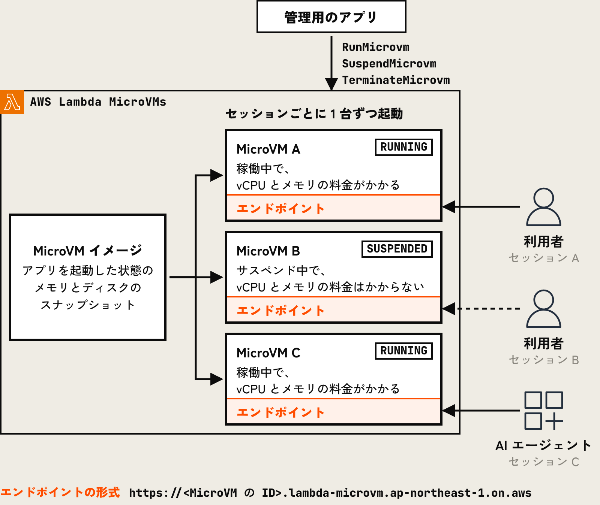
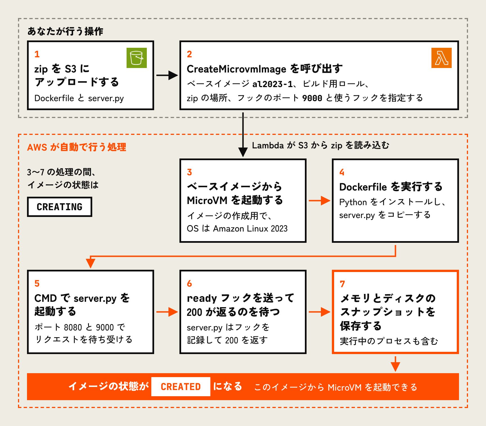
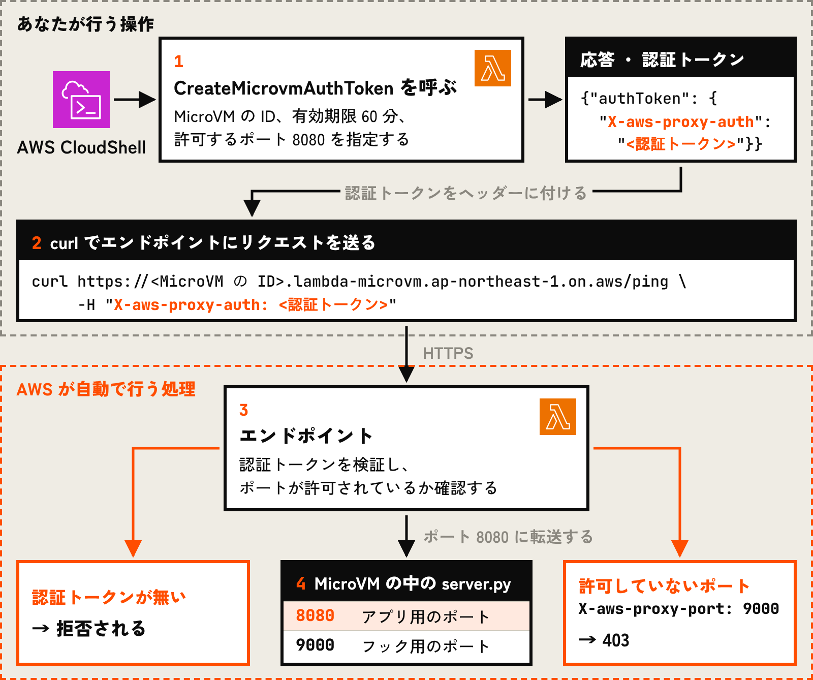

:::note info
AWS Deep Cuts の GitHub はこちらです。
https://github.com/AWS-Deep-Cuts/AWS-Deep-Cuts
:::

# AWS Deep Cutsとは？
AWS Deep Cutsは、AWS の最新のサービスやニッチな機能、または高度にアカデミックな知識を要求するサービスなど、多くの人が知らない 『隠れた名曲 = **Deep Cuts**』 を深くまで掘り下げる技術シリーズです。

このようなサービスはWeb情報も少なく、初学者は気軽にキャッチアップできないのが実情です。

そこで AWS Deep Cuts シリーズでは、**前提知識も含めた分かりやすいサービス解説** と **手順通りに進めれば誰でも再現できるハンズオン** を提供します！

# そもそもAIエージェントのサンドボックスとは？
AI のチャットサービスに CSV ファイルを渡して「月ごとの売上をグラフにして」と依頼すると、AI が集計用の Python のコードを生成して実行し、作成したグラフを返してくれることがあります。このように、人の依頼を達成するために、コードの実行のような操作まで自動で行う AI を、**AI エージェント**と呼びます。

サービスを使う側にいるときはあまり意識しませんが、AI が生成したコードも、どこかのコンピューターで実行されています。AI エージェントのサービスを開発する立場になると、このコードをどこで実行するかを、自分で決めなければなりません。以降、このようなサービスを開発する人を**開発者**、使う人を**利用者**と呼びます。

このとき注意が必要なのは、AI が生成したコードを、そのまま信頼できないことです。生成されたコードには、誤りや、利用者が意図しない危険な操作が含まれることがあります。たとえば、利用者が渡したファイルに AI への悪意のある指示が紛れ込んでいると、AI がファイルを削除するコードや外部へデータを送信するコードを生成してしまうおそれがあります。そのため、AI が生成したコードは、利用者の PC・サービスを動かしているサーバー・他の利用者の環境から切り離して実行する必要があります。このように、信頼できないコードを安全に実行するために隔離した実行環境を、**サンドボックス**と呼びます。

AI エージェントのサンドボックスには、隔離の他にも、利用者とのやり取りの特徴から生まれる条件があります。利用者は、1 回の依頼で終わらずに、結果を確認しながら「次は前年と比べて」のように依頼を重ねます。AI エージェントは、前の依頼で読み込んだデータや作成したファイルを、次の依頼でも使います。また、利用者が結果を読んで次の依頼を考えている間、サンドボックスでは何も実行されていません。さらに、他の利用者の環境から切り離すために会話ごとにサンドボックスを分けると、利用者が新しい会話を始めるたびに、サンドボックスを 1 つ起動することになります。こうした特徴を踏まえて、筆者は、AI エージェントのサンドボックスには次の 4 つの条件が必要だと考えます。

| 条件 | 必要な理由 |
| --- | --- |
| 他から隔離されている | AI が生成したコードが、他の利用者の環境や、サービスを動かしているサーバーに影響を与えないようにする |
| 状態を保持できる | 前の依頼で読み込んだデータや、会話の途中で作成した変数とファイルを、次の依頼でも使えるようにする |
| すぐに起動する | 利用者が新しい会話を始めるたびに、利用者を待たせないようにする |
| 待機中の費用が小さい | 利用者が次の依頼を考えている間のように、使われていない時間の費用を抑える |

では、この 4 つの条件を満たす実行環境は、どれでしょうか。主な実行環境を 4 つの条件で比べると、次のようになります。○ は条件を満たす、△ は工夫すれば満たせる、× は満たさないことを表します。評価は筆者によるものです。

| 実行環境 | 他から隔離されている | 状態を保持できる | すぐに起動する | 待機中の費用が小さい |
| --- | :---: | :---: | :---: | :---: |
| 利用者の PC | × | ○ | ○ | ○ |
| Lambda 関数 | △ | × | ○ | ○ |
| コンテナ | △ | ○ | ○ | × |
| EC2 インスタンス | ○ | ○ | × | △ |
| **Lambda MicroVMs** | ○ | ○ | ○ | ○ |

- **利用者の PC** では、生成されたコードが、利用者のファイルや認証情報に直接アクセスできてしまいます。
- **Lambda 関数** は、1 回の実行が最長 15 分であるため、1 回の実行の中で長い会話を最後まで扱うことはできません。次の呼び出しで同じ実行環境が使われる保証も無いため、同じ会話の中でも、前の依頼で作成した変数やファイルを次の依頼で使えるとは限りません。また、隔離の面では、既定で 1 つの実行環境が、同じ関数への別の利用者の呼び出しに再利用されることもあります。そのため、利用者ごとに実行環境を分けるには、開発者が、そのための設定や仕組みを別途用意する必要があります。
- **コンテナ** を 1 台のサーバーで複数の利用者のために動かす構成では、コンテナどうしが、OS の中核であるカーネルを共有します。カーネルの脆弱性を突かれると、他のコンテナにも影響が及ぶおそれがあります。また、コンテナを起動している間は、利用者が考えていてコンテナが使われていない時間にも料金がかかります。
- **EC2 インスタンス** は、VM（Virtual Machine）です。VM は、1 台の物理サーバーの中に作成する仮想的なコンピューターで、VM ごとに別々の OS が動きます。そのため、EC2 インスタンスどうしは、OS のカーネルを共有しません。停止や休止をすれば、待機中の料金も抑えられます。しかし、起動や再開を待つ時間が長く、会話ごとに 1 台を用意する用途には向きません。

筆者の評価で、4 つの条件をすべて満たすのが、2026 年 6 月に一般提供が始まった **AWS Lambda MicroVMs** です。Lambda MicroVMs は、次の補足で説明する microVM という VM を、会話ごとに 1 台ずつ起動できます。そのため、EC2 インスタンスと同じように、各会話の VM は他の VM と OS のカーネルを共有しません。ただし、Lambda MicroVMs が起動する VM は、既定でインターネットに接続できるため、外部へのデータの送信を防ぐには、ベストプラクティスの章で説明する設定が必要です。

:::note info
**microVM とは**
画面の表示や USB 機器の接続のように、サーバーとして動かすのに不要な機能を省いて軽くした VM のことです。VM であるため、他の VM と OS のカーネルを共有しません。AWS は、microVM を動かすソフトウェアである Firecracker を、2018 年にオープンソースとして公開しました。Lambda 関数の実行環境も、Firecracker の microVM で動いています。それでも表で Lambda 関数の隔離を △ にしたのは、前に説明したとおり、既定では 1 つの実行環境が、同じ関数への別の利用者の呼び出しに再利用されることがあるためです。
:::

# AWS Lambda MicroVMsとは？
AWS Lambda MicroVMs は、前の章の補足で説明した Firecracker の microVM を、開発者が API で起動・一時停止・再開・終了できるサービスです。この記事では、Lambda MicroVMs が起動する 1 台の microVM を、大文字で始まる **MicroVM** と書き、Firecracker が動かす VM 一般を表す小文字の microVM と区別します。また、MicroVM の一時停止を**サスペンド**、再開を**レジューム**と呼びます。

Lambda MicroVMs の全体像は、次の図のとおりです。図のように、開発者は、左の 1 つのイメージから、**セッション**ごとに 1 台ずつ MicroVM を起動します。セッションは、利用者が AI と行う 1 つの会話のように、1 人の利用者とサービスの間で続く一連のやり取りです。



図の左から順に説明します。MicroVM の中では、開発者が用意したアプリが動きます。AI エージェントのサービスであれば、AI が生成したコードを受け取って実行し、結果を返すサーバーのプログラムが、このアプリにあたります。ハンズオンで使う server.py も、受け取った Python のコードを実行して結果を返すアプリです。開発者は、まず MicroVM の起動に使う **MicroVM イメージ** を 1 つ作成します。MicroVM イメージには、このアプリと、アプリを起動した状態のメモリとディスクの内容が保存されます。このように、ある時点のメモリとディスクの内容を保存したデータを、**スナップショット**と呼びます。

図の中央は、このイメージからセッションごとに起動した MicroVM です。MicroVM には、1 台ごとに HTTPS でアクセスするための URL が割り当てられます。この URL を**エンドポイント**と呼びます。図の右の利用者や AI エージェントは、エンドポイントを通じて、MicroVM の中のアプリにアクセスします。

図の一番上の**管理用のアプリ**は、開発者が作成する、Lambda MicroVMs の API を呼び出すプログラムです。開発者は、MicroVM の起動・サスペンド・終了のような操作を、管理用のアプリで行います。以降、単に「アプリ」と書くときは、管理用のアプリではなく、MicroVM の中で動くアプリを指します。

図の MicroVM B のように、リクエストが届いていない間は、MicroVM をサスペンドできます。サスペンド中の MicroVM の状態は `SUSPENDED` で、稼働中の `RUNNING` の MicroVM とは異なり、vCPU とメモリの料金がかかりません。vCPU（virtual CPU）は、VM に割り当てる仮想的な CPU です。

AWS Lambda MicroVMs には、以下のような特徴があります。

- **セッションごとに専用の VM を起動できる**
  開発者が `RunMicrovm` API を呼び出すと、MicroVM が 1 台起動します。Lambda 関数のようにリクエストごとに実行環境が割り当てられるのではなく、1 つのセッションが 1 台の MicroVM を専有します。ただし、1 台の MicroVM を動かせる時間には上限があり、この上限を**最長時間**と呼びます。最長時間には、サスペンドしている時間も含まれます。開発者は、`RunMicrovm` の `maximumDurationInSeconds` に、最長時間を 8 時間までの秒数で指定できます。
- **起動が速い**
  Lambda MicroVMs は、MicroVM を起動するときに、アプリを最初から起動するのではなく、MicroVM イメージに保存されたスナップショットを復元します。そのため、アプリの初期化を待つ必要がありません。AWS は、AWS のサービスの使い方をまとめ、AI エージェントが読み込んで使えるようにした文書を、**Agent Skill** として公開しています。Lambda MicroVMs の Agent Skill によると、MicroVM は通常 1〜10 秒で接続できる状態になります。
- **状態を保ったままサスペンドできる**
  MicroVM をサスペンドすると、Lambda MicroVMs がメモリとディスクの内容を保存し、MicroVM を一時停止します。レジュームすると、MicroVM は、変数や動いていたプロセスがそのまま残った状態で再開します。エンドポイントに一定時間リクエストが届かないときに、Lambda MicroVMs が MicroVM を自動でサスペンドし、リクエストが届くと自動でレジュームする設定もあります。この設定を**アイドルポリシー**と呼びます。
- **一般的なサーバーのプログラムを動かせる**
  MicroVM の中では、ポートで HTTP や WebSocket のリクエストを待ち受ける、一般的なサーバーのプログラムが動きます。Lambda 関数のように、処理をハンドラー関数の形に書き換える必要はありません。
- **料金は稼働時間とスナップショットとデータ転送で決まる**
  MicroVM が稼働している間は、vCPU とメモリの料金がかかります。このほかに、スナップショットの保存料金・書き込み料金・読み取り料金と、データ転送の料金がかかります。サスペンド中は、vCPU とメモリの料金がかかりません。状態ごとの料金は、仕組みの章で詳しく説明します。
- **東京リージョンで使える**
  一般提供が始まった 2026 年 6 月から、東京リージョンで使えます。AWS の発表によると、2026 年 10 月 22 日の時点で、14 のリージョンで提供されています。この 14 のリージョンに、大阪リージョンは含まれていません。
- **CPU のアーキテクチャは ARM64**
  MicroVM は、ARM64 の CPU である AWS Graviton で動きます。Python や Node.js で書いたアプリの多くは、書き換えずに動きます。ただし、x86_64 向けにコンパイルしたプログラムや、ARM64 版が無いライブラリは動きません。

# 仕組み
前の章の全体像の図に沿って、MicroVM イメージを作成してから MicroVM を終了するまでの順に、それぞれの段階で何が起きるのかを説明します。以降、Lambda MicroVMs のサービスが自動で行う処理を「Lambda が〜する」と書きます。この「Lambda」は、Lambda 関数を指すものではありません。

この章の図は、料金の図を除いてハンズオンと共通のため、図では開発者を「あなた」と書いています。また、図の「AWS が自動で行う処理」の枠には、Lambda が自動で行う処理と、それを受けて MicroVM の中のアプリが行う処理を含めています。

各節で説明することと、開発者が呼び出す API は、次のとおりです。

| 節 | 開発者が呼び出す API | 説明すること |
| --- | --- | --- |
| MicroVM イメージの作成 | `CreateMicrovmImage` | スナップショットが保存されるまでの処理 |
| ライフサイクルフック | なし | Lambda がアプリに送る HTTP のリクエスト |
| MicroVM の起動とアクセス | `RunMicrovm`・`CreateMicrovmAuthToken` | エンドポイントと認証トークン |
| サスペンドとレジューム | `SuspendMicrovm`・`ResumeMicrovm` | MicroVM の状態と、アイドルポリシー |
| 同じイメージから起動した MicroVM の注意点 | `RunMicrovm` | スナップショットから復元されたプロセスの値 |
| 料金 | なし | 料金の要素と計算の例 |

## MicroVM イメージの作成
Lambda MicroVMs では、アプリは MicroVM の中のコンテナで動きます。ただし、このコンテナは MicroVM の OS の上で動きます。そのため、MicroVM をセッションごとに 1 台ずつ起動すれば、実行環境の比較で説明したコンテナの構成とは異なり、このコンテナが他の利用者のコンテナと OS のカーネルを共有することはありません。

開発者は、MicroVM イメージを作成するときに、まず Dockerfile とアプリのファイルを 1 つの zip にまとめます。Dockerfile は、コンテナの作成手順を定義するファイルで、インストールするソフトウェア・コピーするファイル・起動するコマンドを順に書きます。ハンズオンで使う Dockerfile は、次のとおりです。

```dockerfile
FROM public.ecr.aws/lambda/microvms:al2023-minimal
RUN dnf install -y python3 && dnf clean all
COPY server.py /app/server.py
EXPOSE 8080 9000
CMD ["python3", "/app/server.py"]
```

1 行目の FROM では、コンテナの元になるイメージを指定します。このイメージを**コンテナイメージ**と呼びます。ここでは、AWS が Lambda MicroVMs 用に公開しているコンテナイメージを指定しています。アプリは、このコンテナイメージから作成したコンテナの中で動きます。

続く行では、Python をインストールし、アプリの `server.py` をコピーし、CMD で `server.py` を起動します。EXPOSE の 8080 はアプリがリクエストを受け付けるポート、9000 は後の節で説明するライフサイクルフックを受け付けるポートです。

開発者は、この zip を S3 にアップロードし、`CreateMicrovmImage` API を呼び出します。このとき、主に次の 4 つを指定します。

| 指定するもの | 内容 |
| --- | --- |
| ベースイメージ | MicroVM の OS。Lambda が管理する Amazon Linux 2023 のイメージから選ぶ |
| ビルド用ロール | イメージの作成中に Lambda が使う IAM ロール。Lambda はこのロールの権限で、S3 から zip を読み込み、ログを書き込む |
| zip の場所 | S3 にアップロードした zip |
| フックの設定 | ライフサイクルフックを受け付けるポートと、使うフックの種類 |

Lambda は、イメージの作成中に、表のビルド用ロールを引き受けます。IAM ロールを引き受けるとは、Lambda のような AWS のサービスが、IAM ロールに付与された権限を一時的に使って AWS のリソースを操作することです。

表の 4 つの他に、開発者は、MicroVM に割り当てるメモリの量も `CreateMicrovmImage` で指定します。メモリの量については、料金の節で説明します。

:::note info
**名前に「イメージ」が付く 3 つのもの**
この記事には、名前に「イメージ」が付くものが 3 つ出てきます。

| 名前 | 何か | 誰が用意するか |
| --- | --- | --- |
| MicroVM イメージ | MicroVM の起動に使うイメージ。アプリと、アプリを起動した状態のスナップショットを含む | 開発者が `CreateMicrovmImage` を呼び出し、Lambda が作成する |
| コンテナイメージ | Dockerfile の FROM で指定する、コンテナの元になるイメージ | ハンズオンでは、AWS が Lambda MicroVMs 用に公開しているものを使う |
| ベースイメージ | MicroVM の OS のイメージ。コンテナは、この OS の上で動く | Lambda が管理する Amazon Linux 2023 のイメージから、開発者が選ぶ |

Docker では、Dockerfile の FROM で指定するイメージを、一般にベースイメージと呼びます。しかし、この記事でベースイメージと書くときは、FROM で指定するコンテナイメージではなく、MicroVM の OS のイメージを指します。以降、単に「イメージ」と書くときは、MicroVM イメージを指します。
:::

下の図は、MicroVM イメージの作成で起きることを順に示しています。開発者が行う操作は、図の 1 の zip の S3 へのアップロードと、2 の `CreateMicrovmImage` の呼び出しです。2 の呼び出しを受けて、Lambda は、図の 3〜7 の順に処理します。

3. ベースイメージから、イメージの作成用の MicroVM を起動する
4. zip の中の Dockerfile を実行する
5. Dockerfile の CMD に書いたコマンドで、アプリを起動する
6. ready フックを有効にしている場合は、アプリに ready フックという HTTP のリクエストを送り、アプリが成功を表す HTTP のステータスコード 200 を返すのを待つ
7. そのときのメモリとディスクの内容を、スナップショットとして保存する

3〜7 の処理の間、イメージの状態は `CREATING` です。処理が終わると、状態は `CREATED` になり、このイメージから MicroVM を起動できるようになります。



このうち特に重要なのは、6 と 7 の処理です。ハンズオンでは ready フックを有効にしているため、Lambda は、アプリが ready フックに 200 を返したときのメモリとディスクの内容を保存します。つまり、MicroVM イメージには、ファイルだけでなく、起動して初期化が終わったアプリのプロセスも含まれています。

MicroVM イメージを作成・更新するたびに、新しい**バージョン**が作成されます。Lambda は、バージョンごとに、MicroVM の中のアプリを起動してスナップショットを保存する処理を行います。この処理を**イメージのビルド**と呼びます。API の仕様では、イメージのビルドごとに記録が残ります。イメージのビルドは CPU の種類と世代ごとに分かれることがあるため、1 つのバージョンに、イメージのビルドとスナップショットが複数あることもあります。このことは、後の「同じイメージから起動した MicroVM の注意点」の節で関係します。

## ライフサイクルフック
前の節の図の 6 では、イメージのビルド中に、Lambda がアプリに ready フックという HTTP のリクエストを送りました。Lambda は、MicroVM の状態が変わるときにも、アプリへ HTTP のリクエストを送ります。これらのリクエストを**ライフサイクルフック**と呼び、短く「フック」とも書きます。

Lambda は、それぞれのフックを、`/aws/lambda-microvms/runtime/v1/<フック名>` というパスへの POST リクエストとして送ります。たとえば ready フックでは、`<フック名>` の部分が `ready` になります。アプリは、フックを受け取ったら必要な処理を行い、200 を返します。この記事とハンズオンで使うフックは、次の 5 つです。

| フック | Lambda がリクエストを送るタイミング | アプリで行う処理の例 |
| --- | --- | --- |
| ready | イメージのビルド中、アプリの起動後 | 初期化が終わったら 200 を返す。200 を受けて、Lambda がスナップショットを保存する |
| run | MicroVM の起動直後 | 利用者の ID や、秘密情報の保存場所の名前のような、MicroVM ごとの値を受け取る |
| suspend | MicroVM をサスペンドする直前 | 外部との接続を閉じる |
| resume | MicroVM をレジュームした直後 | 外部へ接続し直す |
| terminate | 稼働中の MicroVM を終了する直前 | ログを書き出す。状態を MicroVM の外に保存する。外部のサービスへの MicroVM の登録を解除する |

run フックのリクエストの本文は JSON で、MicroVM の ID と、`RunMicrovm` の `runHookPayload` パラメータで指定した文字列が入っています。`runHookPayload` は 4,096 バイトまでです。アプリが run フックに 200 を返すまで、エンドポイントへのリクエストはアプリに届きません。

開発者は、`CreateMicrovmImage` を呼び出すときに、フックを受け付けるポートと、フックごとに有効にするかどうかを指定します。Lambda は、有効にしたフックだけを送ります。

ただし、公式ドキュメントによると、ready フックと run フックは、イメージのビルドより前に有効にしておく必要があります。Lambda がイメージのビルドで保存するスナップショットに、その時点でのこれらのフックの設定が含まれるためです。また、MicroVM の状態が変わるときに送られるフックを使う場合も、ready フックを有効にしておく必要があります。開発者が後からフックの設定を変えるときは、`UpdateMicrovmImage` API でイメージを更新します。`UpdateMicrovmImage` を呼び出すと、Lambda は、新しいバージョンを作成して、イメージのビルドを行います。

## MicroVM の起動とアクセス
開発者が `RunMicrovm` API を呼び出すと、Lambda は、イメージのスナップショットを復元して MicroVM を起動します。Python の起動やライブラリの読み込みはイメージの作成時に終わっているため、MicroVM は、アプリの初期化を待たずに起動します。

開発者は、`RunMicrovm` を呼び出すときに、**実行用ロール**を指定できます。実行用ロールは、MicroVM の実行中に Lambda が引き受ける IAM ロールです。Lambda はこのロールの権限で、アプリのログを CloudWatch Logs に書き込みます。MicroVM の中のアプリも、このロールの権限で AWS のサービスを呼び出せます。

起動した MicroVM には、`https://<MicroVM の ID>.lambda-microvm.<リージョン>.on.aws` という形のエンドポイントが割り当てられます。エンドポイントへのリクエストには、**認証トークン**が必要です。認証トークンは、管理用のアプリが AWS の認証情報を使って `CreateMicrovmAuthToken` API を呼び出すと、Lambda が発行します。このとき、管理用のアプリは、MicroVM の ID・アクセスを許可するポート・60 分までの有効期限を指定します。

発行された認証トークンでは、指定した MicroVM の、指定したポートにだけアクセスできます。利用者や AI エージェントの側でエンドポイントにリクエストを送るプログラムは、管理用のアプリが取得した認証トークンを、`X-aws-proxy-auth` ヘッダーに付けて送ります。

次の図は、認証トークンの発行から、リクエストがアプリに届くまでを、ハンズオンの例で示しています。ハンズオンでは、開発者が、ブラウザから AWS CLI のコマンドを実行できる AWS CloudShell で、認証トークンの取得とリクエストの送信の両方を行います。図の 1 で `CreateMicrovmAuthToken` を呼び出すコマンドが、管理用のアプリの役割を担います。図の 2 の curl は、HTTP のリクエストを送るコマンドです。



図の 3 と 4 のように、Lambda は、エンドポイントに届いたリクエストを、既定では MicroVM の中のポート 8080 に転送します。他のポートにリクエストを送るときは、`X-aws-proxy-port` ヘッダーでポートを指定します。認証トークンで許可していないポートへのリクエストには、アクセスの拒否を表す HTTP のステータスコード 403 が返ります。

## サスペンドとレジューム
起動した MicroVM は、主に稼働中の `RUNNING` とサスペンド中の `SUSPENDED` を行き来し、最後に `TERMINATED` になります。MicroVM の状態と、状態を変える操作は、次の図のとおりです。


次の表は、それぞれの状態の意味と、その状態で主にかかる料金を示しています。

| 状態 | 意味 | 主にかかる料金 |
| --- | --- | --- |
| `PENDING` | 起動の処理中 | スナップショットの読み取り料金 |
| `RUNNING` | 稼働中で、リクエストを受け付ける | vCPU とメモリの料金 |
| `SUSPENDING`・`SUSPENDED` | サスペンドの処理中・サスペンド中 | スナップショットの書き込み料金と保存料金 |
| `TERMINATING`・`TERMINATED` | 終了の処理中・終了済み | 終了済みになった後はかからない |

表では読み取り料金を `PENDING` の行に示しましたが、スナップショットの読み取り料金は、起動のときだけでなくレジュームのときにもかかります。

前の章で説明したとおり、サスペンドでは Lambda がメモリとディスクの内容を保存し、レジュームではその状態から MicroVM を再開します。Agent Skill によると、レジュームにかかる時間は、Lambda が読み取るスナップショットの量に比例し、500 MB あたり約 1 秒が目安です。

レジュームした MicroVM には、変数の値・動いていたプロセス・ファイルがすべて残っています。ただし、MicroVM から外部へのネットワーク接続は、レジュームのときに切断されます。そのため、開発者は、resume フックを受け取ったときに外部へ接続し直す処理を、MicroVM の中のアプリに実装しておきます。

なお、MicroVM の状態には、レジュームの処理中を表すものがありません。公式ドキュメントによると、Lambda が resume フックを送ってから、アプリが 200 を返すまでの間、MicroVM の状態は `SUSPENDED` のままです。MicroVM の状態は、アプリが 200 を返した後に `RUNNING` になります。

:::note info
公式ドキュメントの説明とは異なる挙動の報告もあります。第三者が 2026 年 8 月から 9 月に米国東部のバージニア北部リージョンで行った検証では、リクエストが届いて MicroVM が自動でレジュームしたときに、MicroVM の状態を返す `GetMicrovm` API が、`PENDING` を返してから `RUNNING` を返したと報告されています。
:::

サスペンドとレジュームは、管理用のアプリが API を呼び出して明示的に行うほかに、アイドルポリシーで自動化できます。アイドルポリシーは `RunMicrovm` で指定する設定で、次の 3 つの値を持ちます。

| 設定 | 意味 |
| --- | --- |
| `maxIdleDurationSeconds` | この秒数のあいだエンドポイントにリクエストが届かないと、自動でサスペンドする |
| `autoResumeEnabled` | `true` にすると、サスペンド中にエンドポイントへリクエストが届いたときに、自動でレジュームする |
| `suspendedDurationSeconds` | サスペンドがこの秒数続いたら、自動で終了する |

アイドルポリシーを指定しない場合、MicroVM は自動でサスペンドしません。また、Lambda は、MicroVM が使われているかどうかを、エンドポイントに届くリクエストだけで判定します。そのため、アイドルポリシーを設定した MicroVM の中で、AI が生成したコードのようなプログラムが CPU を使い続けていても、エンドポイントにリクエストが届かなければ、Lambda は MicroVM を自動でサスペンドします。

MicroVM は、主に次のときに終了します。

- 管理用のアプリが `TerminateMicrovm` API を呼び出したとき
- 起動から最長時間に達したとき
- アイドルポリシーの `suspendedDurationSeconds` で指定した秒数のあいだ、サスペンドが続いたとき

このほか、アプリから run フックに 200 が返らなかった場合も、MicroVM は `RUNNING` にならずに終了します。

:::note warn
第三者が 2026 年 10 月 12 日に米国東部のバージニア北部リージョンで行った検証では、`SuspendMicrovm` でサスペンドした MicroVM は、`suspendedDurationSeconds` の秒数を過ぎても終了しなかったと報告されています。そのため、筆者は、MicroVM を終了させる上限を、最長時間で決めておくことを勧めます。
:::

## 同じイメージから起動した MicroVM の注意点
同じイメージから起動した MicroVM どうしでは、アプリが生成した ID や乱数が、同じ値になることがあります。たとえば、アプリがプロセスの起動時にセッション ID を生成するように実装されていると、別の利用者の MicroVM と同じセッション ID になることがあります。

これは、MicroVM が、イメージの作成時に保存したスナップショットから復元されるためです。イメージの作成中に MicroVM の中のアプリが作成してメモリに保持していた値は、同じスナップショットから復元したすべての MicroVM で同じになります。

次の図は、このことをハンズオンで使う server.py で示した例です。図の左のスナップショットには、server.py のプロセスが起動したときに 1 回だけ生成する ID である `boot_id` や、server.py が受け取った ready フックをメモリに記録したものが含まれています。`boot_id` は、この節の最初の例のセッション ID にあたります。図の右は、同じスナップショットから起動した 2 台の MicroVM に、server.py の `/random` への GET リクエストを送ったときの応答です。色を付けた `boot_id` と `random_random` の行は、2 台で同じ値になっています。`random_random` は `random.random()` の値、`os_urandom_hex` は `os.urandom()` の値、`uuid4` は `uuid4()` で生成した ID です。図の値は、説明用の例です。


`random_random` が 2 台で同じになるのは、Python の `random` モジュールの仕組みによるものです。`random` モジュールは、内部状態と呼ばれる値から次の乱数を計算します。内部状態は、モジュールを読み込んだときに初期化され、`random.random()` を呼び出すたびに次の状態に進みます。イメージの作成中に起動したプロセスの内部状態は、同じスナップショットから復元されたすべての MicroVM に、そのまま複製されます。そのため、MicroVM が異なっても、1 回目の呼び出しどうし・2 回目の呼び出しどうしのように、何回目の呼び出しかが同じであれば `random.random()` は同じ値を返します。

一方、`os.urandom()` と `uuid4()` は、呼び出すたびに、Linux カーネルの乱数生成器から値を取得します。乱数生成器が生成する値の並びを決める元の値を、**シード**と呼びます。Firecracker のドキュメントによると、Firecracker は、スナップショットから microVM を復元するたびに VMGenID（Virtual Machine Generation Identifier）という識別子を新しい値に書き換え、書き換えたことを microVM の中の Linux カーネルに通知します。この通知に対応したカーネルは、乱数生成器のシードを新しい値で更新します。

Lambda MicroVMs の Agent Skill によると、MicroVM がスナップショットから復元されるたびに、MicroVM の中のカーネルは、乱数生成器のシードを新しい値で更新します。そのため、`os.urandom()` と `uuid4()` の値は、MicroVM ごとに異なります。ハンズオンの手順 6 では、同じスナップショットから起動した 2 台で、図の 4 つの値を実際に比べます。

公式のベストプラクティスでは、セッション ID や秘密情報のように MicroVM ごとに異なるべき値を、MicroVM の起動後に作成するよう案内しています。Agent Skill は、具体的な方法として、次の 2 つを挙げています。2 つ目の暗号論的に安全な乱数生成器とは、生成した値から次の値を推測できないように設計された乱数生成器です。

- run フックで値を受け取る
- 起動後に、暗号論的に安全な乱数生成器で値を作成する。Python では `secrets` モジュールを使う

`secrets` モジュールは、カーネルの乱数生成器から値を取得するため、MicroVM ごとに異なる値を返します。

:::note info
「MicroVM イメージの作成」の節で説明したとおり、1 つのバージョンに、複数のイメージのビルドがあることもあります。Lambda は、イメージのビルドごとに MicroVM の中のアプリを別々に起動して、スナップショットを保存します。そのため、復元元のイメージのビルドが異なる MicroVM どうしでは、`random` モジュールの内部状態のような、プロセスの中の値も異なります。
:::

## 料金
最後に、ここまでに出てきた状態や操作に、どのような料金がかかるのかを説明します。Lambda MicroVMs の料金は、次の 4 つの要素で決まります。単価は、AWS の価格表である AWS Price List の、2026 年 10 月 28 日時点の東京リージョンの値です。

| 料金の要素 | かかるとき | 東京リージョンの単価 |
| --- | --- | --- |
| ① vCPU とメモリの料金 | 状態が `RUNNING` の間、秒単位でかかる | vCPU 秒あたり $0.0000322421、GB 秒あたり $0.0000042688 |
| ② スナップショットの保存料金 | MicroVM イメージのバージョンを削除するまでと、MicroVM がサスペンドしている間 | GB 時間あたり $0.0001333333 |
| ③ スナップショットの読み取り料金と書き込み料金 | 読み取りは MicroVM の起動とレジュームのとき、書き込みはサスペンドのとき | 読み取り GB あたり $0.0018548941、書き込み GB あたり $0.0046556039 |
| ④ データ転送の料金 | MicroVM と外部が通信するとき | AWS の標準のデータ転送料金 |

次の図は、4 つの要素と、① の vCPU とメモリの料金の計算例です。計算例の 3 つの金額は、図の後で順に説明します。


「MicroVM イメージの作成」の節で触れたとおり、開発者は、MicroVM の大きさをイメージの作成時にメモリの量で指定します。vCPU の数は、メモリ 2 GB あたり 1 vCPU の割合で決まります。Lambda が MicroVM に常に割り当てる vCPU とメモリの量を、**ベースライン**と呼びます。最も小さいベースラインは、0.25 vCPU と 0.5 GB のメモリです。このベースラインの MicroVM が、ベースラインの量だけを使って 1 時間稼働した場合、東京リージョンでの vCPU とメモリの料金は約 $0.037 です。

MicroVM は、負荷に応じて、ベースラインの 4 倍まで vCPU とメモリを使えます。この上限を**ピーク**と呼びます。ベースラインを超えた分には、実際に使った量に応じて、秒単位で追加の料金がかかります。最も小さいベースラインの MicroVM が、1 時間続けてピークの 1 vCPU と 2 GB のメモリを使った場合、1 時間あたりの vCPU とメモリの料金は、最大で約 $0.147 です。AWS Price List には、ベースラインを超えた分の単価が、別の項目として載っていません。そのため、この金額は、ベースラインを超えた分にも、ベースラインと同じ単価がかかるものとして計算しています。

図の 3 つ目の金額のとおり、サスペンド中は ① の料金がかからず、かかるのはスナップショットの保存料金だけです。ただし、サスペンドするときには、スナップショットの書き込み料金がかかります。

また、Agent Skill によると、MicroVM イメージのバージョンにも、そのバージョンを削除するまで保存料金がかかります。MicroVM を 1 台も起動していない間も同じです。この保存料金の単価は公式に明記されていないため、この記事では、サスペンド中のスナップショットと同じ単価がかかるものとして扱っています。

保存料金は、スナップショットの大きさと、保存している時間に比例して積み上がります。説明用の例として、大きさが 10 GB のスナップショットの場合、1 日分の保存料金は、10 GB × 24 時間 × $0.0001333333 で約 $0.03 です。30 日分では、約 $0.96 になります。Agent Skill は、使わなくなったバージョンを削除するよう案内しています。

# AWS Lambda MicroVMsの主な活用事例
ここまでで、Lambda MicroVMs が、セッションごとに専用の VM を起動し、使われていない間はサスペンドして費用を抑えられることを説明しました。この特徴を生かせる場面は、AI エージェントのコード実行環境の他にもあります。次の使い方は、いずれも、AWS の製品ページ・公式ドキュメント・AWS が公開しているサンプルをもとに、筆者が整理したものです。

- **AI エージェントのコード実行環境**
  AI エージェントのサービスでは、管理用のアプリが会話ごとに MicroVM を 1 台起動し、会話の合間はサスペンドし、会話が終わったら終了します。公式ドキュメントには、Claude Managed Agents・OpenAI Agents API・Cursor Cloud Agents の 3 つの AI エージェントのサービスと組み合わせる手順も用意されています。
- **対話型の開発環境と学習環境**
  入力したコードをその場で実行する REPL（Read-Eval-Print Loop）のような対話型の環境や、ノートブック、研修の受講者ごとの環境として使えます。アイドルポリシーを設定すれば、使われていない環境は自動でサスペンドされるため、費用を抑えられます。
- **CI/CD のビルド環境**
  CI/CD は、コードの変更を自動でビルド・テストし、本番の環境に反映する仕組みです。CI/CD のサービスは、外部から受け取った信頼できないコードを、ビルドの依頼ごとに別々の MicroVM で隔離してビルドできます。
- **状態を保持し続けるサーバー**
  複数の利用者が WebSocket で接続するゲームのサーバーのように、状態をメモリに保持し続けるサーバーを、MicroVM の中で実行できます。AWS は、ゲームのサーバーを MicroVM で動かし、使われていない間は自動でサスペンドするサンプルを公開しています。
- **セキュリティのための解析**
  疑わしいファイルや解析ツールを、隔離した環境で実行できます。

# AWS Lambda MicroVMsを使う際のベストプラクティス
ここまでの仕組みを踏まえて、Lambda MicroVMs を使うときに守りたいことを 5 つ挙げます。最初の 3 つは、公式のベストプラクティスと Agent Skill の記述に基づいています。最後の 2 つは、筆者の考えです。

- **MicroVM ごとに異なる値を起動後に作成する**
  セッション ID・秘密情報・乱数のシードは、run フック以降に作成します。乱数には、暗号論的に安全な乱数生成器を使います。
- **ネットワークの接続先を制限する**
  MicroVM は、既定でインターネットに接続できます。MicroVM に出入りする通信の経路は、ネットワークコネクタという設定で決まります。そこで、信頼できないコードを実行するときは、MicroVM を VPC（Virtual Private Cloud）に接続するネットワークコネクタを使います。VPC は、AWS の中に作成する専用の仮想ネットワークです。開発者は、このネットワークコネクタを Lambda の `CreateNetworkConnector` API で事前に作成し、`RunMicrovm` の `egressNetworkConnectors` に指定します。これにより、MicroVM から外部への通信は VPC を通るようになり、許可する通信を定めるセキュリティグループで、MicroVM の接続先を制限できます。
- **実行用ロールの権限と認証トークンの範囲を絞る**
  実行用ロールには、アプリに必要な権限だけを付与します。MicroVM の中で実行したコードも、この権限で AWS を操作できるためです。認証トークンで許可するポートと有効期限も、必要な範囲に絞ります。ただし、実行用ロールを指定しないと、アプリのログは CloudWatch Logs に転送されません。そのため、実行用ロールは省かずに、必要な権限だけを付与して指定します。
- **最長時間とアイドルポリシーを必ず設定する**
  `maximumDurationInSeconds` とアイドルポリシーを設定し、使われなくなった MicroVM が動き続けないようにします。
- **AI が生成したコードを人が確認してから実行する**
  隔離した環境で実行する場合でも、実行の前にコードを表示して人が確認すると、外部への意図しない通信や、大量の計算による料金の増加を防ぎやすくなります。

# ハンズオンはこちら！
ハンズオンでは、AWS CLI のコマンドを 1 つずつ実行し、MicroVM イメージの作成・MicroVM の起動・サスペンドとレジューム・同じイメージから起動した 2 台の比較を、順に確かめます。最後に、生成 AI のモデルを API で呼び出せる Amazon Bedrock を使って、モデルに Python のコードを生成させ、そのコードを MicroVM の中で実行します。

ハンズオンの構成は、次の図のとおりです。図の「手順 2」などの番号は、ハンズオンの手順の番号です。


https://github.com/AWS-Deep-Cuts/aws-lambda-microvms

# まとめ
AWS Lambda MicroVMs は、セッションごとに専用の VM を起動し、状態を保ったままサスペンドできるサービスです。筆者が冒頭で挙げた AI エージェントのサンドボックスの 4 つの条件と、それぞれを満たす Lambda MicroVMs の仕組みは、次のとおりです。

| 条件 | Lambda MicroVMs の仕組み |
| --- | --- |
| 他から隔離されている | セッションごとに専用の MicroVM を起動する。MicroVM は、他の VM と OS のカーネルを共有しない。ただし、外部への通信を防ぐには、ネットワークの接続先を制限する設定が必要 |
| 状態を保持できる | 1 つのセッションが 1 台の MicroVM を専有し、サスペンドしても変数やファイルが残る |
| すぐに起動する | アプリを起動した状態のスナップショットから復元するため、アプリの初期化を待たない |
| 待機中の費用が小さい | サスペンド中は vCPU とメモリの料金がかからず、スナップショットの保存料金だけがかかる |

MicroVM イメージには、アプリを起動した状態のメモリとディスクの内容が保存されています。この仕組みが、MicroVM の起動が速い理由であり、MicroVM ごとに異なる値を起動後に作成する必要がある理由でもあります。AI が生成したコードを安全に実行する環境を探している方は、ぜひハンズオンで試してみてください！

---

参考文献
1. [Lambda MicroVMs の開発者ガイド（AWS Lambda MicroVMs）](https://docs.aws.amazon.com/lambda/latest/dg/lambda-microvms-guide.html)
1. [AWS Lambda MicroVMs の主要な概念（AWS Lambda MicroVMs core concepts）](https://docs.aws.amazon.com/lambda/latest/dg/microvms-how-it-works.html)
1. [MicroVM イメージ（MicroVM images）](https://docs.aws.amazon.com/lambda/latest/dg/microvms-images.html)
1. [MicroVM の起動と利用（Running and using MicroVMs）](https://docs.aws.amazon.com/lambda/latest/dg/microvms-launching.html)
1. [ベストプラクティス（Best practices）](https://docs.aws.amazon.com/lambda/latest/dg/microvms-best-practices.html)
1. [ライフサイクルを完全に制御できる隔離されたサンドボックスを実行する：AWS Lambda が MicroVMs を発表（Run isolated sandboxes with full lifecycle control: AWS Lambda introduces MicroVMs）](https://aws.amazon.com/blogs/aws/run-isolated-sandboxes-with-full-lifecycle-control-aws-lambda-introduces-microvms/)
1. [AWS Lambda の料金（AWS Lambda Pricing）](https://aws.amazon.com/lambda/pricing/)
1. [AWS Price List の AWS Lambda の東京リージョンの価格（AWS Price List: AWSLambda, ap-northeast-1）](https://pricing.us-east-1.amazonaws.com/offers/v1.0/aws/AWSLambda/current/ap-northeast-1/index.json)
1. [Lambda MicroVMs の Agent Skill（aws-lambda-microvms）](https://github.com/aws/agent-toolkit-for-aws/blob/main/skills/specialized-skills/serverless-skills/aws-lambda-microvms/SKILL.md)
1. [Firecracker：サーバーレスアプリケーションのための軽量な仮想化（Firecracker: Lightweight Virtualization for Serverless Applications）](https://www.usenix.org/conference/nsdi20/presentation/agache)
1. [Firecracker：複製した VM のエントロピー（Firecracker: Entropy for Clones）](https://github.com/firecracker-microvm/firecracker/blob/main/docs/snapshotting/random-for-clones.md)
1. [AWS Lambda MicroVMs：実測したプラットフォームの挙動（AWS Lambda MicroVMs: measured platform behavior）](https://github.com/laithalsaadoon/microvms-agentd/blob/main/docs/PLATFORM.md)
